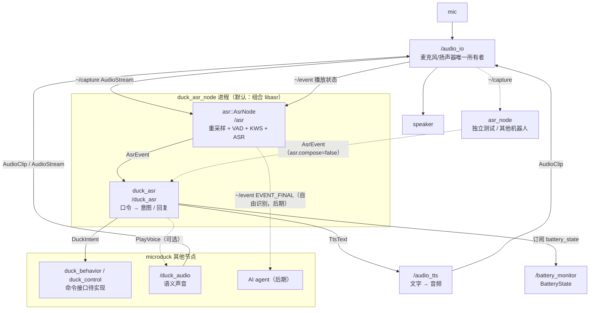

# Microduck 语音识别（ASR / 口令）ROS 2 架构

> 对象：`microduck_rev`（ROS 2 Humble，C++23，`ament_cmake`）。
> 状态：`asr` / `asr_node` 已实现（可切换 SenseVoice / KWS 后端，支持常开唤醒词阶段，本机已用真实模型验证）；`asr_interface`、`duck_asr_interface` 已实现；`duck_asr` 待实现。
> 上游约束：[`duck-ros2-audio-architecture.zh-CN.md`](./duck-ros2-audio-architecture.zh-CN.md)（麦克风唯一所有者、通用层不含鸭子语义）。
> 相关包：`audio_io`、`audio_io_interface`、`tts`、`tts_interface`、`duck_ear`、`battery_monitor`、`duck_control`。

---

## 0. 一句话结论

**代码分成两层，部署合并成一个进程。**

- 通用层：`asr`（库 `libasr` + 独立可执行 `asr_node`）+ `asr_interface`。
  负责采集订阅、重采样、VAD、唤醒词、ASR 后端、会话状态机；**不知道鸭子、电量、姿势**。
- 鸭子层：`duck_asr`（`duck_asr_node`）+ `duck_asr_interface`。
  负责“识别出的文本 → 鸭子意图 / 回复 / 动作”，**不实现 ASR 后端、不打开声卡、不写舵机**。
- 默认部署：`duck_asr_node` 链接 `libasr`，在同一进程里创建 `asr::AsrNode` 和鸭子意图节点；两者仍用
  `asr_interface/AsrEvent` 话题连接，行为与分进程完全一致。`asr_node` 只保留给单测、回放和其他机器人。
  **生产 launch 不要同时启动 `asr_node` 和 `duck_asr_node` 的内置 AsrNode**，否则两个实例会抢同一路采集。
- **固定口令必须作为解码约束送进 KWS 或 ASR**，而不是先跑自由识别再做字符串匹配。因此鸭子包拥有
  “口令语料”，通用包拥有“如何把语料编译成后端约束”。
- 必须加**半双工门控**：鸭子自己播放 TTS/叫声时暂停唤醒与识别，否则会自触发。
- v1 能端到端交付的是：唤醒词 → 固定口令 → 电量查询（`battery_monitor` + `tts`）与意图发布；
  姿势/动作的真实执行依赖 `duck_control` 的命令接口，而该接口目前只有设计文档、尚无实现。

---

## 1. 为什么代码上仍分两个包

| 方案 | 问题 |
|---|---|
| 只做鸭子包，直接实现 ASR | 换项目要重写采集、重采样、VAD、会话状态机、事件接口；模型/后端版本和鸭子业务耦合 |
| 只做通用包，把电量、姿势、动作写进通用包 | 通用接口出现鸭子语义，违反现有 `audio_io`/`tts` 的边界；其他机器人被迫继承鸭子配置 |
| 只用一个 YAML 配置词表 | 如果命令只是“关键词 → 播一个声音”够用；本需求还要查询电量、发布姿势/动作意图、接 AI agent，必须有代码层 |
| **通用包 + 鸭子包（本方案）** | 识别能力可复用；鸭子语义集中在 `duck_asr`；源码和依赖边界清晰 |

**代码边界不是进程边界。** `asr` 不出现 `duck_*` 依赖；`duck_asr` 不实现 ASR 后端，但默认链接
`libasr`，因此会间接继承模型/后端依赖。这是有意的取舍：换项目仍可只拿 `asr` 包，鸭子项目只维护一套
识别实现。

### 1.1 部署形态

| 形态 | 使用方式 | 适用 |
|---|---|---|
| **同进程组合（默认）** | `duck_asr_node` 链接 `libasr`，创建 `asr::AsrNode` + 鸭子意图节点，同一个 executor | 鸭子生产部署；少一个进程、一个 launch 条目 |
| 独立 `asr_node` | `asr_node` 单独进程发布 `AsrEvent`；`duck_asr` 设置 `asr.compose=false` 后订阅 | 单测、WAV/rosbag 回放、调试、故障对比、其他机器人 |
| 第三方链接库 | 其他项目链接 `libasr` 自建节点，或运行 `asr_node` | 复用 |

同一个 `duck_asr_node` 同时支持两种形态：`asr.compose=true`（默认）时自己构造 `AsrNode`；
`asr.compose=false` 时不构造，只订阅外部 `/asr/event`。这样 `asr_node` 可以当测试替身，不必单独维护
一个“鸭子测试版”二进制。

进程内仍然走 `AsrEvent` 话题，而不是私有函数回调：这样独立运行和组合运行的输入输出契约完全一致，
`asr_node` 的测试结果对组合部署同样有效。只有 `AsrEvent`/`AsrState` 这种小消息跨节点；48 kHz 采集流
不会进入 `duck_asr`。如果以后确实要省掉这一次 DDS，可在 `duck_asr` 里改用 `asr::Pipeline` 直接接回调，
`AsrEvent` 契约不变，但不是 v1 的目标。

### 1.2 合并进程接受的代价

| 项 | 后果 |
|---|---|
| ASR 原生崩溃（`segfault`/`abort`/OOM） | 整个 `duck_asr_node` 退出；launch/systemd 重启后 ASR 与意图一起恢复；重启前语音链路不可用 |
| 后端死锁/无响应 | 不能只杀后端；只能由进程级 watchdog 重启整个 `duck_asr_node` |
| 模型缺失/加载失败 | `AsrNode` 保持运行、`AsrState.model_loaded=false`；`duck_asr` 仍可处理其他入口，但语音链路不可用 |
| 依赖 | `duck_asr` 链接 `libasr` 及后端库；换模型/换后端需要重启并重新部署对应后端依赖 |
| 资源 | ASR 与意图层共享地址空间和内存配额，不能单独 cgroup 限制 ASR |
| 测试 | `asr_node` 可独立回放；`duck_asr` 可用 `asr.compose=false` 配合外部 `asr_node` 或 `ros2 topic pub` 测试 |

这些代价是明确接受的：本设计优先减少进程数和部署复杂度，不再追求“ASR 崩溃时鸭子语义层存活”。
其它节点（控制、播放、`duck_ear`）本来就在别的进程，不受 `duck_asr_node` 崩溃影响。

---

## 2. 分层与节点图



边界：

- `audio_io` 仍然是麦克风唯一所有者；`asr::AsrNode` 只订阅 `~/capture`，不打开 ALSA。
- `asr` 只输出**文本与识别事件**，不播声音、不发布鸭子意图；`asr_node` 只是它的独立入口。
- `duck_asr` 组合 `libasr`，但源码只做“文本 → 意图 / 回复 / 动作”；不实现 ASR 后端、不碰音频设备。
- `duck_asr_node` 默认在同一进程里创建 `AsrNode` 与意图节点；`asr.compose=false` 时改用外部 `/asr`。
- 动作执行在 `duck_behavior`/`duck_control`，不在 `duck_asr`。

---

## 3. 通用层：`asr`

`asr` 是独立的 git 项目；内部架构、后端接口、SenseVoice/KWS 实现、唤醒会话、事件字段、参数和失败模式维护在：

**[`src/asr/docs/asr-architecture.zh-CN.md`](../src/asr/docs/asr-architecture.zh-CN.md)**

系统级只保留这些约束：

- `asr` 不打开 ALSA，只订阅 `audio_io` 的采集流；
- `asr` 输出 `AsrEvent` / `AsrState`，接口在 `asr_interface`；
- 默认可切换 `sense_voice` / `keyword` 后端；唤醒阶段通过 `wake.enabled` 开启；
- 唤醒词、命令词语料由 `duck_asr` 提供，`asr` 不硬编码鸭子词汇；
- 生产部署中 `duck_asr_node` 链接 `libasr` 并组合 `AsrNode`，`asr_node` 只用于独立测试和回放。

## 4. 鸭子层：`duck_asr`

### 4.1 职责与组合方式

| 负责 | 不负责 |
|---|---|
| 鸭子唤醒词与口令语料的唯一来源 | 音频采集、重采样、VAD、ASR 推理 |
| 文本归一化、别名/同义口令匹配 | 声卡、播放、音库 |
| `battery.query` → 读 `BatteryState` → TTS 回复 | 舵机写入、运动安全仲裁 |
| 姿势/动作 → 发布 `DuckIntent` | 意图的具体执行 |
| 未知口令的限速反馈 | 自由对话、LLM |

默认组合方式：

```text
duck_asr_node（单进程）
  ├─ asr::AsrNode（节点名 /asr，订阅 /audio_io/capture，发布 AsrEvent）
  ├─ duck_asr::DuckAsrNode（节点名 /duck_asr，订阅 AsrEvent，发布 DuckIntent）
  └─ MultiThreadedExecutor
```

- `asr.compose=true`（默认）：`duck_asr_node` 链接 `libasr`，直接创建 `AsrNode` 和意图节点；不启动
  `asr_node` 可执行文件。
- `asr.compose=false`：不创建 `AsrNode`，只订阅外部 `<asr.node>/event`；用于单测、回放或独立 ASR 进程。
- 两种模式共用同一份意图处理代码；切换模式不改变 `AsrEvent`/`DuckIntent` 契约。

`duck_asr` 自身参数：

| 参数 | 默认 | 说明 |
|---|---|---|
| `asr.compose` | `true` | 是否在本进程内构造 `asr::AsrNode` |
| `asr.node` | `/asr` | 内部节点名，或 `asr.compose=false` 时的事件来源 |
| `asr.params_file` | 空 | 构造 `AsrNode` 时注入的参数文件（含词表、后端、门控） |
| `battery.node` | `/battery_monitor` | 电量话题来源 |
| `tts.node` | `/audio_tts` | 回复播报目标 |
| `intent.confidence_min` | `0.6` | 低于此值按未知口令处理 |
| `unknown_reply_cooldown_ms` | `2000` | 未知口令反馈限速 |

`asr.params_file` 里不要重复声明鸭子意图参数；两边参数命名空间不同，`asr.*` 只属于本节点。

### 4.2 配置是唯一来源，产物自动生成

`config/duck_commands.yaml` 是唯一手写源；构建/安装时由 `tools/gen_vocabulary.py` 生成
`share/duck_asr/config/vocabulary.yaml`，`duck_asr_node` 构造 `AsrNode` 时通过 `asr.params_file`
把它注入 `decoder.vocabulary_file`。不要手写两份词表——否则口令改了而解码约束没改，表现为“说了但识别不出来”。

示例（名称是示意，实际以产品定义为准）：

```yaml
wake:
  - 小鸭小鸭
  - 嗨小鸭

intents:
  - id: battery.query
    phrases: [电量, 还有多少电, 电池还剩多少]
    action: query_battery
    reply: "电量还有 {percent}%"
  - id: posture.stand
    phrases: [站起来, 起立]
    action: publish_intent
    args: {posture: stand}
  - id: posture.sit
    phrases: [坐下, 趴下]
    action: publish_intent
    args: {posture: sit}
  - id: action.nod
    phrases: [点点头]
    action: publish_intent
    args: {action: nod}
  - id: action.spin
    phrases: [转个圈]
    action: publish_intent
    args: {action: spin}
```

匹配规则：

- 归一化：去首尾空白、全角转半角、去标点；不做拼音模糊匹配。
- 只在 `EVENT_FINAL` 上匹配；`EVENT_PARTIAL` 只用于 UI/调试。
- `confidence < intent.confidence_min`（默认沿用节点参数）不执行，按未知口令处理。
- 同一 `session_id` 的 `EVENT_FINAL` 只消费一次；会话被门控取消后不再执行。

### 4.3 电量查询

订阅 `/battery_monitor/battery_state`（`sensor_msgs/BatteryState`，`percentage` 为 0..1），缓存最近一帧：

- 有缓存：`{percent}` 取 `round(percentage * 100)`，通过 `/audio_tts/text`（`play=true`）播报；
- 无缓存或数据过期（默认 5 s）：播报“电量暂时读不到”，不阻塞事件线程；
- 电池节点不在线只影响该口令，不影响其他口令。

### 4.4 姿势 / 动作意图

`duck_asr` 不直接写舵机，也不直接调用 `controller_manager`。它发布：

```text
# duck_asr_interface/msg/DuckIntent.msg
std_msgs/Header header
string session_id
string intent          # battery.query / posture.stand / action.nod ...
string utterance       # 触发它的原始文本，便于日志与回放
float32 confidence
string[] arg_keys
string[] arg_values
```

`intent` 用字符串而不是消息常量：口令集会长，改成枚举就要改接口包并重编所有消费者。已知意图名
由 `duck_commands.yaml` 文档化，消费方按字符串分派；执行方负责校验未知意图。

**当前缺口**：`duck_control` 只有设计文档，没有面向行为的命令话题/服务。因此 v1 的姿势/动作只能
“发布意图 + 日志”，真正执行要等 `duck_control` 的命令接口（或新增 `duck_behavior` 适配层）。
不要为了“能演示”让 `duck_asr` 自己写关节或直接调控制器内部接口。

### 4.5 安全与限速

- 意图执行方负责“跌倒、低电、脚本动作、遥控接管”互斥；`duck_asr` 不做运动仲裁。
- 未知口令反馈默认限速 1 次 / 2 s，避免连续误识别刷屏 TTS。
- `battery.query` 与 TTS 回复不改变运动状态。
- 是否要求唤醒词才能执行姿势/动作，是配置策略，不是硬编码；默认要求。

---

## 5. 端到端延迟预算（目标，待板端实测）

| 环节 | 目标 | 说明 |
|---|---|---|
| 唤醒词命中 | ≤ 300 ms（词尾起算） | KWS 帧移/窗口决定，需实测 |
| 句尾 → `EVENT_FINAL` | ≤ 700 ms | 端点静音 700 ms + 解码；约束解码应显著低于自由识别 |
| `EVENT_FINAL` → `DuckIntent` | ≤ 20 ms | 纯字符串匹配 + 发布 |
| 意图 → 首个音频 | ≤ 500 ms | TTS 冷合成约 0.3 s、缓存命中约 0.1 s（现有 `tts` 文档数据） |
| 电量口令全链路 | ≤ 1.5 s | 唤醒 + 一句话 + TTS |

这些是验收目标，不是实测值；板端 CPU、模型大小、采集丢包会直接改变结果。

---

## 6. 后期扩展到任意语音 / AI agent

接口不需要改：

1. 把 `pipeline.mode` 切到 `free_asr`，`decoder.vocabulary_file` 置空，换流式全量 ASR 后端。
2. `asr` 继续发 `EVENT_PARTIAL`/`EVENT_FINAL`；agent 订阅 `~/event`，不再只由 `duck_asr` 消费。
3. `duck_asr` 保留“口令快速路径”：先匹配固定意图，未命中再把 `EVENT_FINAL` 转给 agent；这样常用命令
   不依赖 LLM 延迟。
4. agent 的回复走 `/audio_tts/text`，与现有 TTS 层一致；不要新建对话播放通道。
5. 如果 agent 需要“唤醒后持续对话”，在通用层增加 `listen.continuous` 会话模式，而不是在 agent 里
   重新订阅麦克风。

可选演进：两路解码（约束口令 + 自由 ASR）同时跑，成本更高；v1 不做，先验证单后端。

---

## 7. 包布局

```text
src/
  asr_interface/
    msg/AsrEvent.msg
    msg/AsrState.msg
    include/asr_interface/ros_msg.hpp
    python/asr_interface_msg/ros_msg.py
    test/

  asr/                   # 详细布局见 src/asr/docs/asr-architecture.zh-CN.md

  duck_asr_interface/
    msg/DuckIntent.msg
    include/duck_asr_interface/ros_msg.hpp
    python/duck_asr_interface_msg/ros_msg.py
    test/

  duck_asr/
    include/duck_asr/...
    src/...
    config/duck_commands.yaml
    config/duck_asr.yaml
    launch/duck_asr.launch.py
    tools/gen_vocabulary.py
    test/
```

本文位于 `docs/duck-ros2-asr-architecture.zh-CN.md`；`asr` 的详细设计在独立仓库的
[`src/asr/docs/asr-architecture.zh-CN.md`](../src/asr/docs/asr-architecture.zh-CN.md)，本文只保留鸭子层和系统接线。

构建依赖方向：

```text
asr_interface    ← asr
asr_interface    ← duck_asr（事件契约）
duck_asr_interface ← duck_asr
asr              ← duck_asr（链接 libasr，默认组合）
```

`duck_asr` 不复制 ASR 实现，只链接 `libasr`；源码依赖 `asr`，接口依赖 `asr_interface`。
生产进程里 `asr::AsrNode` 由 `duck_asr_node` 创建；`asr_node` 可执行文件只用于测试和独立部署。

---

## 8. 验收标准

1. `asr_node` 用真实模型启动，回放一段 WAV 能发布 `EVENT_SPEECH_START` → `EVENT_ENDPOINT` → `EVENT_FINAL`；
   没有 `audio_io` 时节点保持运行并报状态。细节见 ASR 文档。
2. `duck_asr_node` 默认 `asr.compose=true`，不启动外部 `asr_node` 也能收到识别事件并产生意图；
   `asr.compose=false` 时可配合外部 `asr_node` 或 `ros2 topic pub` 工作（`duck_asr` 待实现）。
3. 真实后端下，VAD 检测到语音后得到 `EVENT_FINAL`；启用 wake 时先得到 `EVENT_WAKE`，未命中唤醒词不进入主 ASR。
4. 播放 `audio_io` 音频期间不产生 `EVENT_FINAL`；唤醒窗口内播放 ack 只暂停会话，播放结束后恢复。
5. 采集 `sequence` 缺口时 VAD/会话重置，`audio_gap_count` 增加。
6. `duck_asr` 对“电量”口令读到 `BatteryState` 并通过 `/audio_tts/text` 播报百分比（待实现）。
7. `duck_asr` 对“站起来/点点头”等发布 `DuckIntent`，且不写任何关节（待实现）。
8. 删除模型/后端库后 `asr_node` 与 `duck_asr_node` 均存活，`model_loaded=false`，其他节点不受影响。
9. 依赖检查：`asr` 的 `package.xml` 不含任何 `duck_*`；`duck_asr` 链接 `libasr`，但源码没有复制
   ASR 实现；生产 launch 不同时启动 `asr_node` 与 `asr.compose=true`。
10. 板端实测记录：CPU、VAD 起点延迟、句尾到 `EVENT_FINAL`、采集缺口数、内存；数据写入本文。

---

## 9. 迁移顺序

1. **接口 + 通用骨架（已完成）**：`asr_interface`、`asr` 的重采样/VAD/门控/状态机、
   `replay_capture` 回放验收。
2. **真实后端（已完成 SenseVoice / KWS + 唤醒阶段）**：接入 `sherpa-onnx` + SenseVoice + silero VAD，
   以及 KWS 唤醒/关键词后端；详细设计见 ASR 文档。
3. **鸭子配置与意图（待实现）**：`duck_asr_interface`、`duck_commands.yaml`、词表生成、电量查询和 TTS 回复；
   `duck_asr_node` 链接 `libasr` 并组合 `AsrNode`，同时用 `asr.compose=false` 验证外部 `asr_node` 路径。
4. **动作执行**：等 `duck_control` 的命令接口落地后，新增 `duck_behavior`（或在控制侧加订阅）消费
   `DuckIntent`；在此之前不承诺姿势/动作可执行。
5. **自由识别 + agent**：`free_asr` 模式与 agent 订阅；按实测决定是否保留并行约束解码。

---

## 10. 待确认问题

1. 板端最终用内置 AIC3104 还是 USB 声卡？现有文档记录开发板没有 capture，ASR 与 `duck_ear`
   受同一个硬件前置条件阻塞。
2. 唤醒词是否允许自定义训练，还是先用现成中文 KWS 模型 + 文本关键词？
3. 姿势/动作是否必须唤醒后执行？是否允许 App/按键直接触发（`push_to_talk`）？
4. 识别常开是否可接受功耗/CPU？还是用硬件按键/在场检测触发？
5. AI agent 接入后，固定口令与自由识别是串行（先口令后 agent）还是并行两路解码？
6. 中文模型与唤醒词模型的许可证、体积、分发方式；是否允许模型不进仓库、由安装脚本下载。
7. 是否需要 `Listen` 这类一次性识别 action 作为对外通用能力（v2）。
