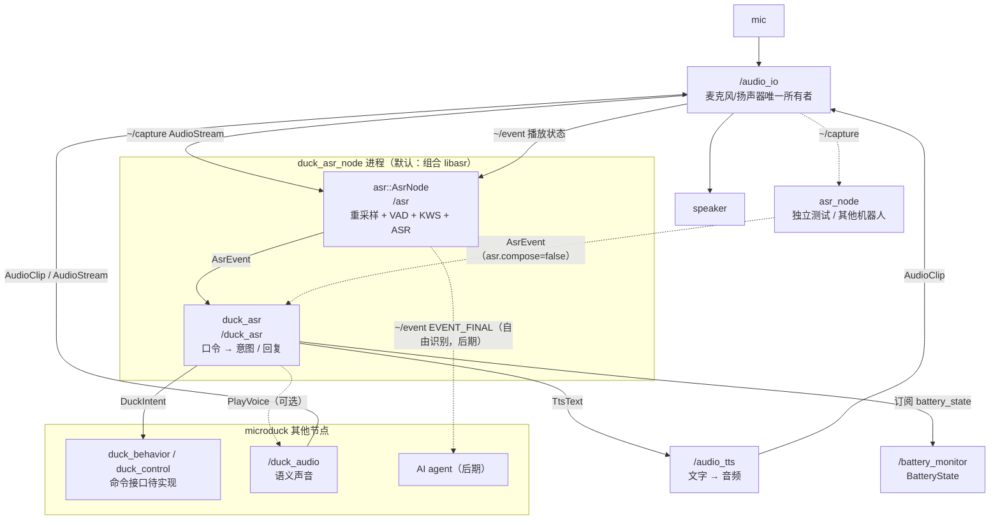
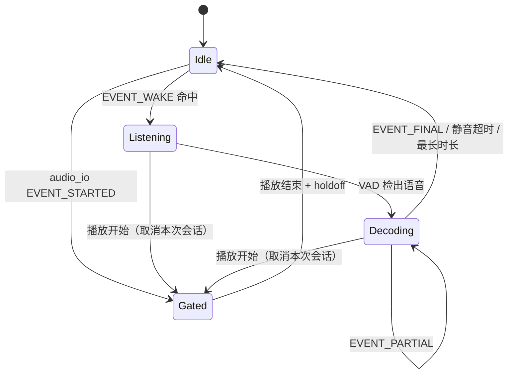

# Microduck 语音识别（ASR / 口令）ROS 2 架构

> 对象：`microduck_rev`（ROS 2 Humble，C++23，`ament_cmake`）。
> 状态：设计稿。`src/asr` 仓库当前只有 `LICENSE`，尚无代码。
> 上游约束：[`duck-ros2-audio-architecture.zh-CN.md`](./duck-ros2-audio-architecture.zh-CN.md)（麦克风唯一所有者、通用层不含鸭子语义）。
> 相关包：`audio_io`、`audio_io_interface`、`tts`、`tts_interface`、`duck_ear`、`battery_monitor`、`duck_control`。

---

## 0. 一句话结论

**代码分成两层，部署合并成一个进程。**

- 通用层：`asr`（库 `libasr` + 独立可执行 `asr_node`）+ `asr_interface`。
  负责采集订阅、重采样、VAD、唤醒词、ASR 后端、会话状态机；**不知道鸭子、电量、姿势**。
- 鸭子层：`duck_asr`（`duck_asr_node`）+ `duck_asr_interface`。
  负责“识别出的文本 → 鸭子意图 / 回复 / 动作”，**不实现 ASR 后端、不打开声卡、不写舵机**。
- 默认部署：`duck_asr_node` 链接 `libasr`，在同一进程里创建 `asr::AsrNode` 和鸭子意图节点；两者仍用
  `asr_interface/AsrEvent` 话题连接，行为与分进程完全一致。`asr_node` 只保留给单测、回放和其他机器人。
  **生产 launch 不要同时启动 `asr_node` 和 `duck_asr_node` 的内置 AsrNode**，否则两个实例会抢同一路采集。
- **固定口令必须作为解码约束送进 KWS 或 ASR**，而不是先跑自由识别再做字符串匹配。因此鸭子包拥有
  “口令语料”，通用包拥有“如何把语料编译成后端约束”。
- 必须加**半双工门控**：鸭子自己播放 TTS/叫声时暂停唤醒与识别，否则会自触发。
- v1 能端到端交付的是：唤醒词 → 固定口令 → 电量查询（`battery_monitor` + `tts`）与意图发布；
  姿势/动作的真实执行依赖 `duck_control` 的命令接口，而该接口目前只有设计文档、尚无实现。

---

## 1. 为什么代码上仍分两个包

| 方案 | 问题 |
|---|---|
| 只做鸭子包，直接实现 ASR | 换项目要重写采集、重采样、VAD、会话状态机、事件接口；模型/后端版本和鸭子业务耦合 |
| 只做通用包，把电量、姿势、动作写进通用包 | 通用接口出现鸭子语义，违反现有 `audio_io`/`tts` 的边界；其他机器人被迫继承鸭子配置 |
| 只用一个 YAML 配置词表 | 如果命令只是“关键词 → 播一个声音”够用；本需求还要查询电量、发布姿势/动作意图、接 AI agent，必须有代码层 |
| **通用包 + 鸭子包（本方案）** | 识别能力可复用；鸭子语义集中在 `duck_asr`；源码和依赖边界清晰 |

**代码边界不是进程边界。** `asr` 不出现 `duck_*` 依赖；`duck_asr` 不实现 ASR 后端，但默认链接
`libasr`，因此会间接继承模型/后端依赖。这是有意的取舍：换项目仍可只拿 `asr` 包，鸭子项目只维护一套
识别实现。

### 1.1 部署形态

| 形态 | 使用方式 | 适用 |
|---|---|---|
| **同进程组合（默认）** | `duck_asr_node` 链接 `libasr`，创建 `asr::AsrNode` + 鸭子意图节点，同一个 executor | 鸭子生产部署；少一个进程、一个 launch 条目 |
| 独立 `asr_node` | `asr_node` 单独进程发布 `AsrEvent`；`duck_asr` 设置 `asr.compose=false` 后订阅 | 单测、WAV/rosbag 回放、调试、故障对比、其他机器人 |
| 第三方链接库 | 其他项目链接 `libasr` 自建节点，或运行 `asr_node` | 复用 |

同一个 `duck_asr_node` 同时支持两种形态：`asr.compose=true`（默认）时自己构造 `AsrNode`；
`asr.compose=false` 时不构造，只订阅外部 `/asr/event`。这样 `asr_node` 可以当测试替身，不必单独维护
一个“鸭子测试版”二进制。

进程内仍然走 `AsrEvent` 话题，而不是私有函数回调：这样独立运行和组合运行的输入输出契约完全一致，
`asr_node` 的测试结果对组合部署同样有效。只有 `AsrEvent`/`AsrState` 这种小消息跨节点；48 kHz 采集流
不会进入 `duck_asr`。如果以后确实要省掉这一次 DDS，可在 `duck_asr` 里改用 `asr::Pipeline` 直接接回调，
`AsrEvent` 契约不变，但不是 v1 的目标。

### 1.2 合并进程接受的代价

| 项 | 后果 |
|---|---|
| ASR 原生崩溃（`segfault`/`abort`/OOM） | 整个 `duck_asr_node` 退出；launch/systemd 重启后 ASR 与意图一起恢复；重启前语音链路不可用 |
| 后端死锁/无响应 | 不能只杀后端；只能由进程级 watchdog 重启整个 `duck_asr_node` |
| 模型缺失/加载失败 | `AsrNode` 保持运行、`AsrState.model_loaded=false`；`duck_asr` 仍可处理其他入口，但语音链路不可用 |
| 依赖 | `duck_asr` 链接 `libasr` 及后端库；换模型/换后端需要重启并重新部署对应后端依赖 |
| 资源 | ASR 与意图层共享地址空间和内存配额，不能单独 cgroup 限制 ASR |
| 测试 | `asr_node` 可独立回放；`duck_asr` 可用 `asr.compose=false` 配合外部 `asr_node` 或 `ros2 topic pub` 测试 |

这些代价是明确接受的：本设计优先减少进程数和部署复杂度，不再追求“ASR 崩溃时鸭子语义层存活”。
其它节点（控制、播放、`duck_ear`）本来就在别的进程，不受 `duck_asr_node` 崩溃影响。

---

## 2. 分层与节点图



边界：

- `audio_io` 仍然是麦克风唯一所有者；`asr::AsrNode` 只订阅 `~/capture`，不打开 ALSA。
- `asr` 只输出**文本与识别事件**，不播声音、不发布鸭子意图；`asr_node` 只是它的独立入口。
- `duck_asr` 组合 `libasr`，但源码只做“文本 → 意图 / 回复 / 动作”；不实现 ASR 后端、不碰音频设备。
- `duck_asr_node` 默认在同一进程里创建 `AsrNode` 与意图节点；`asr.compose=false` 时改用外部 `/asr`。
- 动作执行在 `duck_behavior`/`duck_control`，不在 `duck_asr`。

---

## 3. 通用层：`asr`

### 3.1 包与产物

| 产物 | 说明 |
|---|---|
| `libasr.so` | 组合节点、管线、VAD、重采样、后端工厂 |
| `asr_node` | 只含 `main.cpp`，节点默认全名 `/asr` |
| `asr_interface` | 事件/状态消息；C++ 与 Python 端点 helper |
| `tools/replay_capture` | 把 WAV 按 `AudioStream` 块发布到采集话题，用于离线验收（不是节点） |

库导出两层：`AsrNode(rclcpp::Node::SharedPtr)`（ROS 组合，和 `tts::TtsNode` 同构）与
`Pipeline`（纯 C++：`push_pcm(span<const int16_t>, rate, channels)` + 事件回调）。非 ROS 项目或宿主
节点可以只用 `Pipeline`；`main.cpp` 不承载业务逻辑。

`asr_node` 只负责构造 `AsrNode` 并运行执行器，保留给单独测试、WAV/rosbag 回放和其他机器人。
鸭子生产部署由 `duck_asr_node` 直接实例化 `AsrNode`，不启动 `asr_node` 可执行文件；两者使用同一套
参数和 `AsrEvent` 契约，避免测试路径与生产路径分叉。

命名遵循现有约定：可执行文件 `*_node`，节点名是角色名；多机器人用 `namespace:=robot1` 得到
`/robot1/asr`，`audio_io.node` 与 `capture.topic` 同步改写。

### 3.2 管线

```text
/audio_io/capture
  → 校验（encoding/channels/字节数）
  → 下混 mono
  → 重采样到 16 kHz（带跨块状态）
  → 有界 PCM 环形队列（采集回调只入队）
  → 工作线程：
       ├─ 门控检查（正在播放则丢弃并重置）
       ├─ 唤醒词 KWS（常开，仅 Idle）
       ├─ VAD / 端点检测
       ├─ ASR 解码（仅在唤醒后的会话内）
       └─ 发布 AsrEvent
```

采集回调**不做推理、不分配大对象、不阻塞**；所有后端推理在单工作线程内串行执行，和 `tts` 的
“单工作线程调度”同构。

### 3.3 会话状态机



- `Idle` 只跑 KWS，成本最低；`Listening` 开始把 PCM 送 ASR（或命令 KWS）；`Decoding` 持续出 partial。
- 会话有 `listen.timeout_ms`（唤醒后多久没说话放弃）和 `listen.max_utterance_ms`（最长一句）。
- `pipeline.mode` 至少支持：`wake_command`（默认）、`keyword_command`、`push_to_talk`、`free_asr`（后期 agent）、`off`。
- `gate` 收到播放开始事件时清空队列、重置 VAD/ASR，避免把机器人自己的话识别成命令。

### 3.3.1 两条固定口令路线

固定口令不必一上来就接完整 ASR；两种路线共用同一套话题和会话状态机：

| 路线 | 做法 | 优点 | 代价 | 适用 |
|---|---|---|---|---|
| `keyword_command` | 唤醒后只跑 KWS，每个口令就是一个关键词 | 延迟最低、CPU 最低、后端最小 | 只能精确短语；同义说法要逐条列；无法扩展任意语音 | 板端算力紧张、口令少且固定 |
| `wake_command` | 唤醒后跑词表约束 ASR，输出文本再匹配意图 | 支持同义说法、槽位、后期平滑升级自由识别 | 需要 ASR 模型、延迟和 CPU 更高 | **默认**；与后期 agent 同一条路径 |

建议先按 `wake_command` 设计接口；板端实测若 ASR 延迟/CPU 不可接受，把模式切到 `keyword_command`
即可，`duck_asr`、`AsrEvent`、`DuckIntent` 都不变。

### 3.4 后端抽象

后端只吃 16 kHz mono f32，只吐结果，不发布 ROS 消息、不碰设备。与 `tts` 一样，**v1 用编译期工厂，
不用 pluginlib**；后端数量到 3 个以上、需要热切换时再考虑插件。

```cpp
namespace asr {

struct AsrResult {
    enum class Kind { Partial, Final, Endpoint };
    Kind kind{Kind::Final};
    std::string text;
    float confidence{0.0F};
};

/// 流式解码后端。Utterance 型后端（如 whisper.cpp）在内部缓冲到 Endpoint 再整体解码。
class AsrBackend {
public:
    virtual ~AsrBackend() = default;
    virtual std::string_view name() const noexcept = 0;
    virtual std::expected<void, std::string> initialize(const BackendConfig& config) = 0;
    /// 编译中性词表/语法；空词表表示自由识别。
    virtual std::expected<void, std::string> set_vocabulary(const Vocabulary& vocabulary) = 0;
    virtual void push(std::span<const float> pcm_16k) = 0;
    virtual std::vector<AsrResult> poll() = 0;
    virtual void reset() = 0;
};

/// 常开唤醒词检测；与 ASR 后端解耦，可单独替换。
class WakeWordDetector {
public:
    virtual ~WakeWordDetector() = default;
    virtual std::expected<void, std::string> initialize(const WakeConfig& config) = 0;
    virtual std::optional<WakeHit> process(std::span<const float> pcm_16k) = 0;
    virtual void reset() = 0;
};

} // namespace asr
```

候选后端（按板端实测决定，不预设结论）：

| 后端 | 唤醒 | 约束解码 | 备注 |
|---|---|---|---|
| `mock` | 可配置 | 忽略 | **第一个实现**，用于无模型 CI/回放 |
| `sherpa-onnx` | 有 KWS | 关键词/热词 | 同一 C API 覆盖 KWS 与流式 ASR，作为首选评估对象 |
| `vosk` | 无（用 KWS 或 ASR 词表） | grammar 成熟 | 作为备选；中文小模型体积可控 |
| `whisper.cpp` | 无 | 无（utterance 型） | 只适合后期自由识别，延迟和板端算力需实测 |

模型放 `share/asr/models/` 或参数指向的绝对路径；节点不内置模型。模型默认在启动时加载，
保证唤醒后首句延迟可预测；内存不足时再引入 lazy load，v1 不做。

`duck_ear` 与 `asr` 会同时消费麦克风、各自持有推理运行时（ONNX Runtime / 后端库），
板端内存和 CPU 必须一起实测。不要为了省一份运行时把 ASR 塞进 `duck_ear`：两者模型、采样率契约和
失败模式不同，合并会让摸头检测和识别互相拖累。

### 3.5 接口

`asr_interface`：

| 端点 | 类型 | 语义 | QoS |
|---|---|---|---|
| `~/event` | topic `AsrEvent` | `EVENT_WAKE` / `EVENT_SPEECH_START` / `EVENT_PARTIAL` / `EVENT_ENDPOINT` / `EVENT_FINAL` / `EVENT_FAILED` / `EVENT_CANCELED` | reliable，depth 50 |
| `~/state` | topic `AsrState` | 后端、模型、模式、门控、音频缺口、错误 | reliable，transient_local，depth 1 |
| `~/enable` | service `std_srvs/SetBool` | 启停识别（不影响节点运行） | 可选 |
| `~/listen` | action `Listen` | 按键/App 触发的一次性识别，可取消 | v2，可选 |

`AsrEvent.msg`：

```text
uint8 EVENT_WAKE=0
uint8 EVENT_SPEECH_START=1
uint8 EVENT_PARTIAL=2
uint8 EVENT_ENDPOINT=3
uint8 EVENT_FINAL=4
uint8 EVENT_FAILED=5
uint8 EVENT_CANCELED=6

std_msgs/Header header
string session_id       # 一次唤醒会话；部分/最终结果共享
uint8 event
string text             # EVENT_WAKE=关键词；EVENT_PARTIAL/EVENT_FINAL=转写；EVENT_FAILED/EVENT_CANCELED=空
float32 confidence
string language
string backend
string error
```

`AsrState.msg`：

```text
std_msgs/Header header
string backend
bool model_loaded
string mode             # wake_command / keyword_command / push_to_talk / free_asr / off
bool enabled
bool gated              # 当前因播放而静音
bool session_active
uint64 audio_gap_count  # 检测到的 AudioStream 序号缺口
string last_error
```

事件语义是**边沿**：一次唤醒只发一个 `EVENT_WAKE`；一句话只发一个 `EVENT_FINAL`（partial 可选）；门控取消发
`EVENT_CANCELED`，不伪装成空 `EVENT_FINAL`。

### 3.6 输入契约与采集缺口

沿用 `duck_ear` 的输入契约：

```text
topic        /audio_io/capture
stream_id    mic
encoding     s16le / f32le
sample_rate  48000（可配）
channels     1（1–2，2 声道下混）
QoS          best_effort，depth 2
```

- `AudioStream.sequence` 出现缺口时，**重置 VAD 与解码器**，不能把不连续音频拼成一句；缺口计入
  `audio_gap_count`。
- `eos=true` 表示采集停止：结束当前会话并等待恢复，不退出节点。
- 不合法帧丢一次并只告警一次。
- `capture` 是 best_effort：板端 CPU 紧张时丢包直接降低识别率，必须实测；不能在 ASR 包里偷偷增加
  订阅队列深度来“补偿”。

### 3.7 半双工门控

`audio_io` 的播放与麦克风共用一台设备，鸭子说话时麦克风会收到自己的声音。v1 不做 AEC，先做门控：

- 订阅 `<audio_io.node>/event`；`EVENT_STARTED` 进入 `Gated`，`EVENT_FINISHED`/`EVENT_FAILED`/
  `EVENT_PREEMPTED` 离开，另加 `gate.holdoff_ms` 防止尾音。
- `gate.max_ms` 兜底，避免事件丢失导致永久静音。
- 门控期间丢弃 PCM 并重置会话；播放开始时如果正在识别，发 `EVENT_CANCELED`。
- 后续要“边说边听”再引入 AEC/回声参考，不在 v1 承诺。

### 3.8 参数

| 参数 | 默认 | 说明 |
|---|---|---|
| `capture.topic` | `audio_io` 的 `~/capture` | 复用其他项目时改这里 |
| `capture.stream_id` | `mic` | 空 = 任意 |
| `audio_io.node` | `/audio_io` | 门控事件来源 |
| `pipeline.mode` | `wake_command` | `wake_command` / `keyword_command` / `push_to_talk` / `free_asr` / `off` |
| `input.rate` | `16000` | 后端输入采样率；重采样目标 |
| `wake.enabled` | `true` | 关闭后只能 PTT/外部触发 |
| `wake.keywords_file` | 空 | 中性词表；空 = 后端默认唤醒词 |
| `wake.threshold` | 后端默认 | KWS 阈值 |
| `wake.cooldown_ms` | `1000` | 防连续触发 |
| `listen.timeout_ms` | `5000` | 唤醒后等待开口 |
| `listen.endpoint_silence_ms` | `700` | 判句尾静音 |
| `listen.max_utterance_ms` | `8000` | 单句上限 |
| `decoder.backend` | `mock` | `mock` / `sherpa_onnx` / `vosk` / `whisper_cpp` |
| `decoder.model_dir` | 空 | 后端模型目录 |
| `decoder.vocabulary_file` | 空 | 中性口令词表；空 = 自由识别 |
| `decoder.partial_results` | `true` | 是否发布 `EVENT_PARTIAL` |
| `decoder.confidence_min` | `0.0` | 低于此值不发 `EVENT_FINAL`（后端支持时） |
| `gate.enabled` | `true` | 播放时静音 |
| `gate.holdoff_ms` | `300` | 播放结束后的静音保持 |
| `gate.max_ms` | `15000` | 门控兜底 |
| `worker.queue_ms` | `2000` | PCM 环形队列上限；溢出丢最旧并计数 |
| `frame_id` | `mic` | 事件 header |

### 3.9 中性词表

通用包只定义“词表/语法的抽象”，不定义鸭子命令。每个后端负责编译：

```yaml
# vocabulary.yaml —— 通用格式，鸭子包生成
language: zh-CN
phrases:
  - text: 小鸭小鸭
    kind: wake
  - text: 电量
    kind: command
  - text: 还有多少电
    kind: command
    boost: 1.0
```

后端分别把它编译成 Vosk grammar JSON、sherpa 关键词文件或 whisper 的 prompt 词表。这样
`duck_asr` 的配置不随后端格式变化。

### 3.10 失败模式

| 失败 | 行为 |
|---|---|
| 模型缺失/加载失败 | `AsrNode` 继续运行，`model_loaded=false`、`last_error` 可读，不发识别事件；`duck_asr` 与其他节点不受影响，但语音链路不可用 |
| 后端原生崩溃（`segfault`/`abort`/OOM） | 整个 `duck_asr_node` 退出；由 launch（`respawn=True`）或 systemd 重启后 ASR 与意图一起恢复。**重启前语音链路不可用**；控制、播放、`duck_ear` 不受影响 |
| 后端死锁/无响应 | 进程级 watchdog 只能重启整个 `duck_asr_node`；不能只杀后端 |
| 采集未启动/停止 | 无输入；等待 `audio_io` 恢复，不退出 |
| 采集丢包 | 重置解码器，`audio_gap_count++`，不拼接 |
| 推理异常 | 丢弃本次会话，发 `EVENT_FAILED`，下个会话继续 |
| 门控事件丢失 | `gate.max_ms` 到期自动恢复 |
| 下游无人订阅 | 事件丢弃，不阻塞工作线程 |

---

## 4. 鸭子层：`duck_asr`

### 4.1 职责与组合方式

| 负责 | 不负责 |
|---|---|
| 鸭子唤醒词与口令语料的唯一来源 | 音频采集、重采样、VAD、ASR 推理 |
| 文本归一化、别名/同义口令匹配 | 声卡、播放、音库 |
| `battery.query` → 读 `BatteryState` → TTS 回复 | 舵机写入、运动安全仲裁 |
| 姿势/动作 → 发布 `DuckIntent` | 意图的具体执行 |
| 未知口令的限速反馈 | 自由对话、LLM |

默认组合方式：

```text
duck_asr_node（单进程）
  ├─ asr::AsrNode（节点名 /asr，订阅 /audio_io/capture，发布 AsrEvent）
  ├─ duck_asr::DuckAsrNode（节点名 /duck_asr，订阅 AsrEvent，发布 DuckIntent）
  └─ MultiThreadedExecutor
```

- `asr.compose=true`（默认）：`duck_asr_node` 链接 `libasr`，直接创建 `AsrNode` 和意图节点；不启动
  `asr_node` 可执行文件。
- `asr.compose=false`：不创建 `AsrNode`，只订阅外部 `<asr.node>/event`；用于单测、回放或独立 ASR 进程。
- 两种模式共用同一份意图处理代码；切换模式不改变 `AsrEvent`/`DuckIntent` 契约。

`duck_asr` 自身参数：

| 参数 | 默认 | 说明 |
|---|---|---|
| `asr.compose` | `true` | 是否在本进程内构造 `asr::AsrNode` |
| `asr.node` | `/asr` | 内部节点名，或 `asr.compose=false` 时的事件来源 |
| `asr.params_file` | 空 | 构造 `AsrNode` 时注入的参数文件（含词表、后端、门控） |
| `battery.node` | `/battery_monitor` | 电量话题来源 |
| `tts.node` | `/audio_tts` | 回复播报目标 |
| `intent.confidence_min` | `0.6` | 低于此值按未知口令处理 |
| `unknown_reply_cooldown_ms` | `2000` | 未知口令反馈限速 |

`asr.params_file` 里不要重复声明鸭子意图参数；两边参数命名空间不同，`asr.*` 只属于本节点。

### 4.2 配置是唯一来源，产物自动生成

`config/duck_commands.yaml` 是唯一手写源；构建/安装时由 `tools/gen_vocabulary.py` 生成
`share/duck_asr/config/vocabulary.yaml`，`duck_asr_node` 构造 `AsrNode` 时通过 `asr.params_file`
把它注入 `decoder.vocabulary_file`。不要手写两份词表——否则口令改了而解码约束没改，表现为“说了但识别不出来”。

示例（名称是示意，实际以产品定义为准）：

```yaml
wake:
  - 小鸭小鸭
  - 嗨小鸭

intents:
  - id: battery.query
    phrases: [电量, 还有多少电, 电池还剩多少]
    action: query_battery
    reply: "电量还有 {percent}%"
  - id: posture.stand
    phrases: [站起来, 起立]
    action: publish_intent
    args: {posture: stand}
  - id: posture.sit
    phrases: [坐下, 趴下]
    action: publish_intent
    args: {posture: sit}
  - id: action.nod
    phrases: [点点头]
    action: publish_intent
    args: {action: nod}
  - id: action.spin
    phrases: [转个圈]
    action: publish_intent
    args: {action: spin}
```

匹配规则：

- 归一化：去首尾空白、全角转半角、去标点；不做拼音模糊匹配。
- 只在 `EVENT_FINAL` 上匹配；`EVENT_PARTIAL` 只用于 UI/调试。
- `confidence < intent.confidence_min`（默认沿用节点参数）不执行，按未知口令处理。
- 同一 `session_id` 的 `EVENT_FINAL` 只消费一次；会话被门控取消后不再执行。

### 4.3 电量查询

订阅 `/battery_monitor/battery_state`（`sensor_msgs/BatteryState`，`percentage` 为 0..1），缓存最近一帧：

- 有缓存：`{percent}` 取 `round(percentage * 100)`，通过 `/audio_tts/text`（`play=true`）播报；
- 无缓存或数据过期（默认 5 s）：播报“电量暂时读不到”，不阻塞事件线程；
- 电池节点不在线只影响该口令，不影响其他口令。

### 4.4 姿势 / 动作意图

`duck_asr` 不直接写舵机，也不直接调用 `controller_manager`。它发布：

```text
# duck_asr_interface/msg/DuckIntent.msg
std_msgs/Header header
string session_id
string intent          # battery.query / posture.stand / action.nod ...
string utterance       # 触发它的原始文本，便于日志与回放
float32 confidence
string[] arg_keys
string[] arg_values
```

`intent` 用字符串而不是消息常量：口令集会长，改成枚举就要改接口包并重编所有消费者。已知意图名
由 `duck_commands.yaml` 文档化，消费方按字符串分派；执行方负责校验未知意图。

**当前缺口**：`duck_control` 只有设计文档，没有面向行为的命令话题/服务。因此 v1 的姿势/动作只能
“发布意图 + 日志”，真正执行要等 `duck_control` 的命令接口（或新增 `duck_behavior` 适配层）。
不要为了“能演示”让 `duck_asr` 自己写关节或直接调控制器内部接口。

### 4.5 安全与限速

- 意图执行方负责“跌倒、低电、脚本动作、遥控接管”互斥；`duck_asr` 不做运动仲裁。
- 未知口令反馈默认限速 1 次 / 2 s，避免连续误识别刷屏 TTS。
- `battery.query` 与 TTS 回复不改变运动状态。
- 是否要求唤醒词才能执行姿势/动作，是配置策略，不是硬编码；默认要求。

---

## 5. 端到端延迟预算（目标，待板端实测）

| 环节 | 目标 | 说明 |
|---|---|---|
| 唤醒词命中 | ≤ 300 ms（词尾起算） | KWS 帧移/窗口决定，需实测 |
| 句尾 → `EVENT_FINAL` | ≤ 700 ms | 端点静音 700 ms + 解码；约束解码应显著低于自由识别 |
| `EVENT_FINAL` → `DuckIntent` | ≤ 20 ms | 纯字符串匹配 + 发布 |
| 意图 → 首个音频 | ≤ 500 ms | TTS 冷合成约 0.3 s、缓存命中约 0.1 s（现有 `tts` 文档数据） |
| 电量口令全链路 | ≤ 1.5 s | 唤醒 + 一句话 + TTS |

这些是验收目标，不是实测值；板端 CPU、模型大小、采集丢包会直接改变结果。

---

## 6. 后期扩展到任意语音 / AI agent

接口不需要改：

1. 把 `pipeline.mode` 切到 `free_asr`，`decoder.vocabulary_file` 置空，换流式全量 ASR 后端。
2. `asr` 继续发 `EVENT_PARTIAL`/`EVENT_FINAL`；agent 订阅 `~/event`，不再只由 `duck_asr` 消费。
3. `duck_asr` 保留“口令快速路径”：先匹配固定意图，未命中再把 `EVENT_FINAL` 转给 agent；这样常用命令
   不依赖 LLM 延迟。
4. agent 的回复走 `/audio_tts/text`，与现有 TTS 层一致；不要新建对话播放通道。
5. 如果 agent 需要“唤醒后持续对话”，在通用层增加 `listen.continuous` 会话模式，而不是在 agent 里
   重新订阅麦克风。

可选演进：两路解码（约束口令 + 自由 ASR）同时跑，成本更高；v1 不做，先验证单后端。

---

## 7. 包布局

```text
src/
  asr_interface/
    msg/AsrEvent.msg
    msg/AsrState.msg
    include/asr_interface/ros_msg.hpp
    python/asr_interface_msg/ros_msg.py
    test/

  asr/
    include/asr/
      asr_node.hpp
      pipeline.hpp
      linear_resampler.hpp
      voice_activity_detector.hpp
      asr_backend.hpp
      wake_word_detector.hpp
      ffi/                      # 仅在复用 Rust 后端时需要
    src/...
    config/asr.yaml
    launch/asr.launch.py
    models/                     # 不提交大模型；安装时由脚本/文档提供
    tools/replay_capture.cpp
    test/

  duck_asr_interface/
    msg/DuckIntent.msg
    include/duck_asr_interface/ros_msg.hpp
    python/duck_asr_interface_msg/ros_msg.py
    test/

  duck_asr/
    include/duck_asr/...
    src/...
    config/duck_commands.yaml
    config/duck_asr.yaml
    launch/duck_asr.launch.py
    tools/gen_vocabulary.py
    test/
```

本文位于 `docs/duck-ros2-asr-architecture.zh-CN.md`；各包不再各存一份设计文档，避免版本漂移。

构建依赖方向：

```text
asr_interface    ← asr
asr_interface    ← duck_asr（事件契约）
duck_asr_interface ← duck_asr
asr              ← duck_asr（链接 libasr，默认组合）
```

`duck_asr` 不复制 ASR 实现，只链接 `libasr`；源码依赖 `asr`，接口依赖 `asr_interface`。
生产进程里 `asr::AsrNode` 由 `duck_asr_node` 创建；`asr_node` 可执行文件只用于测试和独立部署。

---

## 8. 验收标准

1. `asr_node` 以 `decoder.backend=mock` 启动，回放一段 WAV 能发布 `EVENT_WAKE` → `EVENT_FINAL`；
   没有 `audio_io` 时节点保持运行并报状态。
2. `duck_asr_node` 默认 `asr.compose=true`，不启动外部 `asr_node` 也能收到识别事件并产生意图；
   `asr.compose=false` 时可配合外部 `asr_node` 或 `ros2 topic pub` 工作。
3. 真实后端下，说唤醒词后说固定口令得到 `EVENT_FINAL`；说词表外内容不产生可执行 `EVENT_FINAL`。
4. 播放 `audio_io` 音频期间不产生 `EVENT_WAKE`/`EVENT_FINAL`；播放结束后 `holdoff` 到期恢复。
5. 采集 `sequence` 缺口时解码器重置，`audio_gap_count` 增加。
6. `duck_asr` 对“电量”口令读到 `BatteryState` 并通过 `/audio_tts/text` 播报百分比。
7. `duck_asr` 对“站起来/点点头”等发布 `DuckIntent`，且不写任何关节；执行消费方未实现时只记录。
8. 删除模型/后端库后 `asr_node` 与 `duck_asr_node` 均存活，`model_loaded=false`，其他节点不受影响。
9. 依赖检查：`asr` 的 `package.xml` 不含任何 `duck_*`；`duck_asr` 链接 `libasr`，但源码没有复制
   ASR 实现；生产 launch 不同时启动 `asr_node` 与 `asr.compose=true`。
10. 板端实测记录：CPU、唤醒延迟、句尾到 `EVENT_FINAL`、采集缺口数、内存；数据写入本文。

---

## 9. 迁移顺序

1. **接口 + 通用骨架**：`asr_interface`、`asr` 的 mock 后端、
   重采样/VAD/门控/状态机、`replay_capture` 回放验收。
2. **真实后端**：先接 `sherpa-onnx` 或 `vosk` 之一，完成 KWS + 词表约束；按板端实测在
   `wake_command` 与 `keyword_command` 之间选默认值，再决定是否加第二个后端。
3. **鸭子配置与意图**：`duck_asr_interface`、`duck_commands.yaml`、词表生成、电量查询和 TTS 回复；
   `duck_asr_node` 链接 `libasr` 并组合 `AsrNode`，同时用 `asr.compose=false` 验证外部 `asr_node` 路径。
4. **动作执行**：等 `duck_control` 的命令接口落地后，新增 `duck_behavior`（或在控制侧加订阅）消费
   `DuckIntent`；在此之前不承诺姿势/动作可执行。
5. **自由识别 + agent**：`free_asr` 模式与 agent 订阅；按实测决定是否保留并行约束解码。

重采样器建议在步骤 1 顺手从 `duck_ear` 提到 `common_cpp`（两个消费者、同一 bug 面，但不需要新建包）；
如果不想动 `duck_ear`，先在通用包内复制并在注释里标注来源，后续再合并。

---

## 10. 待确认问题

1. 板端最终用内置 AIC3104 还是 USB 声卡？现有文档记录开发板没有 capture，ASR 与 `duck_ear`
   受同一个硬件前置条件阻塞。
2. 唤醒词是否允许自定义训练，还是先用现成中文 KWS 模型 + 文本关键词？
3. 姿势/动作是否必须唤醒后执行？是否允许 App/按键直接触发（`push_to_talk`）？
4. 识别常开是否可接受功耗/CPU？还是用硬件按键/在场检测触发？
5. AI agent 接入后，固定口令与自由识别是串行（先口令后 agent）还是并行两路解码？
6. 中文模型与唤醒词模型的许可证、体积、分发方式；是否允许模型不进仓库、由安装脚本下载。
7. 是否需要 `Listen` 这类一次性识别 action 作为对外通用能力（v2）。
