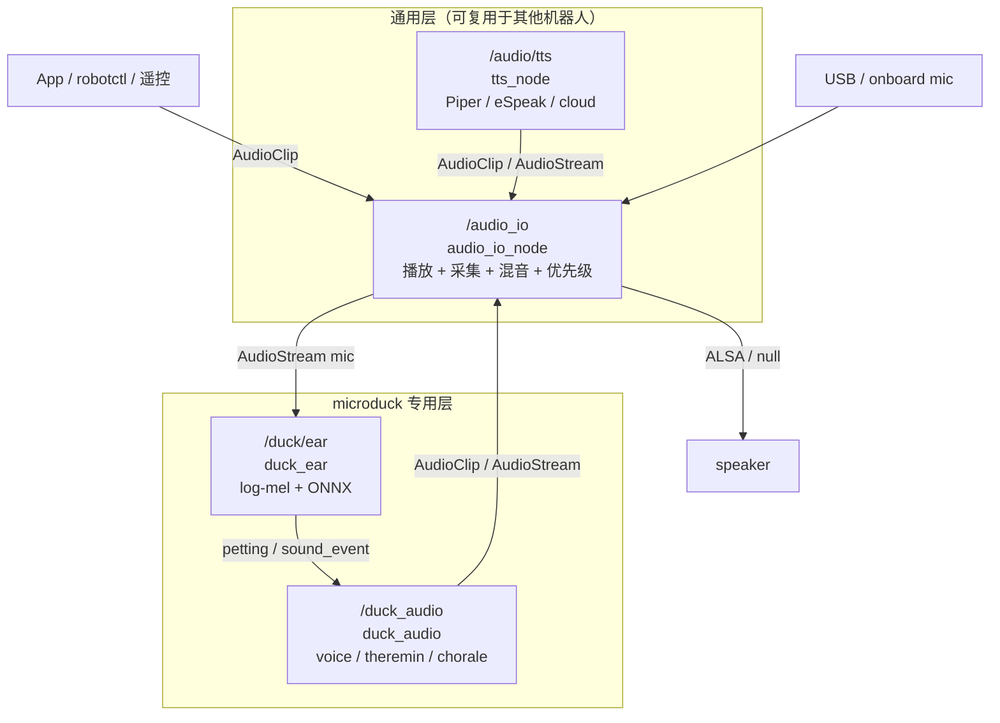

# Microduck 声音系统 ROS 2 架构

> 对象：`microduck_rev`（ROS 2 Humble，C++23，`ament_cmake`）。
> 依据：`pollen-robotics/microduck` 的 `sounds`、`robotd/src/sound.rs`、`theremin`、`chorale`、`pet-detect`，以及当前开发板的实测结果。
> 状态：`audio_io`、`audio_io_interface`、`duck_audio`（voice/wheee/特雷门）、`duck_audio_interface` 已实现；TTS、`duck_ear` 仍为设计，合唱暂不实现。
> `audio_io` 详细架构：[`src/audio_io/docs/audio_io-architecture.zh-CN.md`](../src/audio_io/docs/audio_io-architecture.zh-CN.md)
> 约定：节点名用 `snake_case`；话题/服务/动作名相对于节点私有命名空间书写，例如 `~/play`。

---

## 0. 一句话结论

声音系统拆成三层：

1. **通用音频 I/O 层**：`audio_io` 功能包（库 + `audio_io_node`）独占播放和采集设备，负责 WAV/MP3 解码、混音、优先级、抢占和 PCM 流。
2. **通用 TTS 层**：规划中的 `tts_node` 负责文字 → 音频，提供 service/topic/action，不碰声卡。
3. **microduck 语义层**：`duck_audio` 一个节点承载 `voice`、`wheee`、`theremin`；合唱暂不实现；`duck_ear` 独立负责摸头检测。

三条硬约束：

- **播放设备只有一个所有者**：`audio_io`。其他节点只发 `AudioClip` 或 `AudioStream`。
- **麦克风只有一个所有者**：`audio_io` 的采集侧。`duck_ear`、未来的 WebRTC 都订阅 `~/capture`。
- **通用接口不出现鸭子语义**：`chirp`、`coo`、`wheee`、seed、personality 只属于 `duck_audio_interface`；`audio_io` 只使用 `audio_io_interface`。

---

## 1. 范围与非目标

### 1.1 范围

- 播放预渲染音库（`alarm/greet/inquire/peck/chirp/coo/wheee`）。
- 播放音频文件（当前实现：WAV/MP3），支持循环、增益、起始偏移；FLAC/OGG 为后续扩展。
- 播放实时 PCM 流（特雷门、流式 TTS；合唱暂不实现）。
- TTS：文字 → 音频；service 只合成，topic/action 合成并播放。
- 麦克风采集、摸头检测、环境声事件。
- 优先级、抢占、排队、同组替换、混音/ducking。
- 设备热插拔、错误降级、状态上报。

### 1.2 非目标

- **不做语音识别（ASR）、唤醒词、对话理解**。`pet-detect` 只判断“是否在摸头”，环境声 `Voice` 只是 RMS 包络事件。
- **不做云 TTS 强依赖**。云端 backend 可选，离线 Piper/eSpeak 是默认路径。
- **不在本节点内做 WebRTC 传输**。`mediad` 未来需要麦克风/扬声器时，通过 `AudioStream` 接入 `audio_io`。
- **不把声音合成塞进 `ros2_control` 的 update loop**。声音不是 50 Hz 运动控制的一部分；它有自己的线程和生命周期。

---

## 2. 原型行为摘要（移植时必须保留的性质）

| 原型位置 | 行为 | ROS 2 中的对应 |
|---|---|---|
| `sounds/src/lib.rs` | SoC serial → sha256 → `u32` seed → `Personality` | `duck_audio` 启动时解析 seed；音库 `.seed` 标记优先 |
| `sounds/src/voices.rs` | 7 个 tag × 10/12 个变体，`wheee` 3 段 | 预渲染 WAV 音库，运行时不合成一次性叫声 |
| `sounds/src/synth.rs` | 48 kHz、16-bit mono、加法谐波合成 | 音库格式；实时流也用 48 kHz |
| `robotd/src/sound.rs` | 单个 `aplay` 子进程，新声音杀旧声音 | `audio_io` 的单播放引擎 + 显式抢占策略 |
| `robotd/src/sound.rs` | `wheee` start→loop→end 流式写入 | `AudioStream` + `eos`/超时 |
| `robotd/src/sound.rs` | 特雷门用 `Stream` 实时合成，30 ms 提前量 | `duck_audio` 的 theremin 模块发 `AudioStream`，`audio_io` 只负责播 |
| `robotd/src/sound.rs` | 合唱按 score beat 渲染自己声部 | 当前未实现；接口保留在 `duck_audio_interface` |
| `pet-detect` | `arecord` 16 kHz mono → 40-band log-mel → 20 KB CNN | `audio_io` 采集 → `duck_ear` 订阅并推理 |
| `robotd` IPC | `robot.sound` / `robot.theremin` / `robot.chorale` | 专用 ROS 2 service/topic/action |

必须保留的性质：

1. **音库是确定性的**：同一个 seed 永远得到同一只鸭子的声音；变体只在同一 seed 内重掷。
2. **播放是单设备的**：同一时刻只有一个引擎拥有 PCM；抢占/排队是显式策略，不是“碰巧谁先打开”。
3. **小喇叭补偿**：低频谐波搬到扬声器能发出的频段；默认 300 Hz rolloff，可按硬件配置。
4. **麦克风单客户端**：采集设备不能被 `duck_ear` 和 `mediad` 各自打开。
5. **声音失败不拖垮运动**：没有音库、没有麦克风、没有声卡，机器人仍然能走。

---

## 3. 分层与节点命名



### 3.1 包与节点

| 层 | 包 | 可执行文件 | 节点全名 | 复用性 |
|---|---|---|---|---|
| 通用音频 I/O | `audio_io` | `audio_io_node` | `/audio_io`（可选 namespace） | 是 |
| 通用消息 | `audio_io_interface` | — | — | 是 |
| 通用 TTS（规划） | `robot_audio_tts` | `tts_node` | `/audio/tts` | 是 |
| 鸭子音频（已实现 voice/wheee/特雷门） | `duck_audio` | `duck_audio_node` | `/duck_audio` | 否 |
| 鸭子耳朵（规划） | `duck_ear` | `duck_ear_node` | `/duck/ear` | 否 |
| 鸭子音频消息（已实现） | `duck_audio_interface` | — | — | 否 |

命名规则：

- 通用音频包用 `audio_io`、`audio_io_interface`；规划中的 TTS 用 `robot_audio_tts`，机器人专用包用 `duck_*`（`duck_audio`、`duck_ear`）。
- 可执行文件统一 `*_node`；节点名是角色名词，不是实现细节。
- 不要用 `voice_node`、`sound_node`、`audio_node` 这类没有职责信息的名字。
- 不要用 `sound_play`：ROS 生态已有同名包，且它不解决本文的优先级/会话/混音需求。
- 多机器人时用命名空间 `/robot1/audio_io`、`/robot1/duck_audio`，节点名不变。

### 3.2 `duck_audio` 的边界

`voice`、`wheee`、`theremin` 共享音库、seed、`Personality` 和同一个 Rust `Stream`，因此合并成一个
`/duck_audio` 节点；内部仍按模块拆分。组合式节点、线程/仲裁、Gemini 输入、接口和 FFI 细节见：

**[`src/duck_audio/docs/duck-ros2-architecture.zh-CN.md`](../src/duck_audio/docs/duck-ros2-architecture.zh-CN.md)**

---

## 4. 通用音频 I/O：`audio_io`

`audio_io` 的职责、内部结构、播放/采集、接口、QoS、声道语义、参数、包布局、构建与验收已迁移到独立仓库文档：

**[`src/audio_io/docs/audio_io-architecture.zh-CN.md`](../src/audio_io/docs/audio_io-architecture.zh-CN.md)**

系统级只保留三条约束：

- `audio_io` 是播放和采集设备的唯一所有者；
- 其他节点只通过 `AudioClip` / `AudioStream` 提交数据；
- `audio_io` 不感知鸭子语义、TTS、ToF 或摸头检测。

---

## 5. `duck_audio`：microduck 语义层

`duck_audio` 的职责、组合式节点、voice/wheee/特雷门、Gemini 深度输入、接口、参数、FFI 边界、
构建与验收已迁移到独立文档：

**[`src/duck_audio/docs/duck-ros2-architecture.zh-CN.md`](../src/duck_audio/docs/duck-ros2-architecture.zh-CN.md)**

配套文档：

- [Rust FFI 边界](../src/duck_audio/docs/duck-ros2-rust-ffi.zh-CN.md)
- [Gemini 特雷门](../src/duck_audio/docs/duck-ros2-theremin-gemini.zh-CN.md)

系统级只保留这些约束：

- `duck_audio` 是鸭子语义层，不碰 ALSA；一次性声音发 `AudioClip`，实时声音发 `AudioStream`。
- 音库、seed 和 `Personality` 由 `duck_audio` 持有；默认音库在 `~/.config/duck_ros2/sounds`，启动时自动检查/生成。
- 一次性音效与 `wheee` 走音库；特雷门用 Rust `Stream` 实时合成，Gemini 深度图/点云只提供 `closeness`。
- 合唱暂不实现；`duck_audio_interface` 中的 `SetChorale`/`ChoraleState` 保留给后续。
- 声音失败只影响声音，不影响运动控制。

---

## 6. 麦克风与 `duck_ear`

### 6.1 `audio_io` 采集侧

`audio_io` 在同一个节点中同时持有 playback 和 capture 两个 `snd_pcm_t`，发布 `~/capture`。采集参数、声道语义、设备恢复和验证命令详见：

**[`src/audio_io/docs/audio_io-architecture.zh-CN.md`](../src/audio_io/docs/audio_io-architecture.zh-CN.md)**

**注意：只合并 I/O，不合并处理。** ONNX 推理、VAD、降噪都不进 `audio_io`；规划中的 `duck_ear` 订阅 `~/capture` 做处理。

### 6.2 `duck_ear`（规划）

- 订阅 `/audio_io/capture`；
- 重采样到 16 kHz mono；
- 1 s 窗口、512 FFT、25 ms 窗、10 ms hop、40 mel、log；
- 输入 `[1, 1, 40, 100]` 到 20 KB CNN；
- 滞回：enter ≥ 0.95，exit < 0.85；
- 默认 stride ≈ 250 ms；
- 发布 `~/petting`（`std_msgs/Bool` 或 `duck_audio_interface/PettingEvent`）；
- 同时发布 `~/sound_event`（`Noise` / `Voice`，当前仅诊断）。

麦克风没有单独的 `AudioCapture` 消息：`~/capture` 复用 `AudioStream`，建议 `stream_id = "mic"`，`eos=true` 表示停止采集；采集健康由 `AudioState.capture_ok/capture_error` 和 `AudioEvent` 的设备事件表达。

`duck_audio` 的 voice 模块订阅 `/duck/ear/petting`，在“未摔倒、无脚本动作”时播 `coo`。

### 6.3 什么时候拆回独立 `audio_capture`

采集与 `audio_io` 的拆分条件、接口稳定性说明已迁移到：

**[`src/audio_io/docs/audio_io-architecture.zh-CN.md`](../src/audio_io/docs/audio_io-architecture.zh-CN.md)**

---

## 7. TTS：`/audio/tts`

### 7.1 职责

- 文字 → 音频；
- 管理 TTS 后端、语音、语言、语速、音高；
- 缓存合成结果；
- 把音频交给 `/audio_io`，**不碰声卡**。

### 7.2 三种接口

| 接口 | 类型 | 语义 |
|---|---|---|
| `~/text` | topic `TtsText` | fire-and-forget：合成并播放 |
| `~/synthesize` | service | 只合成，返回缓存音频 URI |
| `~/say` | action | 长文本：进度、按句反馈、可取消 |

```text
# TtsText.msg
string text
string voice_id
string language
float32 rate
float32 pitch
float32 volume
bool play
string group
```

```text
# Synthesize.srv
TtsText request
---
bool success
string audio_uri
float32 duration
string error
```

```text
# Say.action
TtsText text
---
string request_id
---
float32 progress
string current_sentence
```

### 7.3 后端

用 pluginlib 做 `TtsBackend`：

```cpp
class TtsBackend {
public:
  virtual bool initialize(const TtsParams&) = 0;
  virtual std::expected<AudioClip, std::string>
  synthesize(const TtsRequest&) = 0;
  virtual bool supports_streaming() const { return false; }
};
```

- `PiperBackend`：离线、ARM 可跑、质量好，默认；
- `EspeakNgBackend`：兜底；
- `CloudBackend`：可选。

### 7.4 缓存与流式

- 缓存键：`hash(text + voice + rate + pitch)`；
- 缓存目录：`/var/cache/robot_audio/tts/`；
- LRU 清理；
- 长文本按句切分，逐句合成/提交；
- 流式后端直接发 `AudioStream`，不落盘；
- 非流式返回文件 URI，避免大块 PCM 走 DDS。

### 7.5 优先级

默认：

```text
group = "tts"
priority = SPEECH
policy = REPLACE_SAME_GROUP
```

新一句替换旧一句，但不会压掉 `ALERT`。需要“播报完再继续”的场景用 `QUEUE`。

---

## 8. ROS 2 接口、QoS 与生命周期

### 8.1 `audio_io` 接口、QoS 与生命周期

`audio_io` 的接口表、QoS、`start()` / `stop()` 语义、设备重试和状态字段已迁移到：

**[`src/audio_io/docs/audio_io-architecture.zh-CN.md`](../src/audio_io/docs/audio_io-architecture.zh-CN.md)**

### 8.2 后续包的 lifecycle

`duck_audio` / `duck_ear` 的 lifecycle 设计仍待实现。`duck_audio` 当前是组合式普通节点：voice 默认可用，特雷门等待 `~/theremin/enable`，合唱暂不提供。

---

## 9. 设备与后端

设备后端的详细说明已迁移到：

**[`src/audio_io/docs/audio_io-architecture.zh-CN.md`](../src/audio_io/docs/audio_io-architecture.zh-CN.md)**

系统级只保留一条硬约束：

**PulseAudio、PipeWire、直接 ALSA 不要同时抢同一张声卡。** 机器人上如果 `audio_io` 直接使用 ALSA，必须停掉/禁用 PulseAudio，并确保 PipeWire 不接管该卡；否则会得到 `Device or resource busy`。

---

## 10. 实时预算

`audio_io` 的采样率、period/buffer、解码/欠载行为已迁移到：

**[`src/audio_io/docs/audio_io-architecture.zh-CN.md`](../src/audio_io/docs/audio_io-architecture.zh-CN.md)**

特雷门端到端、`wheee` 退出、TTS 首句等属于后续包，目标见对应设计。

---

## 11. 失败模式与降级

`audio_io` 的设备、解码、欠载、流超时等失败行为已迁移到：

**[`src/audio_io/docs/audio_io-architecture.zh-CN.md`](../src/audio_io/docs/audio_io-architecture.zh-CN.md)**

后续包（规划）：

| 失败 | 行为 |
|---|---|
| 没有音库 | `duck_audio` 的 voice 模块禁用语义声音；theremin/chorale 没有 seed 时也禁用；TTS/文件播放仍可用 |
| `duck_audio` 某个模块失败 | 该模块 `state=error`，其他模块继续；节点不 panic、不退出 |
| TTS 后端失败 | `Synthesize` 返回错误；topic 路径发 `~/event`；可回退 eSpeak |

---

## 12. `audio_io` 参数

`audio_io` 的参数默认值、launch 的 `config` / `namespace` 用法和参数文件 key 规则已迁移到：

**[`src/audio_io/docs/audio_io-architecture.zh-CN.md`](../src/audio_io/docs/audio_io-architecture.zh-CN.md)**

`voice.*`、`theremin.*`、`chorale.*`、`tts.*` 属于后续 `duck_audio` / `tts_node`，不在 `audio_io` 中声明。

---

## 13. 包布局

```text
src/
  # audio_io_interface / audio_io 的完整布局见
  # src/audio_io/docs/audio_io-architecture.zh-CN.md

  robot_audio_tts/
    src/tts_node.cpp
    src/backend.cpp
    src/piper_backend.cpp
    src/espeak_backend.cpp
    src/cache.cpp
    include/robot_audio_tts/...
    config/tts.yaml
    launch/tts.launch.py

  duck_audio_interface/
    srv/PlayVoice.srv
    msg/PettingEvent.msg
    msg/SoundEvent.msg
    msg/ThereminState.msg
    msg/ChoraleState.msg

  duck_audio/              # 详细布局见 src/duck_audio/docs/duck-ros2-architecture.zh-CN.md
    include/duck_audio/...
    src/...
    rust/                  # vendored sounds + C ABI
    config/duck_audio.yaml
    launch/duck_audio.launch.py
    tools/

  duck_ear/
    src/duck_ear_node.cpp
    src/mel.cpp
    src/classifier.cpp
    config/duck_ear.yaml
    launch/duck_ear.launch.py
```

---

## 14. 验收标准

`audio_io` / `audio_io_interface` 的验收标准、测试和运行验证已迁移到：

**[`src/audio_io/docs/audio_io-architecture.zh-CN.md`](../src/audio_io/docs/audio_io-architecture.zh-CN.md)**

后续包（规划）：

1. `tts_node` 的 `~/synthesize`、`~/text`、`~/say` 可用。
2. `duck_ear` 在麦克风上检测摸头并触发 `coo`。
3. `duck_audio` 的 voice/wheee/特雷门可用，且单模块失败不影响其他模块；合唱暂不实现。
4. `duck_audio` 默认节点为 `/duck_audio`，`~/voice`、`~/theremin` 接口可用。

---

## 15. 迁移顺序

1. **`audio_io_interface` + `audio_io`（已完成）**：详见 [`src/audio_io/docs/audio_io-architecture.zh-CN.md`](../src/audio_io/docs/audio_io-architecture.zh-CN.md)。
2. **`audio_io` launch 集成（已完成）**：默认 `/audio_io`；支持外部 `config` 与可选 `namespace`。
3. **`duck_audio` 的 voice/wheee 模块（已完成）**：播放预渲染音库；启动 greet；`wheee` 用 `AudioStream`。
4. **`tts_node`**：先 `synthesize` service + `text` topic，Piper/eSpeak；再接 `say` action。
5. **`audio_io` capture + `duck_ear`**：采集已完成；`duck_ear` 摸头检测待实现。
6. **`duck_audio` 的 theremin（已完成）/ chorale（待实现）**：特雷门按 `~/theremin/enable` 开启；合唱接口保留，当前节点不广告。
7. **AIC3104 板级适配**：overlay/DKMS 或换 USB 声卡；再切回机器人内置扬声器/麦克风。

---

## 16. 与运动控制架构的边界

- `ros2_control` / `DuckPolicyController` 负责 50 Hz 运动闭环；**不读音频、不写音频**。
- `duck_audio` 的 theremin / chorale 模块需要动嘴/动头时，通过控制层的命令接口发送目标，不直接写舵机。
- `audio_io` 不感知机器人语义；它只认 `AudioClip`、`AudioStream`、优先级和组。
- 音频节点崩溃不应导致运动控制崩溃；反之，控制层重启不应丢失音库或 TTS 缓存。

---

## 附录 A：当前环境测试命令

### A.1 开发板

```bash
# 声卡与采集设备
cat /proc/asound/cards
aplay -l
arecord -l
ls -l /dev/snd

# 谁占着设备
fuser -v /dev/snd/*

# PipeWire / PulseAudio 状态
pactl info
pactl list short sinks
pactl list short sources
pw-cli ls Device
pw-cli ls Node
pw-play --list-targets

# 直接 ALSA 测试（需先停掉 PulseAudio，避免 EBUSY）
aplay -D plughw:CARD=<card>,DEV=0 /tmp/test.wav
arecord -D plughw:CARD=<card>,DEV=0 -f S16_LE -r 16000 -c 1 -d 3 /tmp/mic.wav
```

### A.2 audio_io 本地验证

`audio_io` 的 launch、外部配置、namespace、麦克风和 MP3 验证命令见：

**[`src/audio_io/docs/audio_io-architecture.zh-CN.md`](../src/audio_io/docs/audio_io-architecture.zh-CN.md)**

### A.3 笔记本 PipeWire

```bash
pactl info
pw-play --list-targets
pw-play /tmp/test.wav
pactl list sinks | grep -E "状态|State|名称|Name"
```

### A.4 启用 PipeWire（开发板，可选）

```bash
sudo apt install pipewire-audio-client-libraries pipewire-pulse wireplumber
systemctl --user disable --now pulseaudio.service pulseaudio.socket
systemctl --user enable --now pipewire pipewire-pulse wireplumber
sudo loginctl enable-linger cat
wpctl status
pw-play /tmp/test.wav
```

注意：这会让当前桌面音频从 PulseAudio 切到 PipeWire；生产机器人如果选 ALSA 直连，则保持 PulseAudio/PipeWire 不占用设备。

---

## 附录 B：待确认问题

1. `microduck_rev` 的机器人最终使用内置 AIC3104，还是 USB 声卡？这决定 `playback.device` 的默认值和是否需要板级 overlay。
2. 是否允许 TTS 与音效同时出声？如果允许，`MIX` 的 ducking 曲线需要定。
3. `duck_audio` 内部的 theremin / chorale 是否始终同进程，还是保留按参数禁用/拆回独立节点的能力？取决于实测端到端延迟和稳定性。
4. 音库 seed 是否继续绑定 SoC serial，还是允许每台机器人手工配置？
5. WebRTC 双向音频是否在近期进入范围？如果进入，`audio_io` 需要增加 `AudioStream` 的 jitter buffer 和回声消除策略。
