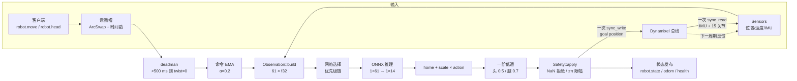
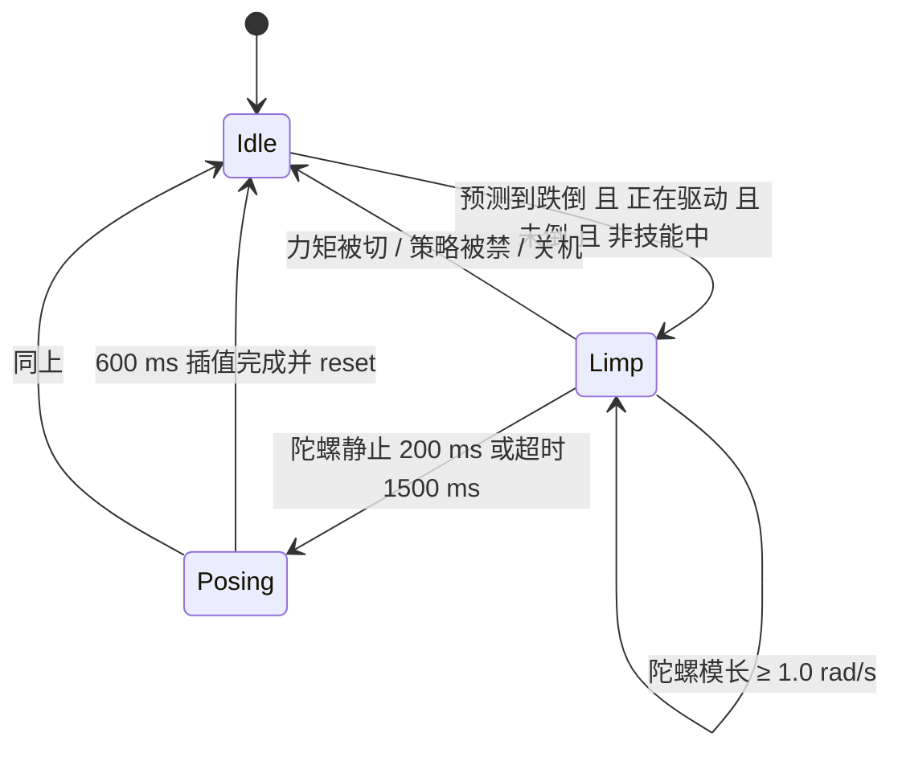
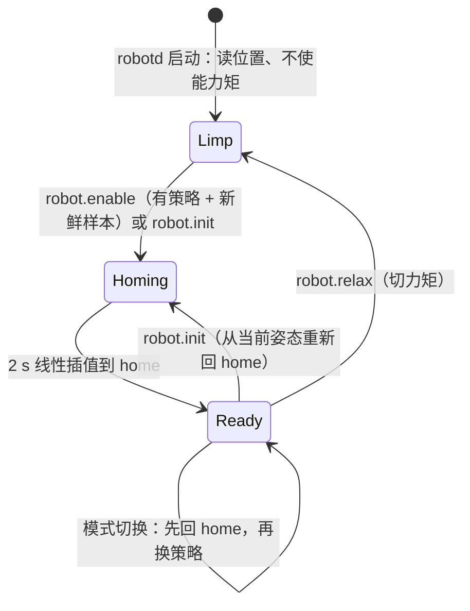
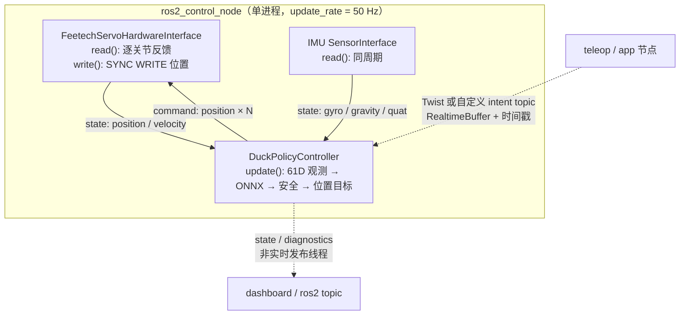

# Microduck 运动控制架构（尤其闭环控制）

> 对象：`pollen-robotics/microduck`（Rust 工作区，`robotd` + `duck-control`）。
> 依据：`docs/design/robotd-design.md`、`docs/design/architecture.md` 以及当前源码。
> 目的：为 `microduck_rev` 的重实现提供一份可对照的闭环控制说明。
> 约定：角度单位为 rad，车体（trunk）右手系；速度指令 `(vx, vy, vyaw)`；控制周期 20 ms（50 Hz）。

---

## 0. 一句话结论

Microduck 不是“主机跑位置 PID”的架构。它是一个 **50 Hz 的神经策略外环 + 伺服内部位置环** 的级联结构：

- 外环每 20 ms 读一次全部传感器，把 **61 维观测** 送进 ONNX 策略，得到 **14 维动作**；
- 动作只被解释成 **15 个关节的位置目标**：`target = home_pose + scale × action`；
- 目标经过一阶低通、安全限幅后，用一条 `sync_write` 写给 Dynamixel；
- 每个 XL330 伺服用自己的编码器和位置 P 环（`kI = kD = 0`）跟踪该目标；
- 闭环所需的反馈（关节位置/速度、IMU 姿态与角速度、上一步动作）全部在下一帧观测里回到策略。

因此“闭环”由四层组成：**遥操作命令环（人去闭环）→ 50 Hz 策略环 → 伺服位置环 → 安全/失效状态机**。策略本身不输出力矩，也不做经典 PID；稳定性来自训练、增益调度、滤波和失效处理。

---

## 1. 系统分层与 crate 边界

```text
客户端（padd 手柄 / app / robotctl / BLE / WebRTC）
        │  JSON-RPC：robot.move / robot.head / robot.enable / robot.init / robot.relax ...
        ▼
┌──────────────────────────────────────────────────────────────┐
│ robotd（进程）                                                │
│  · Unix socket + JSON-RPC（tokio，独立于控制线程）              │
│  · 意图槽（ArcSwap + 时间戳）→ 控制线程只做原子读，永不等待客户端 │
│  · 健康/状态发布（atomics + 有界 broadcast，drop-on-lag）       │
└───────────────────────────┬──────────────────────────────────┘
                            │ 同一个进程、独立 tokio 控制线程
┌───────────────────────────▼──────────────────────────────────┐
│ duck-control（库，无 socket / 无 tokio）                       │
│  bus(DynamixelIo/FakeIo) · imu(SFLP 解码) · obs(61D)          │
│  policy(ONNX 加载/推理) · safety(唯一 RobotIo 写句柄) · fall    │
└───────────────────────────┬──────────────────────────────────┘
                            │ 1 Mbps，Dynamixel protocol v2
┌───────────────────────────▼──────────────────────────────────┐
│ /dev/ttyS2：IMU 板(id 200) + 15 个舵机                          │
│ 左腿 20–24 · 颈/头/嘴 30–34 · 右腿 10–14                        │
└──────────────────────────────────────────────────────────────┘

旁路库（被 robotd 调用，不是服务）：
  kinematics  —— MJCF 前向运动学（脚/头/手链）
  odometry    —— 基于脚底接触的里程计
  robotd-params —— TOML 参数 schema/默认值/校验
```

关键结构性约束：

1. **`Safety` 独占 `RobotIo` 写句柄**。策略、调度器、客户端都只能“提议”目标，无法直接写电机；由借用检查器保证，而不是靠约定。
2. **控制线程不等待任何客户端**。意图是带时间戳的原子槽；状态流是有界广播，慢订阅者只会丢帧。
3. **启动不动作**。`robotd` 启动时读取当前位置作为 `hold`，不使能力矩；更新重启不会让站立的机器人倒下。
4. **50 Hz 循环用 `MissedTickBehavior::Skip`**：不补跑积压、不因每次唤醒延迟而永久掉速。

---

## 2. 一个控制周期（20 ms）的完整闭环



### 2.1 伪代码（与 `robotd/src/main.rs::control_loop` 一致）

```text
每 20 ms：
  fresh = safety.read()                    # 一次 sync_read；失败不致命
  sensors = coast.sample(fresh)            # 最多连续 3 个 tick 沿用上一帧好数据
  if fresh:
      safety.observe(fresh, 20ms)          # 跌倒判定（只吃新鲜样本）
      if imu_ready: odometry.update(...)   # 接触里程计（只用新鲜样本）

  snap = intents.snapshot()
  (gated, deadman) = safety.gate(snap.command, snap.twist_age)

  处理 robot.init / robot.relax（每 tick 取一次）
  处理技能请求（sitstand / ground_pick / kick / roulade）
  limp-fall 状态机（见 §7.3）
  命令 EMA：twist/head/body 各自 α = 0.2
  bring-up 状态机（Limp → Homing → Ready，见 §8）

  driving = enabled ∧ Ready ∧ 有策略 ∧ ¬limp_fall
            ∧ 本 tick 有样本 ∧ IMU 已收敛 ∧ ¬powered_off

  if driving: targets, gain = controller.step(sensors, command, ...)
  else if 正在回 home: targets = 插值目标, gain = running
  else: targets = hold, gain = running

  嘴/Theremin/Chorale 可覆盖 mouth 目标（嘴不属于任何策略）
  safety.apply(targets, hold, gain)        # 唯一写电机路径
  发布 robot.state（仅当有订阅者）
```

### 2.2 时序与预算

| 项 | 数值 / 行为 |
|---|---|
| 控制周期 | 20 ms（50 Hz，`control.hz`） |
| 总线事务 | 每 tick 1 次 `sync_read` + 1 次 `sync_write`；每 1 s 额外读电压/温度 |
| 读取内容 | 从地址 124 起 12 字节/设备：PWM、电流、速度、位置；IMU 板同事务 |
| 读超时 | 30 ms（`duck-control/src/bus.rs::READ_TIMEOUT`） |
| `sync_read` 语义 | 所有设备都应答才成功；任一舵机沉默则整次事务失败 |
| IMU | 板载 SFLP 四元数（半精度）+ 陀螺；主机不做姿态融合 |
| 推理线程 | ONNX Runtime 每 session 1 个 intra-op 线程，避免控制线程被外部线程池阻塞 |
| 读失败 | 记录连续错误数；最多 3 tick 用上一帧“滑行”，之后停止驱动并保持 |

注意：30 ms 读超时大于 20 ms 周期，所以一次坏事务必然导致丢 tick；`Skip` 语义保证不会把补跑的命令叠在总线上。

循环自身也有监督闭环，但它不参与运动控制：控制线程只发布 tick 计数、最后 tick 时间、连续总线错误等 atomics；IPC 侧据此计算实际频率与 missed，`update_gate.min_achieved_hz = 45`（默认 50 Hz 的 90%）才允许更新被保留。健康是“发布”的，不是“询问”控制线程的——卡死的循环会报告自己不健康，而不是挂住调用者。

---

## 3. 观测：唯一且高风险的 61 维契约

所有 alpha 策略共享同一个布局：`obs[1,61] → actions[1,14]`。**索引错一位不会报错，只会得到一只看起来合理但会摔倒的机器人。**

| 下标 | 宽度 | 含义 |
|---|---|---|
| `0..3` | 3 | 陀螺仪，车体系，rad/s |
| `3..6` | 3 | 投影重力，车体系，单位向量；直立 `[0,0,-1]` |
| `6..20` | 14 | 关节位置 **减去 home pose**（不含嘴） |
| `20..34` | 14 | 关节速度（不含嘴） |
| `34..48` | 14 | 上一帧 **原始策略输出**（未经 scale、不含嘴） |
| `48..61` | 13 | 命令块 |

命令块：

| 下标 | 内容 |
|---|---|
| `48..51` | `vx, vy, vyaw` |
| `51..55` | `neck_pitch, head_pitch, head_yaw, head_roll` |
| `55..57` | `body x, y` —— 训练中未绑定，恒为 0 |
| `57` | `body z` |
| `58` | `body roll` |
| `59` | `body pitch` |
| `60` | `body yaw` —— 训练中未绑定，恒为 0 |

两个容易“顺手修坏”的点：

1. **头部目标通过命令块进入策略，不能再在策略输出上叠加一次**。原型在另一种模式下会重复叠加，导致头部弯曲两次。
2. **body 块顺序是 `z, roll, pitch`**，不是 `z, pitch, roll`；交换后“前倾”会变成“侧倾”。

动作与关节的映射：

```text
policy action 0..8  → joint 0..8      （左腿 5 + 颈/头 4）
policy action 9..13 → joint 10..14    （跳过 mouth，index 9）
```

`scatter_action` 与 `policy_joints` 共用同一个 `joint_of()`，保证读写方向不会漂移。

---

## 4. 策略与技能调度

### 4.1 网络清单

| 网络 | 作用 | 默认文件 |
|---|---|---|
| Walk | 行走；始终必载 | `alpha_walking.onnx` / roller: `roller.onnx` |
| Stand | 低速/零速站立；roller 模式不加载 | `alpha_stand.onnx` |
| SitStand | 坐下/起立；`vx` 槽作为姿态标志 | `alpha_sitstand.onnx` |
| GroundPick | 按相位脚本的地面拾取；roller 下是蹲伏 | `alpha_ground_pick.onnx` / `roller_crouch.onnx` |
| KickLeft / KickRight | 固定 0.5 s 踢球窗口 | `ball_kick_left/right.onnx` |
| Roulade | 前滚翻；单次 1.0 s，可连续接滚 | `roulade.onnx` |

加载时校验：输入宽度必须 61、输出必须 14、ONNX Runtime 必须可用；每个网络先做一次 warm-up 推理，把首次调用的抖动移出控制热路径。任一配置路径加载失败 = 整个策略加载失败（release 应回滚），而不是悄悄少一个技能。

### 4.2 选择优先级（每 tick）

```text
roulade > kick > ground_pick > sit/rise > stand(按命令模长或强制) > walk
```

| 状态 | 送入策略的命令 | 说明 |
|---|---|---|
| Roulade | 全 0 | 切进该网络即开始滚；按住按钮会在 150 ms 链式窗口内续滚 |
| Kick | 全 0 | 头部/身体命令也清零 |
| GroundPick | `[cos φ, sin φ, 0]` | 相位 φ 从 0 到 0.7，周期 4 s（roller 3 s） |
| Sitting | `vx = 1` | 姿态标志 1 = 坐 |
| Rising | `[0,0,0]` | 起立 1 s 后交回主策略 |
| Stand | 客户端命令（body 模式下 twist 清零） | 命令模长 ≤ 0.05 选中 |
| Walk | 客户端命令 | 其余情况 |

`stand` 的选择条件由 `Policy::will_stand(twist_magnitude)` 给出，同一个答案同时用于选择网络、动作缩放和增益，避免两处判断不一致。

策略不可用时：保持 `hold` 姿态、继续按 50 Hz 出 tick、健康状态报告原因，让 updater 回滚；**不会**杀死控制线程。

---

## 5. 从动作到关节目标

### 5.1 基本变换

```text
offset[j] = scale × action[j]                 （j 为 14 个策略关节）
target[j] = DEFAULT_POSITION[j] + offset[j]   （15 个关节，mouth 保持原值）
target[j] = α × target[j] + (1−α) × previous[j]   （仅头/腿）
```

- `DEFAULT_POSITION` 是 alpha 的 home pose，必须与训练环境的 `HOME_FRAME` 完全一致；它是观测里 14 个位置槽的参考零点。
- 策略输出反馈用的是 **raw action**，不是缩放后的关节目标——训练时观测的就是策略自己的输出。
- 低通在缩放之后执行；`previous` 在第一个 tick 为 `None`，因此滤波器从真实姿态起步，而不是从 0 拖上来。

### 5.2 缩放与增益调度

| 状态 | action scale | kP |
|---|---|---|
| Walk | 0.9（roller 0.8） | 200 |
| Stand | 1.0 | 160（`200 × 0.8`） |
| Kick 窗口 | 1.0 | 160（其命令为全 0，按站立调参） |
| SitStand 起立 | 1.0 | 160（命令为全 0） |
| SitStand 坐下 | 1.0 | 200（`vx=1`，模长为 1） |
| GroundPick | 1.0（roller 0.8） | 200 |
| Roulade | 1.0 | 200 |
| 跌倒软着陆（Limp） | —（直接跟随实测位置） | 50 |
| 跌倒后姿态回正（Pose） | —（插值到 home） | 160 |

> kick 与起立的 160 有一个前提：站立网络已加载（默认 bundle 满足）。`will_stand()` 在 `stand = none` 时恒为 false，这两条路径会退回 200。`Sit` 的 200 不受此影响。

**为什么 kick 和“起立”跑站立增益**：它们的有效命令都是全 0，原型中“站立转移”正是由全 0 命令触发的；保持这一行为是因为踢球和起立就是按这个增益调出来的。实现上每 tick 从当前状态重算 scale/gain，不做保存/恢复，避免 sit→stand 后残留旧值。

### 5.3 电压自适应

默认关闭。开启时：

```text
scale_mult = nominal_voltage / clamp(measured_voltage, 6.0, 9.5)
scale     *= scale_mult
```

舵机的有效 kP 随供电电压变化；按 `7.4 V / 实测` 缩放动作，可在电池下垂时保持响应一致。电压来自舵机自身供电读数，经 ~10 s EMA 平滑。

### 5.4 低通滤波

一阶 EMA：`y = α·x + (1−α)·y_prev`，逐 tick 执行。

| 覆盖对象 | α | 约等效时间常数（20 ms 周期） |
|---|---|---|
| 颈/头 4 个关节 | 0.5 | ≈ 29 ms |
| 10 个腿部关节 | 0.7 | ≈ 56 ms |
| 嘴 | 不滤波 | 由意图/Theremin/Chorale 直接控制 |

这些 α 是策略训练时使用的值；**改它们等于改训练分布**，移植时必须保持一致。滤波只平滑目标，不改变伺服内部的实际跟踪动态。

---

## 6. 伺服内环与总线配置

### 6.1 总线

- 15 个 XL330 + 1 个 `imu_to_dxl` v2 板共享一条 UART，1 Mbps，Dynamixel protocol v2。
- 每 tick 一次合并 `sync_read`：IMU 板 id 200 排在 id 列表最前，先应答；随后是 15 个舵机。
- 写路径只有一条：`sync_write` 目标位置。
- 增益/力矩使能是“每关节一次事务”，因此不能每 tick 写；`Safety` 缓存最后一次 kP，仅变化时写。

### 6.2 启动时校正的 EEPROM 寄存器

| 寄存器 | 值 | 原因 |
|---|---|---|
| `return_delay_time` | 0 | 出厂 250 = 每设备 500 µs 周转；16 设备约 8 ms/tick（40% 预算） |
| `baud_rate` | 3 | 1 Mbps，必须与总线一致 |
| `pwm_slope` | 255 | 原型实测值 |
| `shutdown` | 52 | 过载/过热/输入电压故障锁存掩码 |

### 6.3 位置环参数

- 只写位置 P 增益；`kI = 0`、`kD = 0`。
- 这些是 RAM 寄存器，掉电恢复出厂值；出厂 D 非 0，会阻尼伺服内部 PID，使机器人在相同 kP 下明显更软。因此启动时固定写 0，而不是暴露成调参项。

> 闭环保真点：主机不做关节位置 PID。主机的“控制量”是位置目标；真正的误差纠正发生在每个舵机内部，以远高于 50 Hz 的频率运行。主机侧的反馈只用于 **下一帧策略输入** 和 **安全/状态判断**。

---

## 7. 安全闭环

### 7.1 命令门控（deadman）

- 每个意图槽带时间戳；`robot.move` 为 notification，最后写入者生效，50 Hz 无回包。
- 意图年龄 > 500 ms：**只把 twist 清零，头部保持**。理由：丢失通信时双足的安全状态是“站住”，而不是“瘫掉”；过期的头部姿态无害，过期的速度会把机器人走进墙里。
- `robot.stop` 与 `robot.relax` 是不同事件：前者停止驱动并回 home；后者切力矩。

### 7.2 写电机前的两条无条件规则

`Safety::apply` 是唯一写路径：

1. **非有限值拒绝**：任一目标为 `NaN/Inf`，不夹取，直接改写 `hold`。把 `NaN` 夹到边界会产生一个“看起来合理”的关节角，机器人会猛地撞向限位。
2. **执行器行程夹取**：每个目标夹到 `[−π, +π]`。这是 XL330 的行程，不是各关节的解剖学限位；它拦的是坏张量/离谱 scale，不负责机械安全。

另外，`apply` **没有跌倒门控**：跌倒判定只报告，不阻止任何人继续驱动。这样“跌倒后起身”不需要绕过安全规则；安全规则一旦需要 bypass 就不再是安全规则。

### 7.3 跌倒：两个独立检测器

| 检测器 | 问题 | 判据 | 默认参数 |
|---|---|---|---|
| `Safety::observe` | 机器人是否已经倒下？ | 投影重力 `gz > −0.5` 持续 200 ms | 双向去抖；一个直立样本即清零 |
| `FallPredictor`（limp-fall） | 机器人是否正在倒？ | 已倾斜 `gz > −0.90`（约 26°）∧ `ġz > 0` ∧ 300 ms 外推后 `gz > −0.5`，持续 60 ms | 60 ms = 3 tick |

预测器用解析导数，不对四元数做差分：

```text
ġ = −ω × g      ⇒      ġz = −(ωx·gy − ωy·gx)
```

陀螺与重力来自同一个 12 字节 IMU 块；差分 SFLP 四元数会把滤波器滞后加进“最需要提前”的量。

`Safety::observe` 在 IMU 尚未收敛（`quat_samples < 25`，约 0.25 s）时不投票，保持上一次判定，避免开机把直立机器人锁成“跌倒”，并把 kP 留在 50。

### 7.4 Limp-fall 状态机（默认开启）

目标不是“接住落地”，而是让机器人以软姿态落地，再交给站立策略——站立策略擅长从静止、已知姿态起身，不擅长在动态跌倒中挣扎起身。



| 阶段 | 目标 | kP | 目的 |
|---|---|---|---|
| `Limp` | 跟随实测关节位置 | 50 | 固定目标会在机器人塌陷时积累误差，等于用电机顶地板 |
| `Posing` | 从实测位置线性插值到 `DEFAULT_POSITION`，600 ms | 160 | 关节在地面上滑动，不抬起整机 |
| 交还 | `controller.reset()`，twist 全程为 0 | 站立策略接管 | 命令模长为 0，自然选中 Stand，即“起身” |

整个序列期间 `driving = false`，目标由状态机产生，但仍通过 `safety.apply` 写到电机——没有后门。

### 7.5 电量与关机

- 电池区间：6.6 V（空，负载下）– 8.2 V（满，负载下），NP-F550 2S。
- 电压是舵机供电读数，~10 s EMA；因此负载瞬时压降不会触发。
- 达到空阈值：若有 sitstand 且未跌倒，先坐下，再切力矩并关机；否则直接切力矩关机。

---

## 8. 启动/驱动状态机



- **启动绝不动作**：Dynamixel 在进程死亡期间保持最后目标，所以更新重启不会产生姿态缺口。
- **`enable` 的两个条件**：已加载策略（“使能”就是“使能策略”）、本 tick 有新鲜样本（ramp 必须从真实位置开始）。是否跌倒不是条件——躺在地上启动正是“请求站起来”的正常方式。
- **seated boot**：若启动时 10 个腿部关节相对 home 的平均偏差 > 0.30 rad，改用 sitstand 网络起身，而不是线性 ramp 把折叠的腿拖过地面。
- **`hold` 的语义**：驱动停止时捕获一次当前姿态；不在每 tick 重读，否则会在重力下缓慢下垂。因通信/总线中断而停止时，`hold` 取最后一次好样本；因用户 `stop` 而停止时，`hold = DEFAULT_POSITION`。
- **coast**：总线读失败时最多 3 tick 复用上一帧样本；安全判定和里程计只吃新鲜样本，滑行帧不能伪装成新数据。
- **恢复重置**：停止超过 200 ms 后才在恢复驱动时 `controller.reset()`；更短的抖动不重置，否则重置本身会成为一次跳变。

---

## 9. 传感器链路

### 9.1 IMU（`imu_to_dxl` v2 / LSM6DSV16X）

12 字节块：

| 字节 | 内容 |
|---|---|
| `0..6` | 陀螺 x/y/z，`i16` LE，±500 dps |
| `6..12` | SFLP 四元数 x/y/z，IEEE half；`w = √(1−x²−y²−z²)` |

处理链：

1. 陀螺按安装旋转 `+90° about Y` 转到车体系；
2. 半精度解码四元数，乘安装逆旋转并归一化；
3. 全 0 四元数字节表示 SFLP 尚未写表：保持上一帧好值，**不**回落到单位四元数（那等于告诉跌倒检测“机器人完全直立”）；
4. `gravity = R(q)⁻¹ · [0,0,−1]`，再归一化；
5. 陀螺与重力各做 3 点中值滤波（单样本尖峰抑制，无平均滞后）；
6. `ready()` 需要累计 ≥ 25 个有效四元数样本；
7. 总线层统计“读取成功但样本完全重复”的连续次数，超过阈值后限速告警（IMU 停更会静默喂死姿态）。

### 9.2 关节

- 位置/速度来自同一 `sync_read`；速度寄存器直接进入观测。
- 电压：15 个舵机取平均，剔除 0 应答；温度不平均，按关节上报最热者。

### 9.3 里程计（`odometry`）

- 接触式：任一瞬间以一只脚的一个角点为地面锚点，锚点世界 Z=0，X/Y 在成为锚点时确定；
- 车体世界位姿由 IMU 姿态 + `kinematics` 的 MJCF 前向运动学得到；
- 另一只脚有角点低于锚点并持续 2 tick，锚点切换，且新锚点保留其当前世界 X/Y，保证估计连续；
- 航向 = IMU 积分 yaw；无磁力计、无回环校正，漂移不修正，属于相对运动估计；
- 每 tick 两次脚链求值，不增加总线读取；只用新鲜样本。

---

## 10. 参数默认值（与闭环直接相关）

| 键 | 默认 | 作用 |
|---|---|---|
| `control.hz` | 50 | 控制频率 |
| `control.cmd_alpha` | 0.2 | twist/body 命令 EMA |
| `control.head_alpha` | 0.2 | 头部命令 EMA |
| `policy.enabled` | true | 是否加载策略；false 时保持姿态且健康 |
| `policy.mode` | `walk` | `walk` / `roller`，同时选择策略集与调参预设 |
| `policy.gain` | 200 | 行走 kP |
| `policy.standing_gain_ratio` | 0.8 | 站立 kP = 160 |
| `policy.action_scale` | 0.9（walk）/ 0.8（roller） | 动作缩放 |
| `policy.standing_action_scale` | 1.0 | 站立缩放 |
| `policy.head_lowpass` | 0.5 | 头部低通 |
| `policy.legs_lowpass` | 0.7 | 腿部低通 |
| `policy.voltage_adapt` | false | 电压自适应 |
| `policy.nominal_voltage` | 7.4 | 自适应参考电压 |
| `safety.fall_gravity_z` | −0.5 | 跌倒判定阈值 |
| `safety.fall_debounce_ms` | 200 | 跌倒去抖 |
| `safety.deadman_ms` | 500 | 意图超时 |
| `safety.gain_limp` | 50 | 软着陆 kP |
| `safety.limp_fall` | true | 预测性软着陆 |
| `safety.limp_fall_tilt_z` | −0.90 | 预测器倾斜门限 |
| `safety.limp_fall_lookahead_ms` | 300 | 外推时域 |
| `safety.limp_fall_debounce_ms` | 60 | 预测去抖 |
| `safety.limp_fall_still_rate` | 1.0 rad/s | 判定落地 |
| `safety.limp_fall_still_ms` | 200 | 落地需保持 |
| `safety.limp_fall_max_ms` | 1500 | 软着陆超时 |
| `safety.limp_fall_pose_ms` | 600 | 回正插值 |
| `safety.limp_fall_pose_gain` | 160 | 回正 kP |
| `safety.battery_empty_shutdown` | true | 空电自动坐下关机 |

参数文件启动时读取一次，不热加载；位于 `/etc/robot/robotd.toml`，不在 release 目录内，因此更新和回滚都不会覆盖它。未注释的旧值会永久冻结在该板子上——这是实际踩过的坑。

---

## 11. 闭环可靠性边界（移植时必须保留的性质）

| 性质 | 为什么 | 代码位置 |
|---|---|---|
| 只有 `Safety` 能拿到写句柄 | 结构上杜绝“策略/客户端直接写电机” | `duck-control/src/safety.rs` |
| 策略只输出位置目标，不输出力矩 | 与伺服内环解耦；训练/部署契约一致 | `duck-control/src/policy.rs` |
| 观测 61 维布局逐位固定 | 错位不会报错，只会摔 | `duck-control/src/obs.rs` |
| `DEFAULT_POSITION == HOME_FRAME` | 位置槽是相对 home 的；偏差是 14 个常量偏置 | `duck-control/src/model.rs` |
| 低通 α 与训练一致 | 改 α = 改训练分布 | `robotd/src/control.rs` |
| 动作反馈用 raw action | 训练时观测的是策略自身输出 | `robotd/src/control.rs` |
| 跌倒判定不门控驱动 | 否则起身逻辑必须绕过安全层 | `duck-control/src/safety.rs` |
| `NaN` 拒绝而非夹取 | 夹取会产生可信但错误的关节角 | `duck-control/src/safety.rs::apply` |
| kP 仅变化时写 | 每 tick 写 15 个增益会挤占总线 | `duck-control/src/safety.rs::set_gain` |
| 总线失败最多滑行 3 tick | 单次丢事务应不可见；持续失明应停住 | `robotd/src/main.rs::Coast` |
| IMU 未收敛时不驱动、不判跌倒 | SFLP 前 ~0.25 s 的重力读数无意义 | `duck-control/src/imu.rs` / `duck-control/src/safety.rs` |
| `MissedTickBehavior::Skip` | 不补跑、不叠加命令、不永久掉速 | `robotd/src/main.rs` |
| 启动不使能力矩 | 更新重启不能让站立的机器人动作 | `robotd/src/main.rs::adopt_startup_pose` |
| 意图槽分离 twist/head | 两个客户端分别控制身体和头时不会互相覆盖 | `robotd/src/intents.rs` |

### 常见移植陷阱

1. **把 body 块写成 `z, pitch, roll`** → 前倾变侧倾。
2. **把 head 目标既放进命令块又加到动作上** → 头弯两次。
3. **动作索引不跳过 mouth** → index 9 之后全部错位，症状是“走路怪但能站”。
4. **在主机上再加一层位置 PID** → 与伺服内部 P 环串联，相位滞后，机器人会振或软。
5. **把 deadman 实现成“切力矩”** → 丢通信时机器人瘫倒；正确行为是站住。
6. **把跌倒判定接到驱动门控** → 躺在地上的机器人无法被命令起身。
7. **在 IMU 未收敛时启动策略** → 前几秒的重力是滤波器中间态，对应原型里的 “crazy start”。

---

## 12. 代码索引

| 关注点 | 文件 |
|---|---|
| 50 Hz 主循环、状态机、发布 | `robotd/src/main.rs::control_loop` |
| 技能优先级、缩放/增益调度、低通 | `robotd/src/control.rs::Controller::step` |
| 观测布局、动作散射 | `duck-control/src/obs.rs` |
| 策略加载、校验、推理、warm-up | `duck-control/src/policy.rs` |
| 安全写路径、deadman、跌倒判定 | `duck-control/src/safety.rs` |
| 预测性跌倒检测 | `duck-control/src/fall.rs` |
| IMU 解码/中值/就绪 | `duck-control/src/imu.rs` |
| 关节表、home pose、嘴、电池 | `duck-control/src/model.rs` |
| 总线事务、EEPROM 校正、增益 | `duck-control/src/bus.rs` |
| 参数 schema/默认值 | `robotd-params/src/lib.rs` |
| 参数键表/编辑器元数据 | `robotd-params/src/registry.rs` |
| 接触里程计 | `odometry/src/lib.rs` |
| MJCF 前向运动学 | `kinematics/src/lib.rs` |
| 设计文档（权威叙述） | `docs/design/robotd-design.md` §1–§4 |
| 全系统架构 | `docs/design/architecture.md` |

---

## 13. 与 `microduck_rev` 对照时建议先确认的接口

1. **控制频率与总线事务模型**：是否同样是“一读一写”，还是每关节独立事务？后者会把 20 ms 预算吃光。
2. **观测/动作宽度与顺序**：是否严格 61/14、是否跳过嘴、home pose 是否与训练一致。
3. **策略输出语义**：位置偏移还是绝对位置？是否经过 scale 和低通？
4. **伺服内环参数**：kP/kI/kD、`return_delay_time`、`shutdown` 掩码是否按 alpha 机器人配置。
5. **失效语义**：丢通信、丢总线、IMU 未收敛、策略缺失、跌倒，分别对应“站住 / 滑行 / 保持 / 不驱动 / 软着陆”的哪一种。
6. **启动语义**：进程启动是否读取当前位置、是否使能力矩、更新重启是否保持姿态。

---

## 14. 迁移到 ROS 2：把闭环放进一个 `ros2_control` 进程

结论：**可以只用一个进程承载完整闭环，但这个进程应当是 `ros2_control_node` / `controller_manager`，闭环代码应当是一个 `ControllerInterface` 插件；不应是“一个普通 rclcpp Node 通过 topic 遥控另一个 ros2_control 节点”。**

原因：`feetech_servo_ros2_control` 提供的是 `hardware_interface::SystemInterface` 插件，不是节点，也不是可直接调用的独立驱动服务。它必须由 `controller_manager` 的 update loop 驱动。ROS 2 的 update loop 本身就是 robotd tick 的同构物：

```text
controller_manager 每个周期（同一线程）：
  hardware.read()                # 读 15 个舵机（本包为顺序读）
  controller.update()            # 你的策略：观测 → ONNX → 目标
  hardware.write()               # 一次 SYNC WRITE
```

### 14.1 推荐布局



- 一个进程、一个 update 线程完成“读—算—写”，与 `robotd` 的 `control_loop` 等价。
- 遥操作、可视化、录像等节点保持独立；它们只能通过实时缓冲写入意图，不能阻塞 update。
- 控制器在 `on_activate` 里 warm-up ONNX、读当前位置、重置滤波器；`update()` 内不分配、不加锁、不打日志、不调用会阻塞的 ROS 接口。

### 14.2 三种可选方案

| 方案 | 闭环所在 | 优点 | 代价 |
|---|---|---|---|
| **A. 自定义 `ControllerInterface`（推荐）** | `controller_manager` 的 `update()` | 与 robotd 最接近；无跨进程延迟；生命周期、URDF、仿真复用 | 需要写 C++ 插件；要遵守实时约束 |
| B. 独立 Node 直接使用 `ScsProtocol` | 自己的 50 Hz timer，Node 独占串口 | 最像 robotd；实现最短；便于调试 | 绕过 ros2_control；自己实现扭矩/生命周期/URDF/控制器管理；无法直接复用本包的 `SystemInterface` |
| C. 独立策略 Node + topic 收发 | 策略 Node 订阅 `joint_states` / IMU，发布位置命令 | 解耦；可用 Python | 每 tick 两次 IPC 与调度抖动；QoS 丢帧；50 Hz 平衡控制不推荐 |

如果目标是短期验证策略，B 可行：Node 直接持有 `ScsSerialPort` + `ScsProtocol`，每 20 ms 自己 `read_registers` / `sync_write_goal_positions`。如果目标是与现有 `feetech_servo_ros2_control` 共存并保留 ros2_control 生态，选 A。

### 14.3 IMU 的接入方式

按优先级：

1. **同一 update loop 的 `SensorInterface` 组件（推荐）**：IMU 作为独立 `<ros2_control type="sensor">` 硬件组件，`read()` 与舵机 `read()` 在同一周期被调用，控制器从 state interface 读取。IMU 在 I2C/SPI/独立串口时都适用。
2. **扩展 Feetech `SystemInterface`**：仅当 IMU 与舵机确实共享同一条串口/总线，且你能在同一个 `read()` 中完成两种协议的分帧。否则不要为了“一个插件”把两条无关的物理链路揉在一起。
3. **订阅 IMU topic（兜底）**：用 `realtime_tools::RealtimeBuffer` 接收最新样本，并检查时间戳；超过若干周期未更新就视为“本 tick 无新鲜样本”，按 robotd 的 `coast`/`hold` 语义处理，而不是继续用旧姿态驱动。

### 14.4 本包的对接要点与差异

| 事项 | 本包现状 | 迁移建议 |
|---|---|---|
| 命令接口 | 仅 `position` | 与策略输出“位置目标”天然一致；无需力矩接口 |
| 读总线 | 逐关节顺序读，SCS 协议无 SYNC READ | 这是 20 ms 预算最大项；先实测 15 关节读+推理+写是否稳定 < 20 ms |
| 写总线 | 一次 SYNC WRITE（位置+时间+速度） | 与 robotd 的单次写一致 |
| 位置换算 | `rad = (ticks − 511) × range_deg × π / 180 / 1024` | home pose、关节符号、`range_deg` 必须逐关节核对 |
| 速度 | `write()` 每周期带 `joint.speed`（tick/s） | 这是隐式速率限制；太小会让策略跟踪滞后，需按最大关节速度配置 |
| 增益 | `p_coefficient` / `d_coefficient` 作为 EEPROM 参数，仅 `on_configure` 写入 | **无法像 robotd 那样按状态切 200/160/50**；需要固定增益，或确认 SCS 是否支持 RAM 增益写入后新增命令接口 |
| 软着陆 | 无 | 固定增益下可命令“跟随实测位置”（误差≈0，输出力矩很小）来近似 `Limp`；`Posing` 仍可用 600 ms 插值 |
| 非有限命令 | `write()` 遇到 `NaN/Inf` 跳过该关节 | 必须在控制器内先做整帧拒绝，否则是“部分关节继续动”而非 robotd 的整帧保持 |
| 读失败 | 任一舵机无应答即 `read()` 返回 `ERROR` | `controller_manager` 的 update 会返回错误并进入错误处理路径（是否停用控制器取决于版本/配置）；robotd 是滑行 3 tick。需要改插件或在验收标准中明确接受哪种行为 |
| 激活 | `on_activate` 读当前位置、锁存命令、使能力矩 | 与“启动不动作”一致，可直接保留 |
| 去激活 | `on_deactivate` 关闭所有扭矩 | 与“停止后保持姿态”不一致；普通 stop 应保持 hardware active，由控制器写 hold 目标 |
| 状态接口 | `position/velocity/load/voltage/temperature/current` | 观测只需 position/velocity；电压可用于电池/自适应，温度可做降额 |

### 14.5 控制器实现清单

```text
DuckPolicyController : controller_interface::ControllerInterface

on_configure:
  - 加载并校验每个 ONNX：输入 61、输出 14
  - 分配固定大小的观测/动作缓冲
  - 读取参数：action_scale、lowpass、standing 阈值、deadman、home pose 映射

on_activate:
  - 每个网络 warm-up 一次
  - 读 state interfaces 的当前位置，锁存 command = 当前值
  - 清空 last_action / 滤波器 previous，避免从旧状态起步

update(time, period):
  - 从 state interfaces 读关节位置/速度、IMU gyro/gravity/quat
  - 取 teleop 意图（RealtimeBuffer/atomic + 时间戳），deadman 超时清 twist
  - 选择网络（roulade > kick > ground_pick > sit/rise > stand > walk）
  - 构造 61D 观测，推理，scale，低通
  - NaN/Inf 整帧拒绝；夹到执行器行程
  - 写 command interfaces
  - 失败时写 hold 目标，不抛异常、不退出 update

on_deactivate:
  - 写 hold 目标；是否切扭矩交给 hardware 生命周期，不在这里做
```

### 14.6 验收标准

1. `controller_manager` 以 50 Hz 运行时，`read + update + write` 的 p99 小于 20 ms，且无 tick 堆积。
2. `update()` 热路径零动态分配、零阻塞锁、零同步日志。
3. 单次舵机应答超时，机器人是“保持/滑行”还是“硬件 ERROR”，与设计选择一致，并有测试覆盖。
4. 启动/激活不产生目标跳变：`on_activate` 后第一个 `write()` 的目标等于实测位置。
5. 丢 teleop 500 ms 后 twist 归零、机器人站住，而不是切扭矩。
6. IMU 未收敛或样本过期时，控制器不驱动，并按明确状态上报。

### 14.7 15 个舵机：3 路串口并行读取

**结论：可以，前提是 3 条总线在电气上真正独立，并且由同一个硬件接口在内部并行读取；不是在 URDF 里放 3 个现有 `FeetechServoHardwareInterface` 实例。**

为什么后者不行：`controller_manager` 的 `ResourceManager::read()` 是单线程顺序遍历所有硬件组件，`write()` 同样。3 个插件实例会得到 `t1 + t2 + t3`，不是 `max(t1, t2, t3)`。现有插件内部也没有线程池。

推荐结构：

```text
MultiBusFeetechSystemInterface : hardware_interface::SystemInterface
  ├─ ScsSerialPort / ScsProtocol  bus 0  (5 servos)
  ├─ ScsSerialPort / ScsProtocol  bus 1  (5 servos)
  └─ ScsSerialPort / ScsProtocol  bus 2  (5 servos)

  read():  3 个持久 worker 同时读各自 5 个关节 → barrier 汇合 → 导出 state
  write(): 3 个 worker 同时 SYNC WRITE 各自 5 个目标 → barrier 汇合
```

- 每个 bus 仍按 SCS 协议逐关节顺序读（SCS 没有 SYNC READ），但 3 条 bus 的等待时间重叠。
- 用 3 个**持久线程 + `std::barrier`**（C++20），不要在每 tick `std::async`/建线程。
- 每 tick 的 `read` 墙钟时间约为 `max(bus0, bus1, bus2)`，而不是三者之和；一条 bus 超时不应阻塞另外两条的完成，只影响汇合等待。
- `write` 同样是每 bus 一次 SYNC WRITE，3 条并行；写本身很便宜，主要收益在读。

时间预算（把用户实测的 10 舵机 >20 ms 作为参考）：

| 方案 | 估计读时间 | 剩余给推理/写 |
|---|---|---|
| 15 舵机、1 路 | >30 ms | 已经超 20 ms |
| 3 路 × 5 舵机，理想并行 | ~10–13 ms | ~7–10 ms |
| 3 路 × 5 舵机，含线程/调度抖动 | 以 p99 为准，不应只看均值 | 需要实测 |

电气与接线约束：

- 3 路必须是 3 条独立的半双工 TTL 总线；不能把 3 个适配器的信号线并到同一条舵机链上。
- 每条链单独供电/接地，适配器与舵机电源共地；分开供电还能降低线损和压降。
- 舵机 ID 建议全机器人唯一，便于 state/command 映射与故障定位（虽然不同 bus 上可以重复）。
- 3 个 USB CDC 适配器若挂在同一个 Hub 上，USB 帧调度仍可能让延迟不完全重叠；先实测，必要时分到不同根 Hub。

软件侧必须处理的点：

1. **每个关节增加 bus 索引**：配置里从 `id` 扩展为 `(bus, id)`；URDF 仍导出 15 个关节。
2. **错误语义按 bus 聚合**：一条 bus 失败时，保留该 bus 上一帧好数据并标记 degraded；不要因为一条 bus 超时让整个 `read()` 返回 ERROR，否则另外两条也停了。
3. **超时预算**：每 bus 的 `response_timeout_ms` 应小于 20 ms；并行后总等待是最大值，不是和。
4. **生命周期**：`on_configure` 打开 3 个端口并校验；缺一条 bus 时是“启动失败”还是“降级运行”要明确。安全默认是启动失败，避免 5 个关节不受控。
5. **实时性**：3 个 reader 线程 + 控制/推理线程会争 CPU。绑核、设优先级，并测 p99；如果推理也在这 4 核上，可能需要 2 路而不是 3 路。
6. **写与读的相位**：`read → controller.update → write` 仍在一个 update 周期内完成；bus 线程只负责 I/O，不参与策略。

先做的低成本优化（可能不需要 3 路）：

- **`return_delay_time = 0`**：SCS 寄存器 7，单位 2 µs。若出厂值较大，每个舵机每次事务都多等一段，10 个舵机就是数毫秒到十几毫秒；本包支持在关节 YAML 中配置。
- **只读策略需要的字段**：位置 + 速度 4 字节，而不是 15 字节（含负载/电压/温度/电流）。事务往返开销仍占主导，但能省一点。
- **确认 1 Mbps 已是舵机上限**；不要盲目提高波特率。
- 先测“单舵机一次读”的 p50/p99，判断是协议周转、USB 帧延迟还是舵机 `return_delay_time` 占主导，再决定是否上 3 路。

### 14.8 USB CDC 与开发板原生 UART 的延迟

方向是对的：USB CDC 很可能占了 10 舵机 >20 ms 中的很大一部分，但换原生 UART 不是线性加速，先分解再下结论。

USB CDC 的额外延迟来源：

- USB 全速总线的 1 ms 帧调度；一次请求/应答可能跨 1–2 个帧。
- `cdc_acm` 驱动的缓冲、tty 层 `read/poll` 唤醒。
- 主机侧调度：控制线程被唤醒后才发现数据到了。
- 适配器本身的 USB 周转与固件缓冲。

原生 UART 去掉了 USB 帧和 CDC 缓冲，单次事务更接近线速下限：

```text
1 Mbps，8 字节请求 + 21 字节应答 = 29 字节 ≈ 290 µs 线速
+ 舵机响应/return_delay_time
+ UART 驱动与线程唤醒（几十 µs 到数百 µs）
```

按 10 舵机实测 >20 ms 反推，当前每舵机 >2 ms；换原生 UART 后，若 `return_delay_time` 已经为 0，10 舵机有机会降到约 3–6 ms，15 舵机约 5–9 ms。**这是估算，必须以 p99 实测为准。**

但以下几种情况会让“换 UART”收益很小：

- 开发板上的 UART 其实是板载 **USB-UART 桥**（CH340/CP210x/FTDI），那仍然走 USB CDC/串口，不是 SoC 原生 UART。
- `return_delay_time` 仍较大：每个舵机每次都多等一段，10 个舵机很容易就是 10 ms 量级；先设为 0。
- 仍然读取 15 字节全反馈：位置+速度只需 4 字节，响应负载更长会多花线速时间。
- 开发板 CPU 更慢、调度更忙：UART 去掉了 USB，但去不掉线程唤醒和推理争 CPU；控制线程需要实时优先级/绑核。

电气上注意：原生 UART 通常是独立的 TX/RX（3.3 V），而 SCS 是单线半双工 TTL。需要半双工方向控制/收发器，不能把 TX 直接并在信号线上；适配器与舵机电源必须共地。

建议用本仓库的 `bench_scs_read` 做 A/B，而不是只换硬件后凭感觉：

```bash
# USB CDC
bench_scs_read --port /dev/ttyACM0 --ids 1-10 --iters 500

# 开发板原生 UART
bench_scs_read --port /dev/ttyS2 --ids 1-10 --iters 500

# 单舵机基线：区分“每事务固定开销”和“舵机数量”
bench_scs_read --port DEV --ids 1 --iters 1000

# 比较 return_delay_time=0 前后、以及只读 4 字节与 15 字节
```

看 p50 与 p99，不要只看均值；单舵机基线乘以数量若接近实测总值，说明是每事务固定开销（USB/驱动/舵机延迟），换 UART 或降 `return_delay_time` 有效；若单舵机很快、总数却线性膨胀，则更像总线/协议周转问题。

### 14.9 实测：10 个 SCS225 的 USB CDC 读取耗时

测试条件：

- 10 个 SCS225，ID 为 `1,2,3,4,5,11,12,13,14,15`。
- USB CDC 适配器 `1a86:8040`（QinHeng USB CDC-Serial），1 Mbps。
- 读取方式与插件一致：每个舵机一次 READ `0x38..0x46`，15 字节反馈，顺序执行。
- 已读回所有舵机的 `return_delay_time`（寄存器 7）均为 **0**，排除舵机返回延迟的影响。
- 通过 usbfs 直接走 CDC bulk 端点（容器内 tty 节点被 device cgroup 拦截），数据来自真实舵机。

结果：

| 舵机数 | 循环数 | median | p95 | p99 | max | 每舵机均值 |
|---|---|---|---|---|---|---|
| 1 | 1000 | 2.400 ms | 2.724 ms | 3.016 ms | 3.360 ms | 2.461 ms |
| 5 | 300 | 12.242 ms | 13.273 ms | 13.750 ms | 14.268 ms | 2.472 ms |
| 10 | 500 | 24.327 ms | 26.286 ms | 27.061 ms | 27.530 ms | 2.459 ms |

线速下限：`29 字节 × 10 bit / 1 Mbps ≈ 290 µs/舵机`；10 舵机约 2.9 ms。实测每舵机约 2.46 ms，意味着 **约 2.1–2.2 ms/舵机 是 USB CDC 固定事务开销**，不是数据长度、也不是 `return_delay_time`。

结论：

1. 10 舵机 24 ms 基本是 `10 × 2.46 ms` 的线性叠加，单舵机基线就能预测总数；瓶颈是每事务的 USB 往返，不是总线带宽。
2. 缩短读取字段（15 字节 → 4 字节）最多省约 0.1 ms/舵机，不能解决 20 ms 问题。
3. `return_delay_time` 已经是 0，这一项没有剩余收益。
4. **换 SoC 原生 UART 是正确方向**：去掉 USB 帧与 CDC 缓冲后，每事务有机会接近线速 + 舵机响应，10 舵机预计 3–6 ms，15 舵机预计 5–9 ms；以实测 p99 为准。
5. 如果仍用 USB CDC，3 路 × 5 舵机的并行读取理论上是 `max(5 × 2.46) ≈ 12.3 ms`，能进 20 ms，但仍建议优先换原生 UART，减少适配器、接线和 USB 调度不确定性。
6. 10 ms 超时在 1000 周期长跑中出现过一次瞬时失败；500 周期、20 ms 超时稳定。USB CDC 路径建议超时 ≥20 ms，并配合重试/滑行，而不是 10 ms 硬超时。

复现：

```bash
# 仓库工具（tty 路径，上板后使用）
build/feetech_servo_ros2_control/bench_scs_read --port /dev/ttyACM0 \
  --ids 1,2,3,4,5,11,12,13,14,15 --iters 500
```
