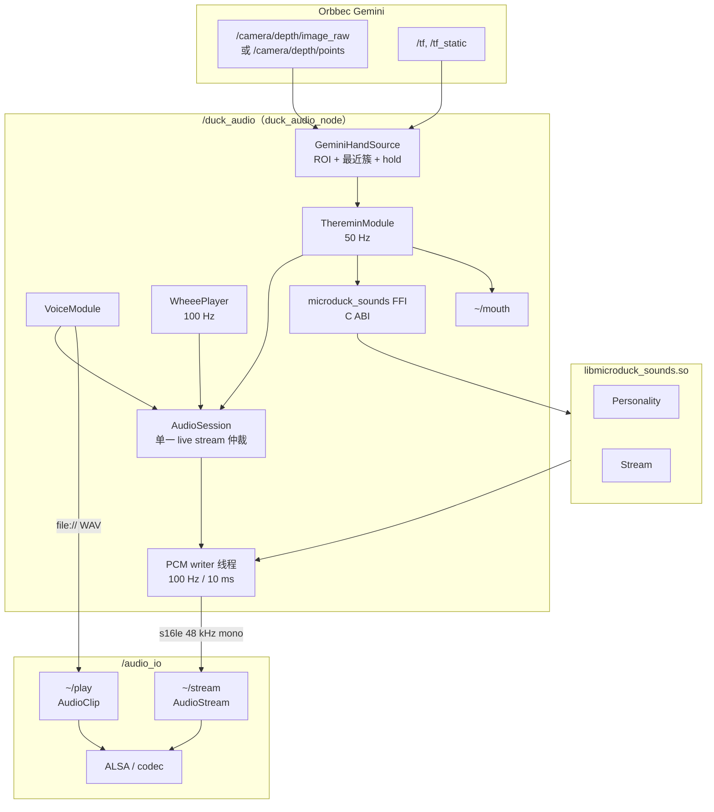
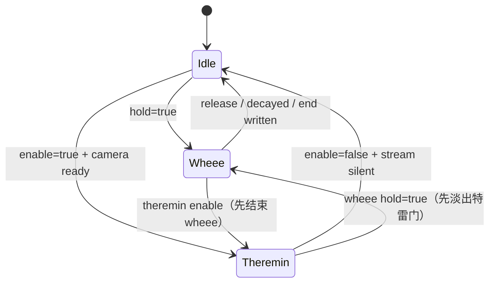

# duck_audio ROS 2 实现架构

> 状态：voice / wheee / Gemini 特雷门已实现；合唱暂不实现 · Scope：`microduck_rev` 的 `duck_audio` 功能包
> 目标：**C++ ROS 2 节点直接调用原版 Rust `sounds` crate**，不重写 DSP、配方、乐谱和节拍算法。
> 原型行为见 [原型架构](microduck-sounds-architecture.zh-CN.md)；FFI 细节见 [Rust FFI 边界](duck-ros2-rust-ffi.zh-CN.md)；特雷门见 [Gemini 特雷门](duck-ros2-theremin-gemini.zh-CN.md)。
> 分层与命名以顶层 [`docs/duck-ros2-audio-architecture.zh-CN.md`](../../../docs/duck-ros2-audio-architecture.zh-CN.md) 为准。

---

## 0. 结论

`duck_audio` 采用 **C++ 节点 + Rust 静态/动态库（C ABI）**，而不是把 `sounds` 用 C++ 重写一遍：

| 层 | 语言 | 职责 |
|---|---|---|
| ROS 2 节点、参数、服务、话题、动作 | C++23 | 生命周期、线程、DDS、状态机、日志 |
| 声音身份与合成 | Rust（原版 `sounds`） | `Personality`、`Stream`、配方、`Score`、`cast`、`beat` |
| 播放设备 | C++ `audio_io` | ALSA 独占、解码、混音、抢占、采集 |

运行时只有两类音频出口：

1. **预渲染音效**：`audio_io/play` 的 `AudioClip`，URI 指向 `~/.config/duck_ros2/sounds/<tag>/*.wav`。一次性叫声、`wheee` 的三段 WAV 都由 Rust 在安装时渲染好，运行时不需要合成。
2. **实时 PCM**：`audio_io/stream` 的 `AudioStream`。特雷门用 Rust `Stream::wheee` 逐块合成，10 ms 一块，`s16le`、48 kHz、mono。合唱暂不实现。

没有 ToF 不是问题：特雷门的“手距”输入改由 **Orbbec Gemini 深度图/点云**提供。`Stream` 只接受 `closeness 0..1`，不知道也不关心这个数来自 ToF 还是 Gemini；需要替换的只是“手部跟踪器”这一层。**合成器和音色完全复用原版。**

---

## 1. 范围与非目标

### 1.1 范围

- 音库发现、seed/`Personality`、`has_voice` 降级。
- 一次性 tag：`greet`、`chirp`、`coo`、`peck`、`alarm`、`inquire`。
- `wheee` 的 start → loop → end 流式播放。
- 特雷门：Gemini 深度输入 → `closeness` → Rust `Stream::wheee` → `AudioStream`。
- ~~合唱~~：暂不实现；`duck_audio_interface` 里的 `SetChorale`/`ChoraleState` 保留给后续。
- 嘴部目标输出，供控制层在策略动作之后覆盖。

### 1.2 非目标

- 不在 `duck_audio` 中打开 ALSA；播放设备仍归 `audio_io`。
- 不实现 TTS、ASR、唤醒词。
- 不把声音合成放进 `ros2_control` 的 update loop。
- 不重写 `sounds` 的 DSP、配方、音库格式或乐谱语法。
- 不在本节点内实现 BLE；合唱的无线传输由后续 `btd` 桥接节点/话题负责。

---

## 2. 系统上下文



关键边界：

- `duck_audio` **不订阅** `/camera/color`；点云/深度图已经包含几何信息。
- `duck_audio` **不链接** `orbbec_camera`；只依赖 `sensor_msgs`、`tf2_ros` 等通用消息。相机由独立 launch 启动。
- `audio_io` 不知道鸭子语义；`duck_audio` 不知道 ALSA。

---

## 3. 包布局

```text
src/duck_audio/
├── CMakeLists.txt
├── package.xml
├── include/duck_audio/
│   ├── duck_audio_node.hpp
│   ├── voice_runtime.hpp
│   ├── voice_module.hpp
│   ├── wheee_player.hpp
│   ├── theremin_module.hpp
│   ├── audio_session.hpp
│   ├── stream_publisher.hpp
│   ├── hand_source.hpp
│   ├── hand_tracker.hpp
│   ├── gemini_hand_source.hpp
│   ├── wav_pcm_reader.hpp
│   └── ffi/microduck_sounds.h
├── src/
│   ├── main.cpp
│   ├── duck_audio_node.cpp
│   ├── voice_runtime.cpp
│   ├── voice_module.cpp
│   ├── wheee_player.cpp
│   ├── theremin_module.cpp
│   ├── audio_session.cpp
│   ├── stream_publisher.cpp
│   ├── hand_tracker.cpp
│   ├── gemini_hand_source.cpp
│   └── wav_pcm_reader.cpp
├── rust/
│   ├── Cargo.toml / Cargo.lock
│   ├── UPSTREAM_MICRODUCK_COMMIT
│   ├── sounds/                 # 原版 crate，固定 commit
│   ├── robotd-params/          # 最小 serial 兼容层
│   └── microduck_sounds_ffi/   # C ABI 包装
├── config/duck_audio.yaml
├── launch/duck_audio.launch.py
├── test/
└── docs/
```

### 3.1 组合式节点与两个 CMake target

`DuckAudioNode` **不继承** `rclcpp::Node`，而是持有调用方传入的 `rclcpp::Node::SharedPtr`，与
`battery_monitor` 的组合方式一致：

```cpp
auto node = std::make_shared<rclcpp::Node>("duck_audio");
auto audio = std::make_shared<duck_audio::DuckAudioNode>(node);
```

这样其他功能包可以把自己的节点传进来，共享同一个执行器；参数也声明在传入的节点上。

CMake 输出两个 target：

| target | 类型 | 内容 |
|---|---|---|
| `duck_audio` | `SHARED` → `libduck_audio.so` | `DuckAudioNode`、voice/wheee/theremin、FFI 调用、全部实现 |
| `duck_audio_node` | executable | 只含 `main.cpp`，创建节点并 `spin`，链接 `duck_audio` |

`libduck_audio.so` 通过 `$ORIGIN` 找到同目录的 `libmicroduck_sounds.so`；节点通过 `$ORIGIN/..`
找到 `libduck_audio.so`。`libduck_audio` 是共享库，其他节点链接它时不需要重复编译实现。

`rust/sounds` 必须是**仓库内固定副本或 submodule**，不能指向 `../microduck/sounds`。原因：

- 原版 `sounds/Cargo.toml` 使用 `version.workspace = true`，脱离原 workspace 无法解析；
- 指向外部路径会让 CI、交叉编译和发布不可复现；
- FFI 的 ABI 与音色身份需要一个可审计的 commit。

具体 workspace 写法见 [Rust FFI 边界](duck-ros2-rust-ffi.zh-CN.md) §2。

---

## 4. 运行时对象与线程

### 4.1 对象

| 对象 | 生命周期 | 职责 |
|---|---|---|
| `VoiceRuntime` | 节点级 | seed、`DuckVoice*`、音库路径、`has_voice`、`BANK_VERSION` 校验 |
| `VoiceModule` | 节点级 | 一次性 tag、`AudioClip` 发布 |
| `WheeePlayer` | 节点级 | `WheeeHold` lease、start/loop/end、`AudioStream` |
| `ThereminModule` | 节点级，可禁用 | Gemini 输入、手部跟踪、`Stream::wheee`、嘴部目标 |
| `AudioSession` | 节点级 | 只有一个 live stream：`None / Wheee / Theremin` |
| `StreamPublisher` | 每个 live stream 一个 | 10 ms PCM 包、`sequence`、`eos`、DDS QoS |
| `GeminiHandSource` | Theremin 级 | 订阅深度图/点云、ROI、最近簇、hold、staleness |
| `WavPcmReader` | Wheee 级 | 读取音库三段 WAV 的 S16LE PCM |

### 4.2 线程与速率

| 线程/执行器 | 速率 | 工作 |
|---|---|---|
| ROS executor（默认 callback group） | 事件 | `voice/play`、状态、enable 服务 |
| ROS executor（camera callback group） | 15/30 Hz | 接收深度图/点云，写入 latest 槽；解析可在此回调完成 |
| Theremin control timer | 50 Hz | 读最新 hand、计算 `closeness`、写原子参数、发布状态/嘴 |
| PCM writer | 100 Hz | 读参数、调用 FFI `block()`、发布 `AudioStream` |
| `wheee` writer | 100 Hz 或 20 ms | 读音库 PCM、按 hold 发 start/loop/end |
| `audio_io` playback | 10 ms period | 解码/混音/ALSA |

**FFI 的 `block()` 只在 writer 线程调用。** ROS 回调只写参数（原子量）和状态，不做 10 ms 合成；否则 executor 抖动会直接进入音频。

### 4.3 参数传递

- `hz`、`level`、`open`、`formant_shift`、`beats`、`singing` 用 `std::atomic<uint64_t>` 存 `double` 的 bits，或 `realtime_tools::RealtimeBuffer`。
- 不用 `std::mutex` 包住 writer 的每块合成；避免优先级反转。
- `float`/`double` 原子在目标平台不保证 lock-free 时，用 bits 方案。原型的 `Live` 就是 `AtomicU64`，可直接照搬。

---

## 5. 模块

### 5.1 `VoiceRuntime` 与 `VoiceModule`

启动顺序：

1. 读 `voice.bank`（默认 `~/.config/duck_ros2/sounds`，支持 `~`/`$HOME`）。
2. 读 `.seed`，格式 `seed:bank_version`。
3. 用 FFI `duck_bank_version()` 与标记中的版本比较；不一致视为音库过期。
4. `voice.seed` 非 0 时优先使用；否则读 `.seed`；没有 `.seed` 时尝试 `duck_hardware_seed()`；仍没有则 `has_voice=false`。
5. 扫描 bank 目录，确认至少有一个 `.wav`；否则 `has_voice=false`。
6. `has_voice=false` 时：`voice/play` 直接拒绝并说明“检查音库目录或运行 `ros2 run duck_audio sounds ensure-bank`”；theremin 的 enable 也拒绝。

音库由节点**启动时检查并自动生成**（`VoiceRuntime::ensure_bank`）：

- 目录不存在、没有 WAV、没有 `.seed` 或 `.seed` 版本不匹配时，用 `duck_render_all` 渲染到同级
  `<bank>.new`，写 `.seed` 后原子替换；
- 缺失时 seed 取 `voice.seed`（非 0）或硬件/本地身份；已有 `.seed` 时优先保留原 seed；
- 渲染/替换失败只让 `has_voice=false`，不影响运动控制；
- 也保留 `ros2 run duck_audio sounds ensure-bank --force` 作为开发/修复工具。

一次性 tag 的 `AudioClip` 映射：

| tag | priority | policy | group | 备注 |
|---|---|---|---|---|
| `greet` | `PRIORITY_INTERACTION` | `REPLACE_SAME_GROUP` | `voice` | 启动提示 |
| `chirp` | `PRIORITY_INTERACTION` | `PREEMPT` | `voice` | 最常触发，可打断上一个 |
| `coo` | `PRIORITY_AMBIENT` | `QUEUE` | `voice` | 摸头响应 |
| `peck` | `PRIORITY_ALERT` | `PREEMPT` | `voice` | 关机告别；可用 `PlayClip` action 等待，1.5 s 上限 |
| `alarm` | `PRIORITY_ALERT` | `PREEMPT` | `voice` | 客户端请求 |
| `inquire` | `PRIORITY_INTERACTION` | `PREEMPT` | `voice` | 客户端请求 |

`VoiceModule::play(tag)`：

- 选变体：扫描 `<bank>/<tag>/*.wav`，按文件名排序，用 `steady_clock` 纳秒位取模；与原型一致。
- 组 URI：`file://<abs path>`。
- 如果 `AudioSession` 不是 `None`，直接丢弃（原型行为）；不要排队，声音是事件不是队列。
- 发布 `audio_io/play`；失败只记日志，不影响运动。

`wheee` 不走 `AudioClip`，因为需要 start/loop/end 与 hold：

- `wheee` 不走 `PlayVoice`；客户端以 5–10 Hz 向 `~/voice/wheee_hold` 发布 `held=true`，`held=false` 或超过 300 ms 未刷新 → 释放/落地。
- `AudioSession` 取得 `Wheee` 所有权，停止 `voice` 组的 `AudioClip`（`audio_io/stop`，`group=voice`）。
- writer 读取 `wheee_start_*.wav`、`wheee_loop_*.wav`、`wheee_end_*.wav`，验证 48 kHz/mono/16-bit；先发 start，再循环 loop，释放后发 end，最后 `eos=true`。
- 没有三段 WAV（半渲染音库）→ 退化为一次性 `AudioClip`，不循环；日志说明。

### 5.2 `ThereminModule`

```text
Gemini 深度图/点云
  → GeminiHandSource: ROI + 最近有支撑的深度簇 + 250 ms hold
  → closeness 0..1
  → DuckStream::wheee（FFI）
  → 10 ms PCM → AudioStream
```

- 输入层只负责“手在哪里”，见 [Gemini 特雷门](duck-ros2-theremin-gemini.zh-CN.md)。
- 50 Hz timer 读取 latest `Hand`：
  - 有手：`hz = duck_hz_at(voice, closeness)`；`level=1`；`open=closeness`。
  - 无手但未超 hold：沿用上一帧的 `hz`，`level=0`，`open=0`（淡出在原音高上）。
  - 传感器 stale：`tracker.reset()`，`level=0`，`open=0`。
- `hz` 保持“最后一次有效音高”，不要在手离开时滑向最低音；这是原型刻意的行为。
- writer 线程：
  - 每 10 ms 读原子参数，`duck_stream_set()`，`duck_stream_block(buf, 480)`。
  - 转 `s16le`，发布 `AudioStream{stream_id="theremin", sample_rate=48000, channels=1}`。
  - 连续发布静音也可；如果为了省带宽停发，`audio_io` 的 200 ms stream timeout 会结束流，重新开始时需要新流。
- enable/disable：
  - `~/theremin/enable` `SetTheremin`；`active=true` 时若相机无数据则拒绝（`accepted=false, reason=...`）。
  - `false` 时 `level=0`，等待 `duck_stream_is_silent()`，发 `eos`，释放 stream 和 session。
- 嘴部：把 `closeness` 发布到 `~/mouth`（`std_msgs/Float64`，0..1）；控制层在策略动作之后覆盖 mouth 关节。无手时为 0，闭嘴。

### 5.3 合唱（暂不实现）

本阶段不实现合唱；`ChoraleModule`、`SetChorale` 和 `ChoraleState` 只保留接口，节点不广告 `~/chorale/enable`。后续接入 BLE 时再实现：

- `Score` 来自 FFI：`duck_score_wistful()`、`duck_score_from_text()`、`duck_score_from_midi()`。
- `cast`/`seat_all` 来自 FFI；输入是 seed 或 register 列表。
- `Conductor`/`Follower` 来自 FFI；beat 的输入未来由 BLE 桥接节点提供，当前可由参数/本地时钟驱动。
- writer 线程按 `beats` 位置选择 `Note`，调用 `duck_stream_new_choral(voice, part)`、`set_formant_shift`、`set(midi_hz*detune, level, open)`、`block`。
- 输出 `AudioStream{stream_id="chorale"}`；`CHORALE_LEVEL=0.55`、`speaker_rolloff=300 Hz` 与原型的实时路径一致。
- enable 服务携带可选 piece id；默认 `wistful`。未知 piece 拒绝，不猜。
- 没有 BLE 时，`chorale/enable` 的 `piece` 只影响本地选曲；不要假装在合奏。

### 5.4 嘴部输出

`duck_audio` 发布 `~/mouth`，类型 `std_msgs/msg/Float64`，范围 0..1：

- 特雷门：`open = closeness`；
- 无声音：0。

控制层在 `duck_control` 的 50 Hz tick 里、策略动作写入 `targets` 之后覆盖 mouth 目标。mouth 不属于任何策略，也不应该被策略动作索引覆盖。若未来需要多来源仲裁，再把 `Float64` 升级为带 `source` 的消息，接口语义不变。

---

## 6. 仲裁：同一时刻只有一个 live stream

`audio_io` 会把 `AudioStream` 与 `AudioClip` 混音，但原型的声音语义是**独占**的：`wheee` 持有 PCM 时一次性音效被丢弃；`wheee` 与特雷门互斥。因此 `duck_audio` 在语义层做仲裁，而不是依赖 `audio_io` 的混音。



规则：

1. `VoiceModule` 的一次性音效只在 `Idle` 播放；非 `Idle` 时丢弃。
2. `wheee` 取得所有权前，调用 `audio_io/stop` 停止 `group=voice`，避免一次性音效压在上面。
3. 特雷门 enable 时，若 `Wheee` 活跃，先发 `wheee` 的 end 段；`wheee` 在特雷门活跃时忽略 hold。
4. 实时流停止后，必须等 writer 实际结束（`eos` 已发布/线程 join）再释放 session；否则新的流可能与旧包混在一起。
5. `audio_io` 的 `AudioStream` 没有 group/priority 字段（当前实现固定 `group="stream"`、`priority=INTERACTION`、`policy=MIX`），所以**不要**用 `audio_io/stop` 去停单条流；用 `stream_id` + `eos` 和本地 session 管理。

---

## 7. ROS 2 接口

节点全名 `/duck_audio`；接口名相对于节点私有命名空间。

| 接口 | 类型 | 说明 |
|---|---|---|
| `~/voice/play` | service `duck_audio_interface/srv/PlayVoice` | 一次性 tag、`variant`；返回 `accepted`、`request_id`、`reason` |
| `~/voice/wheee_hold` | topic `duck_audio_interface/msg/WheeeHold` | `wheee` 的 lease，5–10 Hz 刷新；300 ms 未刷新视为 decayed |
| `~/voice/state` | topic `duck_audio_interface/msg/VoiceState` | `has_voice`、seed、bank、bank_version、最近错误 |
| `~/chorale/*` | — | 接口保留，当前节点不广告；合唱暂不实现 |
| `~/theremin/enable` | service `duck_audio_interface/srv/SetTheremin` | 启停；无相机/无音库时 `accepted=false` + reason |
| `~/theremin/state` | topic `duck_audio_interface/msg/ThereminState` | `range_m`、`closeness`、`note_hz`、`mouth`、`points`、`held`、`sensor_ok` |
| `~/mouth` | topic `std_msgs/msg/Float64` | 0..1；控制层覆盖 mouth |

发布到 `audio_io`：

| 接口 | 类型 | QoS |
|---|---|---|
| `/audio_io/play` | `audio_io_interface/msg/AudioClip` | reliable, depth 10 |
| `/audio_io/stream` | `audio_io_interface/msg/AudioStream` | best_effort, depth 2 |
| `/audio_io/stop` | `audio_io_interface/srv/StopAudio` | 仅用于停止 `group=voice` |

`AudioStream` 字段：

```text
stream_id = "theremin" | "chorale" | "wheee"
encoding  = "s16le"
sample_rate = 48000
channels = 1
sequence = 递增
eos = 最后一包
data = 10 ms PCM = 480 samples = 960 bytes
```

`audio_io` 的 `stream.timeout_ms=200`：writer 必须至少每 200 ms 发一包；10 ms 块远低于这个上限。

`~/voice/state`、`~/theremin/state`、`~/chorale/state` 建议 `transient_local` depth 1，便于新客户端立即拿到状态。

---

## 8. 参数与 launch

```yaml
duck_audio:
  ros__parameters:
    voice:
      bank: ~/.config/duck_ros2/sounds
      seed: 0                 # 0 = auto（bank .seed → hardware seed）
      greet: true
      variant: -1             # -1 = 随机；>=0 = 固定，用于回放
    theremin:
      enabled: true
      input: depth_image      # depth_image | point_cloud
      depth_topic: /camera/depth/image_raw
      camera_info_topic: /camera/depth/camera_info
      cloud_topic: /camera/depth/points
      target_frame: ""        # 空 = 相机光学坐标系；否则 TF 到该 frame
      near_m: 0.12
      far_m: 0.70
      lateral_m: 0.35
      y_min_m: -0.25
      y_max_m: 0.20
      roi_x_frac: 0.60
      roi_y0_frac: 0.20
      roi_y1_frac: 0.80
      min_points: 40
      bin_m: 0.02
      hold_ms: 250
      stale_ms: 200
      stream_period_ms: 10
    chorale:
      enabled: false
      piece: 1
      transpose: 0
      room: 0.25
      speaker_rolloff_hz: 300
    stream:
      qos_depth: 2
```

launch：

```bash
ros2 launch duck_audio duck_audio.launch.py \
  voice.bank:=~/.config/duck_ros2/sounds \
  theremin.input:=depth_image
```

相机独立启动（Gemini 330 示例见 §9 和 [Gemini 特雷门](duck-ros2-theremin-gemini.zh-CN.md)）。

---

## 9. 构建与部署

### 9.1 依赖

| 依赖 | 用途 |
|---|---|
| `ament_cmake`、`rclcpp`、`std_msgs` | 节点 |
| `audio_io_interface` | `AudioClip` / `AudioStream` / `StopAudio` |
| `duck_audio_interface` | 鸭子语义服务/状态 |
| `sensor_msgs` | `Image` / `PointCloud2` |
| `geometry_msgs`、`tf2_ros`、`tf2_sensor_msgs` | 相机坐标系变换 |
| Rust 1.89+、Cargo | 构建 `libmicroduck_sounds` |
| Orbbec `orbbec_camera` | **运行期**启动相机；`duck_audio` 不链接它 |

### 9.2 CMake 要点

- **两个 target**：`duck_audio` 共享库（`libduck_audio.so`）承载全部组合式节点代码；`duck_audio_node` 只含 `main.cpp`，链接 `duck_audio`。
- `add_custom_command` 调 `cargo build --release --locked -p microduck_sounds_ffi`；`BYPRODUCTS` 指向 `libmicroduck_sounds.so`。
- `add_library(microduck_sounds SHARED IMPORTED)` + `IMPORTED_LOCATION`；`add_dependencies(duck_audio duck_audio_rust)`。
- `libduck_audio.so` 的 `$ORIGIN` 找同目录的 `libmicroduck_sounds.so`；节点 `$ORIGIN/..` 找 `libduck_audio.so`。
- 交叉编译 aarch64 时传 `--target aarch64-unknown-linux-gnu` 和 linker 环境变量；详见 FFI 文档。
- 允许 `DUCK_AUDIO_USE_PREBUILT_RUST=ON`，从 `lib/` 找预编译库；CI 与板端可以分开构建。

### 9.3 部署

```text
/opt/robot/...
  lib/libduck_audio.so
  lib/libmicroduck_sounds.so
  lib/duck_audio/duck_audio_node
  share/duck_audio/config/duck_audio.yaml
~/.config/duck_ros2/sounds/...
```

`audio_io` 与 `duck_audio` 是两个 systemd 服务；`duck_audio` 在 `audio_io` 之后启动，但不强依赖（`audio_io` 不在时只发日志，不崩溃）。

---

## 10. 失败模式

| 失败 | 行为 | 运动影响 |
|---|---|---|
| 音库不存在/为空 | `has_voice=false`；`voice/play`、theremin、chorale 拒绝并说明 | 无 |
| `.seed` 与 `BANK_VERSION` 不匹配 | 启动时用原 seed 自动重渲染；失败才禁用实时声音 | 无 |
| 无 seed | 一次性音效仍可播；theremin/chorale 禁用 | 无 |
| 无 `libmicroduck_sounds.so` | 节点启动失败还是降级？→ **启动失败**，因为这是打包错误；不要静默降级 | 无 |
| FFI panic | `catch_unwind` → `DUCK_ERR_PANIC`；当前流停止，节点继续 | 无 |
| ABI 版本不匹配 | 启动时 `duck_abi_version()` 检查失败，节点拒绝启用实时声音，记录版本 | 无 |
| 相机无数据/stale | theremin `sensor_ok=false`，level 0，嘴 0；enable 拒绝 | 无 |
| 点云字段缺失/NaN/过多点 | 本帧丢弃，保持 hold；连续失败则 silence | 无 |
| TF 不可用 | 如果 `target_frame` 为空则用相机系；否则拒绝 theremin，不猜 | 无 |
| `audio_io` 不在 | 发布失败/无订阅；日志；voice 仍可接受请求但不响 | 无 |
| `AudioStream` DDS 丢包 | `audio_io` 按序列/超时处理；duck_audio 继续发；不重传旧音频 | 无 |
| `audio_io` stream timeout | 200 ms 无包自动结束；duck_audio 下一包重新开始 | 无 |
| `wheee` 三段缺失 | 拒绝启动 wheee，记录错误；不影响一次性音效 | 无 |

原则：**声音是可选设备**。任何声音失败都只影响声音，不影响运动、安全和控制回路。

---

## 11. 验收

### 11.1 启动

```bash
ros2 launch orbbec_camera gemini_330_series.launch.py \
  camera_name:=camera enable_color:=false enable_depth:=true \
  depth_registration:=false enable_point_cloud:=true \
  ordered_pc:=false point_cloud_qos:=sensor_data depth_qos:=sensor_data \
  depth_fps:=15

ros2 launch duck_audio duck_audio.launch.py
```

检查：

```bash
ros2 topic hz /camera/depth/points
ros2 topic echo --once /duck_audio/voice/state
ros2 service call /duck_audio/voice/play duck_audio_interface/srv/PlayVoice "{tag: chirp, hold: false}"
ros2 service call /duck_audio/theremin/enable std_srvs/srv/SetBool "{data: true}"
ros2 topic echo /duck_audio/theremin/state
ros2 topic hz /audio_io/stream
```

### 11.2 必须验证的行为

| 行为 | 验证 |
|---|---|
| 一次性音效走 `AudioClip`，不合成 | `ros2 topic echo /audio_io/play` 看到 `file://.../chirp_*.wav` |
| `wheee` 三段无缝 | 按住 hold，听 loop 接缝；松开听到 end |
| 特雷门音高随距离变化 | 手 15/30/50/70 cm，`note_hz` 单调下降，`mouth` 同步 |
| 手离开后淡出，不滑向最低音 | 松手后 `note_hz` 保持最后值，`mouth→0` |
| 点云 stale 后静音 | 遮挡相机 300 ms，`sensor_ok=false`，level 0 |
| 实时流互斥 | 启用 theremin 后 `wheee` 结束；启用 chorale 后 theremin 淡出 |
| 没有音库时拒绝而非静音 | `voice/play` 返回 `accepted=false` + reason |
| FFI 边界安全 | C++ gtest + ASan/valgrind 无泄漏/越界 |

### 11.3 分阶段

1. **FFI + voice**：`microduck_sounds`、bank 校验、`AudioClip` 一次性音效。
2. **wheee**：WAV 三段读取、`AudioStream` 循环/落地。
3. **theremin**：Gemini 深度图 → `Stream::wheee` → `AudioStream`；点云作为可选输入。
4. **chorale**：Score/cast/beat → `Stream::choral`；BLE 桥接在后续版本接入。
5. **嘴部**：`~/mouth` 与控制层覆盖。

每一阶段都必须能在没有下一阶段的情况下独立降级；不要把“整条链路”作为第一个可运行版本。
