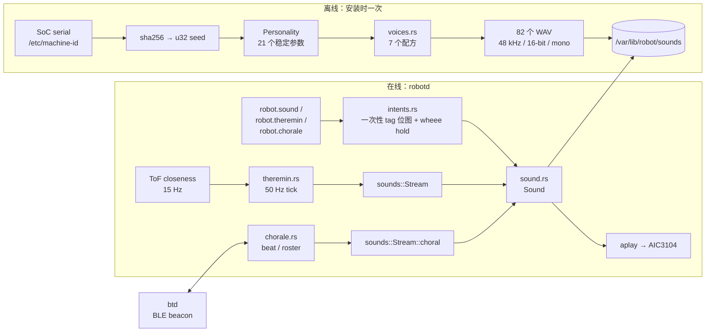
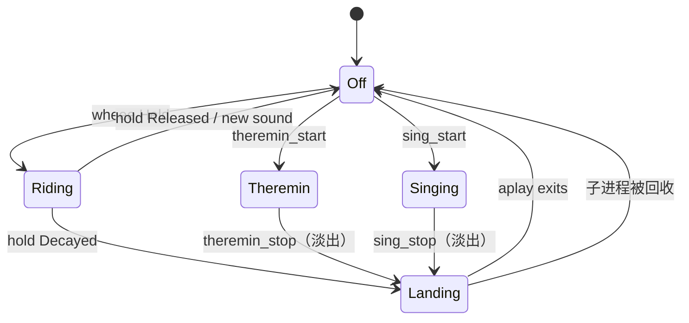

# microduck 声音系统：原型架构

> 对象：`pollen-robotics/microduck` 工作区的 `sounds` crate，以及 `robotd` / `btd` 中消费它的声音路径。
> 性质：对**已实现原型**的架构说明，不是 ROS 2 设计稿。
> 合成细节见 [合成原理](microduck-sounds-synthesis.zh-CN.md)；合唱细节见 [合唱与节拍](microduck-sounds-chorale.zh-CN.md)。
> ROS 2 目标架构见 [`docs/duck-ros2-audio-architecture.zh-CN.md`](../../../docs/duck-ros2-audio-architecture.zh-CN.md)。

---

## 0. 一句话结论

原型的“声音”不是一个播放器，而是**一条从硬件身份到音频样本的确定性推导链**：

```text
SoC serial → sha256 → u32 seed → Personality → 配方(7 tag) → 预渲染 WAV 音库
                                                    ↘ Stream(同一套谐波合成) → 特雷门 / 合唱
```

运行时有两条路径：

- **离线音库**：`sounds ensure-bank` 在安装时把 7 个 tag、共 82 个 WAV 渲染到 `/var/lib/robot/sounds`；`robotd` 播放时只负责挑文件、抢占和流式拼接。
- **在线合成**：特雷门和合唱不读 WAV，而是在写线程里以 48 kHz 逐块调用 `sounds::Stream`，参数来自 50 Hz 控制回路和 BLE beat。

三条硬约束：

1. **音库确定性**：同一个 seed 在同一 `BANK_VERSION` 下必须得到同一批样本。
2. **PCM 单所有者**：同一时刻只有一条 `aplay` 持有 codec；新声音杀旧声音，或显式淡出。
3. **失败可降级**：没有音库、没有 seed、没有声卡时，运动控制不受影响，只是没有声音。

---

## 1. 模块全景



关键点：离线与在线共享 `Personality` 和 `synth` 基元，但**不共享代码路径**。音库是整段渲染后归一化；`Stream` 是无未来信息的逐块渲染，因此归一化、包络和滤波器都必须换成因果形式（见合成原理文档 §8）。

---

## 2. 代码结构与职责

| 路径 | 职责 | 关键符号 |
|---|---|---|
| `sounds/src/lib.rs` | crate 门面、tag 注册、音库渲染、seed 派生、`BANK_VERSION` | `TAGS`、`render_all`、`ensure_bank` 的库侧、`hardware_seed`、`seed_from_id` |
| `sounds/src/personality.rs` | seed → 稳定音色/节奏参数；每个 `(tag, variant)` 的子 RNG | `Personality::from_seed`、`variant_rng`、`harmonics` |
| `sounds/src/rng.rs` | 自有确定性 RNG，避免上游算法漂移；CRC-32 tag 哈希 | `Rng`、`crc32` |
| `sounds/src/synth.rs` | DSP 基元：时间轴、插值、包络、相位、谐波、颤音/抖动/粉噪/click、归一化 | `SR`、`harmonic_osc`、`pink_noise` |
| `sounds/src/voices.rs` | 7 个 tag 的配方；`wheee` 的三段切分与循环交叉淡化 | `alarm`、`greet`、`inquire`、`peck`、`chirp`、`coo`、`wheee_segments` |
| `sounds/src/stream.rs` | 可实时驱动的逐块合成器；参数 slew、静态增益、扬声器 rolloff | `Stream::new/wheee/choral`、`set`、`block`、`range_hz` |
| `sounds/src/chorale/mod.rs` | 乐谱、声部、音符、元音、编排、混音、混响 | `Score`、`Part`、`Note`、`Vowel`、`cast`、`seat_all`、`render` |
| `sounds/src/chorale/text.rs` | 手写 `.duckscore` 文本前端 | `parse` |
| `sounds/src/chorale/midi.rs` | Standard MIDI File 前端（无第三方依赖） | `parse`、`Import` |
| `sounds/src/chorale/beat.rs` | conductor/follower 的 beat 模型；BLE 槽位抖动下的相位平均 | `Conductor`、`Follower`、`SLOT_MEAN_S` |
| `sounds/src/main.rs` | CLI：`show`、`render`、`render-all`、`play`、`theremin`、`chorale`、`ensure-bank` | `ensure-bank` 的原子替换 |
| `robotd/src/sound.rs` | 运行时唯一 PCM 所有者；一次性音效、`wheee` 三段、特雷门、合唱声部 | `Sound`、`Ride`、`Live` |
| `robotd/src/chorale.rs` | 合唱行为：听/conduct/follow、roster、piece 注册、位置发布 | `Chorale`、`Tick`、`seat_all` |
| `btd/src/chorale.rs` | BLE beacon 传输；不拥有合唱状态 | `ChoraleBeacon`、`broadcast`、`watch` |
| `duck-ipc-proto/src/lib.rs` | `robot.sound` / `robot.theremin` / `robot.chorale` 的线格式 | `SoundTag`、`SoundParams`、`ChoraleBeacon` |

`sounds` 是独立 crate，**不依赖 `robotd`**；`robotd` 只依赖它的库接口。这个边界是原型能在笔记本上跑 `sounds chorale` 预览的原因，也是移植时应保留的边界。

`sounds/Cargo.toml` 记录了来源：它是 `apirrone/microduck_sounds`（Python/numpy）的 Rust 重写；`parrot` 模块（麦克风学习叫声）没有移植，也未进入运行时。

---

## 3. 身份：seed 与 Personality

### 3.1 seed 派生

```text
seed = BE_u32(sha256(id)[0..4])
```

- `id` 首选 `/proc/device-tree/serial-number`（SoC efuse serial，烧在芯片里，重刷不丢）。
- 没有该文件时退回 `/etc/machine-id`（每次系统安装唯一，但重装会变）。
- sha256 的作用是**去相关**：同一批次的相邻工厂序列号不会得到相邻的 seed，从而不会得到“几乎一样”的鸭子。
- 该派生与 Python 安装器一致：`sha256sum | cut -c1-8` 按十六进制读成 `u32`。测试 `the_seed_derivation_matches_the_installer` 用 `"test-serial" → 0xC96F1146` 钉住。

`robotd` 运行时**优先读音库的 `.seed` 标记**，而不是重新读硬件：

```text
/var/lib/robot/sounds/.seed   内容 "seed:bank_version"
```

原因是标记记录的是“磁盘上这些 WAV 是用哪个 seed 渲染的”。如果硬件 seed 变化但音库没重渲染，实时特雷门仍应与旁边的 WAV 叫声是同一只鸭子；只有音库缺失时才退回 `hardware_seed()`。

### 3.2 Personality

`Personality::from_seed(seed)` 用同一个 RNG 顺序抽取 21 个参数。字段分为四组：

| 组 | 字段 | 作用 |
|---|---|---|
| 音高 | `pitch_center_hz`、`register`、`pitch_spread`、`glide_bias` | 基频中心、八度偏移、滑音幅度、上升/下降倾向 |
| 音色 | `brightness`、`tilt`、`nasal`、`harmonic_skew`、`formant_n`、`formant_gain` | 7 次谐波的权重形状 |
| 调制 | `vibrato_*`、`jitter_depth`、`breath`、`quackiness`、`am_*`、`warble_*` | 颤音、随机抖动、气声、AM 嘎嘎声、啁啾颤音 |
| 时间 | `attack_sharpness`、`speed` | 起音硬度、全局速度倍率 |

音高中心不是直接均匀取 160–380 Hz，而是先抽一个双峰 register（`-1/0/0/+1` 再叠加 ±0.4），再乘 `2^(register*0.45)`，最后 clamp 到 110–620 Hz。结果是一群鸭子整体偏低，但存在“小鸭子/大鸭子”两类。

`Personality` 是 `Copy` 的；每个配方在需要“软化”时复制一份并改字段（例如 `chirp` 降低 quackiness，`coo` 降低 AM 速率），不改变 seed 身份。

### 3.3 variant 子 RNG

`variant_rng(tag, variant)` 不消耗主 RNG，而是把三元组混合成一个新的 `u32`：

```text
h = seed*1_000_003
  ^ crc32(tag)
  ^ variant*2_654_435_761
rng = Rng::from_seed(h as u32)
```

- 用 CRC-32 而不是 `std` hasher：标准库 hasher 的种子可能按进程加盐，会导致每次重渲染音库时 variant 全部重掷。
- 同一 `(seed, tag, variant)` 永远得到同一串随机数；不同 variant 之间去相关。
- `Tag` 的名字而不是编号参与哈希，所以新增 tag 不会移动既有 tag 的 variant。

RNG 本身是自有的 xoshiro256++：`splitmix64` 把 `u32` seed 扩展成四个 64-bit 状态字；uniform 取 `next_u64() >> 11` 的 53 位，normal 用 Box–Muller（成对生成，余数留到下一次）。`crc32` 是 IEEE 多项式、与 `zlib.crc32` 一致。没有使用 `rand`，因为 `StdRng` 明确保留改变算法的权利，而“生成器就是声音”——换算法等于悄悄给全舰队换声。

### 3.4 确定性的边界

| 层面 | 是否稳定 | 说明 |
|---|---|---|
| 同 seed 的 `Personality` | 永远 | 字段派生顺序是 ABI |
| 同 `(seed, tag, variant)` 的样本 | 在 `BANK_VERSION` 内稳定 | Rust RNG 已固定，不依赖 `rand` crate |
| 跨 `BANK_VERSION` | 不保证 | synth 或 RNG 变更时 bump；安装器会重渲染整个音库 |
| 跨 Python/Rust | 不保证 | numpy RNG 不同、采样率从 22.05 kHz 改为 48 kHz；移植时一次性重掷所有鸭子 |
| 播放时选哪个 variant | 不稳定 | `robotd` 用 `SystemTime` 的纳秒位随机挑文件 |

`BANK_VERSION = 5`：v4 是最后一个 Python 音库，v5 是 Rust 原生 48 kHz 音库。标记里带版本号，所以旧音库在升级后自动失配并重渲染。

---

## 4. 音库：离线渲染与安装

### 4.1 tag、变体与用途

| tag | 语义 | 变体数 | 运行时触发 |
|---|---|---|---|
| `alarm` | 尖锐警报 | 10 | `robot.sound` 客户端；原型内部无自动触发 |
| `greet` | 唤醒/启动，可能是双音节 “wak-wak” | 12 | `robotd` 启动时 `audio.greet` |
| `inquire` | 上扬疑问 | 10 | `robot.sound` 客户端 |
| `peck` | 低沉“tock”，告别 | 10 | 关机/坐下前 |
| `chirp` | 嘴部扳机叫声；4 种轮廓循环 | 12 | `robotctl quack`、模式切换、客户端 |
| `coo` | 困倦、气声，摸头响应 | 10 | `pet-detect` 的 `PettingEvent::Start` |
| `wheee` | 按住扳机的滑行声，三段 | 6 × 3 | 扳机 hold |

总计 `10+12+10+10+12+10+18 = 82` 个 WAV。

`chirp` 和 `greet` 变体最多，因为它们在运行时最常被听到；`wheee` 只有 6 个变体，但每个变体产生 start/loop/end 三个文件。

### 4.2 目录布局

```text
/var/lib/robot/sounds/
├── .seed                       # "3405691582:5"
├── alarm/  alarm_a.wav .. alarm_j.wav
├── greet/  greet_a.wav .. greet_l.wav
├── inquire/inquire_a.wav .. inquire_j.wav
├── peck/   peck_a.wav .. peck_j.wav
├── chirp/  chirp_a.wav .. chirp_l.wav
├── coo/    coo_a.wav .. coo_j.wav
└── wheee/
    wheee_start_a.wav wheee_loop_a.wav wheee_end_a.wav
    ...
    wheee_start_f.wav wheee_loop_f.wav wheee_end_f.wav
```

命名规则是 `<tag>_<letter>.wav` 或 `<tag>_<segment>_<letter>.wav`；字母是 `a + variant`。`robotd` 播放时扫描目录并按扩展名 `.wav` 过滤，不解析字母含义。

### 4.3 格式

| 属性 | 值 |
|---|---|
| 采样率 | 48 000 Hz |
| 位深 | 16-bit signed |
| 声道 | mono |
| 容器 | RIFF/WAVE（`hound` 写出） |

原型的 Python 版本在 22.05 kHz 渲染，再用 ffmpeg 重采样到 48 kHz，因为 Radxa 的 I²S 时钟树固定在 48 k 家族（44.1 k 家族会偏约 9%）。Rust 版本直接 48 kHz 渲染，去掉 ffmpeg 依赖和重采样步骤；两个 22.05 kHz 调参的常量（jitter 平滑窗、粉噪极点）按 `SR/22050` 缩放，保持时间尺度而不是样本数。

### 4.4 渲染与安装

`render_all(personality, out_dir)`：

1. 按 `TAGS` 顺序遍历 tag。
2. 每个 variant 调用配方，得到 `f32` mono。
3. `wheee` 调用 `wheee_segments`，写三个文件；其他 tag 写一个。
4. 逐个 `to_wav`，必要时创建父目录。

`ensure-bank` 的幂等与原子性：

```text
marker = "<seed>:<BANK_VERSION>"
if !force && read(.seed) == marker: 直接返回
staging = dir.with_extension("new")
remove_dir_all(staging); render_all(..., staging); write(staging/.seed)
remove_dir_all(dir); create_dir_all(dir.parent())
rename(staging, dir)
```

先在同级目录渲染完整再 `rename`，避免断电留下“标记完整但文件不全”的音库。`--force` 只用于开发时强制重渲染。

### 4.5 开发与试听 CLI

`sounds` 二进制既是安装钩子，也是唯一的试听工具：

| 命令 | 作用 |
|---|---|
| `sounds show [--seed N]` | 打印 seed 派生的 `Personality` 全字段 |
| `sounds render <tag> <out.wav> [--seed N] [--variant V]` | 渲染单个音效 |
| `sounds render-all <dir> [--seed N]` | 渲染整套音库（与 `ensure-bank` 同一布局） |
| `sounds play <tag> [--seed N] [--variant V] [--device D]` | 渲染后通过 `aplay` 播放 |
| `sounds theremin [--out x.wav] [--seed N] [--variant V]` | 用脚本手势驱动 `Stream::wheee` |
| `sounds chorale [--voices 2..4] [--seeds ...] [--score x] [--bpm B] [--transpose N] [--room R] [--rolloff HZ]` | 离线渲染整首合唱 |
| `sounds ensure-bank [--dir D] [--force] [--seed N]` | 幂等安装/重渲染音库 |

两个试听命令的设计值得保留：

- **`theremin` 不按音频块驱动，而按 ToF 的真实 15 Hz 帧率驱动**：`theremin_sweep` 每帧调用一次 `Stream::set`，每帧渲染 `SR/15` 个样本。这样听到的就是 `robotd` 在真实传感器速率下会发出的声音，能暴露“按音频率试听时被掩盖的阶梯感”。
- **`chorale` 先渲染、再判听感**：它把整首曲子离线混音，所以“编曲好不好”在任何两只鸭子需要对齐时钟之前就能回答；默认 `--rolloff 300` 按鸭子喇叭而不是全频音箱渲染。

---

## 5. 运行时：唯一 PCM 所有者

### 5.1 为什么需要状态机

codec 的 PCM 是**独占、单客户端**的。`robotd` 同时要处理：

- 一次性音效（新声音杀旧声音，允许连续按键干净地打断）；
- `wheee` 的 start → loop → end（按住时循环，松开/超时要“落地”）；
- 特雷门（实时合成，松开是淡出不是切断）；
- 合唱（按 score 位置渲染自己的声部，掉线后要回到正确位置）。

所以 `Sound::ride` 不是 bool，而是五个状态：



`Off / Riding / Landing / Theremin / Singing` 的区别在“谁拥有 PCM”和“如何退出”：

| 状态 | 所有者 | 退出方式 |
|---|---|---|
| `Off` | 无 | — |
| `Riding` | `wheee` 写线程 | 释放=杀子进程；超时=置 `Landing`，让写线程补 end 段 |
| `Landing` | 正在 drain 的 `aplay` | `try_wait` 回收 |
| `Theremin` | 参数写线程 | `playing=false` → level 淡到 0 → `is_silent` → 退出 |
| `Singing` | score 写线程 | 同上，`singing=false` → 淡出 |

`reap_landing` 每个 tick 尝试 `try_wait`，因为没有任何地方可以阻塞等待；`wheee` 的落地子进程就靠这个回收。

### 5.2 一次性音效

```text
play(tag, blocking):
  if ride != Off && !blocking: 跳过（wheee/特雷门/合唱持有 PCM）
  stop_child()                  # 杀旧声音，清 hold，清 live
  pick(tag)                     # 目录下随机一个 .wav
  aplay -q -D <device> <wav>
```

- `pick` 用 `SystemTime` 的 `subsec_nanos % len` 选文件；排序后 `swap_remove`，保证目录遍历顺序不影响哪一个是“第一个”。
- 非阻塞路径只 spawn，不等；控制回路是 50 Hz，不能等音频。
- `blocking=true` 只用于关机前的 `peck`：最多等 `BLOCKING_PLAY_MAX = 1500 ms`，然后在 `poweroff()` 前强杀，防止卡死的 PCM 把机器人留在“已禁用意图但没关机”的状态。
- 没有音库时只警告一次，然后每次调用安静跳过。`has_voice = audio.enabled && has_any_wav(bank)` 在启动时决定 `robot.sound` 是否直接拒绝，而不是接受后静音。

### 5.3 `wheee`：三段流

`start_wheee` 做的是把三个 WAV 的**原始 PCM**拼进一条 `aplay`，而不是三次播放：

```text
aplay -q -D <device> -t raw -f S16_LE -c 1 -r <rate> --buffer-time=120000
写线程:
  start_pcm 全部写入
  while wheee_held: 反复写 loop_pcm
  写 end_pcm
```

- 每 8192 字节一块；按 `sent/bytes_per_sec - elapsed` 计算“已提前多少秒”，超过 250 ms 就 sleep。否则管道会一次吞掉约 0.7 s 循环音频，松手后的 end 段会晚 250 ms 以上。
- `wheee_held` 是 `Arc<AtomicBool>`；`land_ride` 只清标志、不杀子进程，写线程退出循环后继续写 end 段。`stop_child` 才杀子进程。
- 客户端 hold 的新鲜度是 300 ms（`WHEEE_HOLD_FRESH`）：`Some(true)` 在 300 ms 内算 `Held`，超过算 `Decayed`，`Some(false)` 算 `Released`。这样客户端死在半路不会让机器人永远 wheee。
- 音库没有 wheee 三段时，`degraded_wheee` 退化为播放一个一次性 `wheee` WAV，并仍然把 `ride` 置为 `Riding` 以锁住触发路径；否则 20 ms 的 tick 会以 50 Hz 反复 fork/exec/kill `aplay`。

### 5.4 特雷门：实时合成

特雷门不是播放 WAV，而是：

```text
ToF 深度帧（15 Hz） → theremin.rs 的 50 Hz tick
  → closeness 0..1（0 远，1 近）
  → Sound::theremin_set(hz, level, open)
  → Live 原子量
  → 写线程读最新值，Stream::wheee(personality, 0).block(10 ms)
  → PCM → aplay -t raw
```

- `Live` 用 `AtomicU64` 存 `f64` bits，而不是 channel：控制回路不能因音频阻塞，写线程也只需要“最新值”而不是历史队列。
- 写线程 10 ms 一块（`SYNTH_BLOCK = SR/100`），保持约 30 ms 提前量（`SYNTH_LEAD_S`）。`wheee` 的 250 ms 提前量只延迟松手，但对乐器来说，30 ms 是“手移动”和“听到”的间隔，必须短。
- `Stream::wheee(personality, 0)` 的 variant 固定为 0，不按每次演奏重掷：乐器每次被拿起都换一个 wobble rate 会变成另一件乐器。
- 松手不是杀进程：`playing=false` 后把 level 目标设为 0，继续渲染到 `is_silent()`，再退出线程。手离开 ToF 帧时同理，只是 `theremin.rs` 把 level 设 0、保留音高，避免“滑向最低音再消失”。
- `aplay` 的合成 PCM 参数是 `--buffer-time=40000 --period-time=10000`，比 `wheee` 的 120 ms 缓冲短，减少手势到声音的延迟。

### 5.5 合唱：按 score 位置渲染

合唱的音频侧不接收“第几个音符”，而接收**共享的 score 位置（beats）**：

```text
控制回路每 tick:
  chorale.tick() → Tick.singing = Some((part, beats))
  sound.sing_start(score, part)   # 同 piece/part 幂等，不重启
  sound.sing_at(beats, singing)

写线程:
  at = beats * beat_s - seat.onset_offset_s
  找到覆盖 at 的 Note
  Stream::choral(personality, part as u32)
  set_formant_shift(vowel.formant_shift())
  set(midi_hz(note.midi) * detune, level, vowel.open())
  block(10 ms)
```

- `sing_start` 只在 `(piece, part)` 变化或没有 live 时重启；同一 tick 反复调用不会打断乐句。
- 位置来自 `Conductor` 或 `Follower`，不是本地样本计数。音频卡顿后恢复时，会按当前时间重新定位，而不是落后一个小节。
- `CHORALE_LEVEL = 0.55`：四只鸭子在房间里是声学相加，离线预览用 `1/sqrt(n)` 归一化，实时没有这个除法，所以每只鸭子必须预先低一点。单个鸭子独唱会偏轻，这是有意的取舍。
- `SPEAKER_ROLLOFF_HZ = 300`：小喇叭发不出 130 Hz 的 bass 基频，`Stream::set_speaker_rolloff` 把能量搬到它能发的谐波上。

### 5.6 速率与延迟预算

| 环节 | 速率 | 延迟/块 |
|---|---|---|
| 控制回路 | 50 Hz | 20 ms/tick |
| ToF 深度 | 15 Hz | ~67 ms/帧 |
| 特雷门合成块 | 100 Hz | 10 ms |
| 特雷门提前量 | — | 30 ms |
| `wheee` 写块 | 8192 B | 250 ms 上限 |
| 合唱合成块 | 100 Hz | 10 ms，提前 30 ms |
| 音库采样率 | 48 kHz | — |

控制回路只写原子量/队列，不做音频合成；合成在 writer thread 里。唯一的阻塞是关机 `peck`，有 1.5 s 上限。

---

## 6. 触发映射与外部接口

### 6.1 IPC

| 方法 | 参数 | 行为 |
|---|---|---|
| `robot.sound` | `SoundParams { tag, hold? }` | 一次性 tag 置位；`Wheee` 的 `hold` 写入带时间戳的原子量 |
| `robot.theremin` | 启停/参数 | 控制回路决定是否持有乐器 |
| `robot.chorale` | 启停/可选 piece pin | 进入听/conduct/follow 状态机 |

`SoundTag` 枚举：`Alarm`、`Greet`、`Inquire`、`Peck`、`Chirp`、`Coo`、`Wheee`。一次性 tag 在 `intents` 里是一个位图，`take_sounds()` 每 tick 一次性取走并按固定顺序返回；`Wheee` 不走位图，因为它是电平而不是边沿。

### 6.2 内部触发

| 事件 | tag | 条件/备注 |
|---|---|---|
| `robotd` 启动 | `greet` | `audio.greet`；也是无头板上的“守护进程已启动”提示 |
| `robotctl quack` | `chirp` | `robotctl` 发 `robot.sound` |
| 模式切换 | `chirp` ×1 或 ×2 | 走路一声，roller 两声 |
| 摸头开始 | `coo` | 未摔倒且无脚本动作在跑；`pet_detect` 默认关闭 |
| 关机/坐下 | `peck` | 能坐下时非阻塞；直接断电时阻塞，最多 1.5 s |
| 扳机 hold | `wheee` | 300 ms 新鲜度；释放杀进程，超时落地 |
| `alarm` / `inquire` | — | 只通过 `robot.sound` 暴露，原型内部没有自动触发 |

### 6.3 启用条件

| 能力 | 条件 |
|---|---|
| 一次性音效 | `audio.enabled && has_any_wav(bank)`；`Sound` 只在 `audio.enabled` 时构造 |
| 特雷门 | `audio.enabled && theremin.enabled && ToF 有新鲜帧` |
| 合唱 | `audio.enabled && chorale.accept`，且能从音库/硬件拿到 seed |
| 摸头 | `audio.enabled && pet_detect 解析为 true && 模型存在` |

`has_voice` 是启动时读一次的快照；音库由安装脚本渲染并重启 `robotd`，所以不支持运行中热加载音库。

---

## 7. 部署与配置

| 项 | 默认值 | 说明 |
|---|---|---|
| 音库目录 | `/var/lib/robot/sounds` | `[audio] bank` |
| 播放设备 | `plughw:aic3104` | TLV320AIC3104 codec |
| 启动叫声 | 开 | `[audio] greet` |
| 安装钩子 | `bin/sounds ensure-bank --dir /var/lib/robot/sounds` | 每次发布安装都跑；失败只警告，不让安装失败 |
| 音库标记 | `<seed>:<BANK_VERSION>` | 失配即重渲染 |

安装钩子的语义是“**幂等，失败可接受**”：音库渲染失败时机器人仍然能走，只是没有声音；下一次安装会再试。

---

## 8. 失败模式

| 失败 | 原型行为 | 代价/风险 |
|---|---|---|
| 音库不存在 | 启动时 `has_voice=false`；`robot.sound` 拒绝；播放路径警告一次后跳过 | 机器人安静，运动不受影响 |
| 音库部分缺失（例如只有 `chirp/`） | `has_any_wav` 仍为 true；缺的 tag 播放时 `pick` 返回 `None` | 只有部分声音，不会崩 |
| `wheee` 三段缺失 | 退化为一次性 `wheee` 并锁住 `ride` | 没有 start/loop/end 语义，但不会 50 Hz fork |
| 没有 seed（无 serial、无 machine-id、无 `.seed`） | 一次性音效仍可播放；特雷门/合唱拒绝 | 实时声音不可用 |
| `aplay` 失败 | 一次性音效 debug 日志；特雷门/合唱 spawn 失败返回 false | 无声音，无重试风暴 |
| PCM 被 `wheee` 持有 | 非阻塞一次性音效直接丢弃（不排队） | 事件过期，符合“声音是事件不是队列” |
| 客户端 hold 中断 | 300 ms 后 `Decayed`，`wheee` 落地而不是切断 | 会听完 end 段 |
| 写线程遇到死 `aplay` | 写返回 `EPIPE`；线程退出 | 必须在线程里屏蔽 `SIGPIPE`，否则会杀整个 `robotd` |
| 关机 `peck` 卡住 | 1.5 s 后强杀子进程并继续关机 | 告别声可能被截断 |
| 合唱 piece 未识别 | follower 继续听，不加入 | 宁可安静，不唱错歌 |
| 合唱 conductor 消失 | follower 保持最后相位，按 score tempo 继续；conductor 回来再锁 | 晶体误差量级，几分钟内可接受 |

---

## 9. 必须保留的不变量

移植到 ROS 2/C++ 时，下面这些是行为契约，不是实现细节：

1. **seed → Personality → 样本**的推导必须确定；不能把 `Personality` 存成随机配置后丢失 seed。
2. **variant 只在 seed 内重掷**；不能让 variant 改变 `pitch_center_hz` 之类的身份参数。
3. **音库格式统一**：48 kHz、mono、16-bit；改变格式要 bump 音库版本并重渲染。
4. **`wheee` 的 start/loop/end 必须来自同一次母带渲染**，循环尾部交叉淡化；否则接缝可闻。
5. **一次性音效是事件**：新事件覆盖旧事件，不排队；`wheee` 持有 PCM 时丢弃，不打断。
6. **实时流与音库同源**：`Stream` 的谐波权重、formant、breath 必须来自同一个 `Personality`。
7. **低音补偿是重新分配，不是音量旋钮**：先定静态增益，再做 rolloff；补偿上限 2×，否则小喇叭会饱和。
8. **合唱的音高是绝对的**：A4=440，Equal Temperament；鸭子只贡献音色、微失谐（±5 cents）和起音偏移（±15 ms）。
9. **没有任何声音路径可以阻塞 50 Hz 控制回路**；唯一例外是关机前的有界 `peck`。

## 10. 证据索引

| 结论 | 代码 |
|---|---|
| seed = sha256 前 4 字节 | `sounds/src/lib.rs::seed_from_id` |
| 音库标记/版本 | `sounds/src/lib.rs::BANK_VERSION`、`sounds/src/main.rs::Cmd::EnsureBank` |
| 82 个文件 | `sounds/src/lib.rs::render_all`、测试 `render_all_writes_the_layout_the_robot_plays_from` |
| Personality 派生 | `sounds/src/personality.rs::from_seed` |
| variant 哈希 | `sounds/src/personality.rs::variant_rng` |
| RNG 固定 | `sounds/src/rng.rs::Rng`、测试 `the_stream_is_pinned` |
| 48 kHz / 22.05 kHz 缩放 | `sounds/src/synth.rs` 模块文档与 `pink_noise`/`jitter` |
| `wheee` 三段与交叉淡化 | `sounds/src/voices.rs::wheee_segments` |
| 实时流常量/rolloff | `sounds/src/stream.rs` |
| PCM 状态机 | `robotd/src/sound.rs::Ride`、`wheee`、`start_wheee` |
| 特雷门 30 ms 提前量 | `robotd/src/sound.rs::SYNTH_LEAD_S`、`theremin_start` |
| 合唱 10 ms 块/0.55 电平 | `robotd/src/sound.rs::sing_start`、`CHORALE_LEVEL` |
| hold 300 ms 新鲜度 | `robotd/src/intents.rs::WHEEE_HOLD_FRESH` |
| 合唱位置发布 | `robotd/src/chorale.rs::Tick`、`conduct`/`follow` |
| BLE beacon 格式 | `duck-ipc-proto/src/lib.rs::ChoraleBeacon`、`btd/src/chorale.rs` |
