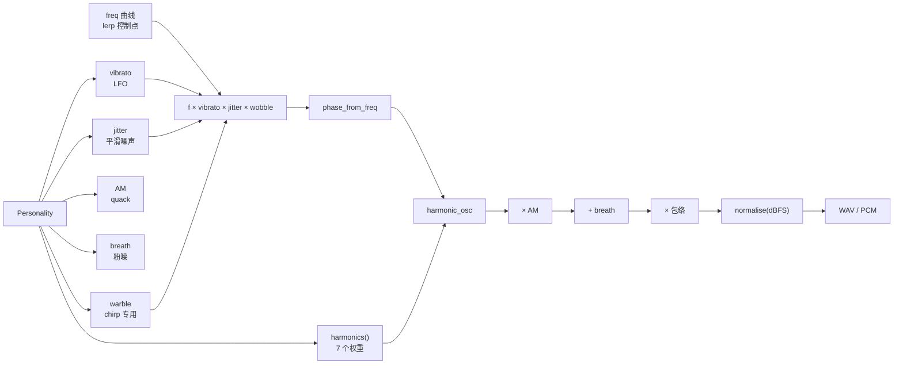

# microduck 声音系统：合成原理

> 对象：`sounds` crate 的 DSP 与配方层。
> 目标：说明“为什么这些参数会产生一只鸭子的声音”，以及每个常量在听感上负责什么。
> 架构与运行时见 [原型架构](microduck-sounds-architecture.zh-CN.md)；合唱见 [合唱与节拍](microduck-sounds-chorale.zh-CN.md)。

---

## 0. 一句话结论

声音是**七次谐波加法合成 + 每只鸭子固定的参数集 + 缓慢调制**：

```text
频率曲线 f(t) ──→ 相位 φ(t)=∫f dt ──→ Σ w_n·sin(nφ)
      ↑                                      │
  vibrato / jitter / wobble              AM 嘎嘎声 + 粉噪气声
      ↑                                      │
  Personality                        包络 × 归一化
```

没有采样、没有滤波器组、没有共振峰滤波器。所谓“音色”只是七个谐波的权重；“元音”只是其中一个谐波的 boost 沿谐波序列移动；“小喇叭补偿”只是把低次谐波的权重搬到高次。

---

## 1. 信号链



离线配方是“先写频率曲线，再整段渲染”；实时 `Stream` 是“每来一个参数就朝它滑，逐样本积分”。两者共用 `harmonics()`、`vibrato`/`jitter`/`breath` 的听感模型，但因果性不同（§8）。

---

## 2. 采样率与时间轴

| 常量 | 值 | 说明 |
|---|---|---|
| `SR` | 48 000 Hz | 原生渲染；Radxa I²S 时钟树固定在 48 k 家族 |
| `TUNED_SR` | 22 050 Hz | Python 配方调参用的旧采样率，只用于缩放两个“按样本数”的常量 |

`t_axis(duration_s)` 返回长度为 `max(round(duration*SR), 1)` 的 `i/SR` 数组。

Python 版本在 22.05 kHz 渲染后用 ffmpeg 重采样；这带来两个问题：ffmpeg 依赖，以及重采样会轻微改变瞬态。Rust 版本直接 48 kHz。两个原本按样本数调的常量被重新缩放：

- jitter 的平滑窗：`64` 样本 @22.05 kHz → `round(64*48000/22050) = 139` 样本 @48 kHz。
- 粉噪极点：`0.985`/样本 @22.05 kHz → `0.985^(22050/48000) ≈ 0.99309`/样本 @48 kHz。

这样保持的是**时间尺度**（约 2.9 ms 的 jitter 平滑、粉噪的转折频率），不是样本数。

---

## 3. DSP 基元

| 基元 | 公式/行为 | 用途 |
|---|---|---|
| `lerp(t, points)` | 分段线性插值，区间外钳到首/尾值（numpy `interp`） | 频率轮廓、包络控制点 |
| `expdecay(t, attack, decay)` | `a=min(t/attack,1)`，`d=exp(-max(t-attack,0)/decay)`，`env=a*d` | 打击型叫声（alarm/greet/peck/chirp） |
| `bell(t, attack, release)` | 上升、平台、下降；`total=t.last()`，下降从 `total-release` 开始 | 持续型叫声（inquire/coo） |
| `phase_from_freq(f)` | `acc += f`；`φ = 2π·acc/SR` | 把瞬时频率积分成相位 |
| `harmonic_osc(φ, w)` | `Σ_{n=1..7} w_n·sin(nφ)` | 主振荡器 |
| `vibrato(t, rate, depth, phase)` | `2^(depth·sin(2π·rate·t+phase)/12)` | 周期颤音；depth 单位是半音 |
| `jitter(t, depth, rng)` | 白噪 → 居中滑动平均（139 样本）→ `2^(depth·x/12)` | 随机音高抖动，避免机械感 |
| `pink_noise(n, rng)` | 泄漏积分 `leak=a·leak+N(0,1)`，再按峰值归一化到 ±1 | 气声/呼吸噪声 |
| `click(n, rng, len)` | 前 `len` 个样本：`U(-1,1)·(1-i/len)^2` | `peck` 的“tock”瞬态 |
| `normalise(x, dBFS)` | 峰值缩放到 `10^(dBFS/20)` | 每个配方最后的电平统一 |
| `to_i16(x)` | `x*32767` 后 clamp 到 `[-32768,32767]` | WAV 写出 |

### 3.1 包络

`expdecay` 的峰值在 `t=attack` 处约为 1，之后指数衰减；`attack` 由配方和 `attack_sharpness` 共同决定：

```text
soft  = 0.04 * duration
sharp = 0.003 * duration
a     = soft + (sharp - soft) * attack_sharpness * snappy
```

`snappy` 是每个配方的“这个音该有多脆”系数：`alarm`/`peck` 用 1.0，`greet` 用 0.5，`chirp` 用 0.7，`inquire`/`coo` 用 `bell`，不直接用这个公式。

### 3.2 滑动平均

`moving_average_same` 复刻 numpy `convolve(x, ones(k)/k, mode="same")`：

- 输出长度与输入相同；
- 零填充；
- `k` 为奇数时窗口居中；偶数时 `offset=(k-1)/2`，与 numpy 的 `same` 对齐。

测试用 `[1,2,3,4,5]`、`k=3` 得到 `[1,2,3,4,3]`，`k=4` 得到 `[0.75,1.5,2.5,3.5,3.0]`，钉住这个语义。它只影响 `jitter` 的平滑形状，不影响其他部分。

### 3.3 粉噪

`pink_noise` 是“便宜的粉噪近似”：一阶泄漏积分把白噪压低频，再按峰值归一到 ±1。离线路径把它按 `breath` 混入；实时 `Stream` 用同一极点，但按 RMS 归一化（§8.4）。

### 3.4 归一化

每个配方最后都调用 `normalise`：

| tag | 目标峰值 |
|---|---|
| `alarm`、`greet`、`inquire`、`peck` | −3 dBFS |
| `coo` | −5 dBFS |
| `chirp` | −6 dBFS |
| `wheee` 母带 | −4 dBFS |

`chirp` 和 `coo` 更低，因为它们在语义上更近、更轻；`alarm` 最响。归一化是**离线路径的终点**，实时路径没有“整段峰值”可看，改用静态增益（§8.3）。

---

## 4. Personality：21 个参数的派生

### 4.1 派生顺序

`from_seed(seed)` 用 `Rng::from_seed(seed)` 按固定顺序抽取。顺序本身是身份的一部分：改变任何一次抽取都会改变之后所有字段。

| 字段 | 范围 | 听感 |
|---|---|---|
| `pitch_center_hz` | 110–620 Hz | 鸭子整体音高；先抽 register 再乘 `2^(register·0.45)` |
| `register` | −1.4..+1.4 | 双峰：`choice([-1,0,0,1]) + uniform(-0.4,0.4)` |
| `pitch_spread` | 0.4–1.2 | 滑音/滑行幅度；越大越戏剧化 |
| `glide_bias` | −1..+1 | 负=下滑，正=上滑；翻转 `greet` 的轮廓 |
| `brightness` | 0.05–0.55 | 高频谐波的抬升；也控制 `alarm` 的 crackle |
| `tilt` | 1.4–2.8 | 谐波衰减指数；越大越暗 |
| `nasal` | 0.1–1.0 | 抬升 2/3 次谐波 |
| `harmonic_skew` | −1..+1 | 正=偏偶次，负=偏奇次（方波感） |
| `formant_n` | 1–5 | 被 boost 的谐波编号 |
| `formant_gain` | 0–1.4 | boost 强度 |
| `vibrato_rate_hz` | 3.5–9.5 | 颤音速度 |
| `vibrato_depth` | 0–0.7 半音 | 颤音深度 |
| `jitter_depth` | 0.03–0.35 半音 | 随机音高抖动 |
| `breath` | 0–0.30 | 气声比例 |
| `quackiness` | 0.2–1.0 | AM 嘎嘎声的开关/深度 |
| `am_rate_hz` | 18–55 Hz | 嘎嘎/呱呱的 AM 速率 |
| `am_depth` | 0.15–0.70 | AM 深度 |
| `warble_hz` | 7–18 Hz | `chirp` 的快速颤音 |
| `warble_depth` | 0–1.4 半音 | `chirp` 颤音深度 |
| `attack_sharpness` | 0–1 | 0=软垫，1=脆 |
| `speed` | 0.82–1.22 | 全局速度倍率（越大越快） |

### 4.2 谐波权重

`harmonics()` 固定 7 个谐波。对 `n=1..7`：

```text
base     = 1 / n^tilt
high     = brightness * (n/7)^1.5
nasal    = nasal * 0.6            if n ∈ {2,3} else 0
skew     = harmonic_skew * 0.4    if n even    (harmonic_skew ≥ 0)
           harmonic_skew * -0.2   if n odd
           -harmonic_skew * -0.3  if n even    (harmonic_skew < 0)
           -harmonic_skew * 0.4   if n odd
formant  = formant_gain           if n == formant_n else 0
w_n      = max(0, base + high + nasal + skew + formant*base*1.5)
w_1      = max(w_1, 0.7)
```

几个设计点：

- `w_1 ≥ 0.7` 保证基频永远占主导，音高可辨。
- `tilt` 是整体明暗；`brightness` 是一条只抬高高次谐波的尾巴，两者不重复。
- `harmonic_skew` 正负不是对称的：正值压奇次、提偶次；负值压偶次、提奇次。这样正负两端分别得到“簧片感”和“方波感”。
- formant 是“某一个谐波的 boost”，不是滤波器；所以“元音”只能通过在谐波序列上移动这个 boost 来近似（§8.5）。

### 4.3 variant 子随机

`variant_rng` 的公式见架构文档 §3.3。它的用途是让同一 tag 的多个 variant 共享音色、只重掷细节：

- 配方里的 `rng.random()` 控制时长、起始频率、轮廓小数、是否双音节；
- 不重新抽 `Personality` 字段。

因此 `chirp` 的 12 个 variant 是 4 种轮廓 × 3 次细节重掷，而不是 12 只不同的鸭子。

---

## 5. 通用发声链 `voice()`

所有一次性配方都经过：

```text
vib  = vibrato(t, p.vibrato_rate_hz, p.vibrato_depth, uniform(0, 2π))
jit  = jitter(t, p.jitter_depth, rng)
f    = freq * vib * jit
φ    = phase_from_freq(f)
body = harmonic_osc(φ, p.harmonics())

am_d = p.am_depth * am_scale * p.quackiness
if am_d > 0.01:
    body *= 1 - am_d * (0.5 + 0.5·sin(2π·p.am_rate_hz·t))

breath = p.breath * breath_scale
if breath > 0:
    body += breath * pink_noise(len(t), rng)
```

要点：

- **AM 是单极性的**：`1 - am_d*(0.5+0.5 sin)` 在 1 和 `1-am_d` 之间摆动，不是环形调制。听感是“喉咙的嘎嘎”，不是“失真”。
- **`quackiness` 是 AM 的闸门**：`am_d` 正比于它。`chirp` 把 quackiness 乘 0.2，`coo` 乘 0.25，所以它们更接近纯音。
- **气声在 AM 之后相加**：噪声不被嘎嘎声调制，听起来像同时存在的呼吸。
- **每个 variant 的 vibrato 相位是随机的**：同一 tag 的多个 variant 不会在颤音上同相。

---

## 6. 七个配方

### 6.1 总表

| tag | 时长（秒，`/speed` 前） | 音高锚点 | 包络 | AM/breath 缩放 | 归一化 |
|---|---|---|---|---|---|
| `alarm` | 0.20 + 0.12r | 中心 ×1.25..1.60，先升后降 | `expdecay`，decay 0.40..0.60×dur | 0.5 / 1.0 | −3 dBFS |
| `greet` | 每音节 0.32 + 0.25r | 中心 ×0.90..1.05，随 `glide_bias` 弯 | `expdecay`，decay 0.7×dur | 1.0 / 1.0 | −3 dBFS |
| `inquire` | 0.42 + 0.25r | 中心 ×0.88..0.98，末端上扬 | `bell`，release 0.32×dur | 0.6 / 1.0 | −3 dBFS |
| `peck` | 0.16 + 0.12r | 中心 ×0.45..0.65，先高后低 | `expdecay`，decay 0.35×dur | 0.3 / 0.5 | −3 dBFS |
| `chirp` | 0.08..0.36，随形状 | 中心 ×0.95..1.70 | `expdecay`，decay 0.55×dur | 1.0 / 0.4 | −6 dBFS |
| `coo` | 0.85 + 0.55r | 中心 ×0.42..0.57，缓慢漂移 | `bell`，release 0.30×dur | 1.0 / 1.0 | −5 dBFS |
| `wheee` | start 0.80+0.30r，loop 1.60+0.60r，end 0.55+0.25r | 中心 →×1.6..2.35→ 回落 | `lerp` 梯形 | 0.5 / 0.5 | −4 dBFS（母带） |

`r` 是 `variant_rng` 抽出的 `[0,1)` 随机数；表里的时长都要再除以 `p.speed`。

### 6.2 `alarm`：尖锐警报

```text
f0      = center * (1.25 + 0.35*spread) * (0.94 + 0.12r)
peak    = f0 * (1.15 + 0.25*spread + 0.10r)     at 0.05*dur
fall    = f0 * (0.75 + 0.20*(1-spread))
contour = [(0, f0), (0.05*dur, peak), (dur, fall)]
env     = expdecay(attack(snappy=1), dur*(0.40+0.20r))
crackle = (0.04 + 0.10*brightness) * N(0,1) * env
```

- 它比本鸭的中心高，但不是无限高；`pitch_spread` 决定它爬多高。
- `crackle` 与 `brightness` 挂钩：亮的鸭子是“嘶哑的警报”，暗的鸭子只是“叫一声”。
- 这是唯一在包络之后再加噪声的配方。

### 6.3 `greet`：启动/唤醒

单音节：

```text
f0    = center * (0.90 + 0.15r) * f0_scale
bend  = 0.10 + 0.15*spread
start = f0 * (1 - bias*bend*0.5)
mid   = f0 * (1 + bias*bend)           at 0.18*dur
end   = f0 * (1 - bias*bend*0.3) * (0.92 + 0.08r)
env   = expdecay(attack(snappy=0.5), 0.70*dur)
```

- `glide_bias` 翻转轮廓：正值的鸭子向上弯，负值的向下弯。这是“同一配方、不同 seed 听起来是不同生物”的最直接例子。
- 40% 概率追加第二个音节：间隔 `(0.05+0.06r)/speed` 秒的静音，第二音节时长 ×0.8、`f0` ×0.95..1.01。单/双音节混合比固定双音节更像活物。
- 两个音节共享同一个 `rng`，所以第二音节不是第一音节的简单复制。

### 6.4 `inquire`：上扬疑问

```text
f0    = center * (0.88 + 0.10r)
rise  = 1.15 + 0.50*spread + 0.20*max(bias,0) + 0.10r
contour = [(0, 0.92*f0), (0.30*dur, 0.95*f0), (dur, rise*f0)]
env   = bell(attack = dur*(0.06 + 0.10*(1-sharpness)), release = 0.32*dur)
```

- 永远上扬（它是问句），但幅度由 `pitch_spread` 和正的 `glide_bias` 决定。
- `bell` 的起音随 `attack_sharpness` 变软/变脆；这是“疑问”与“命令”的差别所在。

### 6.5 `peck`：低沉的“tock”

```text
f0      = center * (0.45 + 0.20r)
contour = [(0, 1.5*f0), (0.04*dur, f0), (dur, 0.80*f0)]
env     = expdecay(attack(snappy=1), 0.35*dur)
click   = click(len = (0.003 + 0.006*sharpness)*SR,
                gain = 0.4 + 0.4*sharpness)
```

- 总是低于本鸭中心；低音域的鸭子会更低。
- 瞬态 click 的时长和增益都由 `attack_sharpness` 决定：脆的鸭子有更明显的“tock”。
- 这是关机前的告别声，所以短、低、不刺耳。

### 6.6 `chirp`：嘴部扳机

`variant % 4` 选轮廓，四个形状刻意不同，避免随机播放听起来像同一段的重复：

| variant % 4 | 形状 | 时长 | 轮廓 |
|---|---|---|---|
| 0 | 上升 blip | 0.10 + 0.10r | `0.88 → 1.12+0.10r → 1.05` |
| 1 | 下降 blip | 0.10 + 0.10r | `1.12+0.10r → 1.0 → 0.78` |
| 2 | 颤音 trill | 0.22 + 0.14r | `1.0 → 1.06 → 0.94`，warble 深度 `max(0.7, warble_depth)*1.6` |
| 3 | 双击 “wek-wek” | 第一声 0.08 + 0.05r | 两声，中间 `0.03+0.03r` 秒静音；第二声时长 ×0.9、`f0` ×0.92..1.02 |

共同点：

- `f0 = center * (0.95 + 0.75r)`：同一只鸭子的 chirp 可以落在中心上方很宽的范围。
- `chirp_syllable` 会复制一份 `Personality` 并软化：`quackiness *= 0.2`、`brightness *= 0.5`、`formant_gain *= 0.5`。chirp 比 greet 更“纯”，不是更响。
- 每个音节有独立的 warble（`warble_hz`/`warble_depth`），这是 chirp 的“鸟叫”感来源。
- 最后归一化到 −6 dBFS：它是最常被触发的音，不能像 alarm 一样响。

### 6.7 `coo`：困倦/摸头

```text
f0      = center * (0.42 + 0.15*(1-sharpness)) * (0.94 + 0.12r)
drift   = 1 + 0.05r + 0.04*bias
contour = [(0, 0.94*f0), (0.5*dur, drift*f0), (dur, 0.90*f0)]
env     = bell(attack = dur*(0.18 + 0.10*(1-sharpness)), release = 0.30*dur)
```

在 `voice()` 之前复制并软化：

```text
breath       = max(p.breath, 0.12) + 0.10
quackiness  *= 0.25
am_rate_hz  *= 0.30
vibrato_rate*= 0.45
vibrato_depth*= 0.70
```

- 它是“向下”的：低于中心，缓慢漂移，没有明显嘎嘎声。
- `breath` 有下限 0.12，再 +0.10：即使这只鸭子本身气声很少，coo 也必须是 breathy 的。
- 归一化到 −5 dBFS，比 alarm/greet 轻。

### 6.8 `wheee`：按住扳机的滑行

`wheee_segments` 先渲染**一条连续母带**，再切成 start/loop/end：

```text
d_start = (0.80 + 0.30r)/speed
d_loop  = (1.60 + 0.60r)/speed
d_end   = (0.55 + 0.25r)/speed
total   = d_start + d_loop + d_end
t1 = d_start; t2 = d_start + d_loop

f0  = center * (0.95 + 0.10r)
top = 1.6 + 0.5*spread + 0.25r
base = lerp[(0, 0.85f0), (0.15*d_start, f0), (t1, top*f0),
            (t2, top*f0), (t2+0.25*d_end, 1.04*top*f0), (total, 0.60f0)]

wob_hz = 4.5 + 3r
swell  = lerp[(0, 0.15), (t1, 1.0), (total, 1.0)]
f      = base * 2^(0.5*swell*sin(2π*wob_hz*t)/12)
env    = lerp[(0,0), (min(0.06, 0.5*d_start), 1),
              (t2 + 0.40*d_end, 1), (total, 0)]
```

- “兴奋摆动”是 `wheee` 自己的 LFO，取代了（部分）vibrato：`vibrato_depth *= 0.5`、`quackiness *= 0.5`。
- 母带先归一化到 −4 dBFS，**再**切片，保证三段电平一致；如果逐段归一化，start→loop 的音量会跳。
- 循环接缝：把 loop 尾部 80 ms 交叉淡化到母带中 loop 起点之前的那段。这样 `loop[last]` 流向 `loop[0]` 的斜率与 `start[last]` 流向 `loop[0]` 一致。
- `wheee()` 返回 `start + loop + loop + end`，用于 CLI 试听；实际运行时由 `robotd` 只播放一次 start、按 hold 重复 loop、最后 end。
- 测试 `the_wheee_loop_wraps_without_a_click` 检查 loop 首尾样本差 <0.2 满量程；未淡化的硬切通常会超过。

---

## 7. 电平与动态

| 层级 | 做法 | 原因 |
|---|---|---|
| 单个配方 | `normalise` 到固定 dBFS | 保证同一 tag 的 variant 音量一致 |
| `wheee` | 母带归一化后切片 | 三段电平一致 |
| 合唱离线混音 | 每只鸭子渲染后求和，再 `1/sqrt(n)` | 不相关信号的能量相加，`1/n` 会让加鸭子反而更轻 |
| 合唱实时 | 每只鸭子 `CHORALE_LEVEL=0.55`，不做除法 | 房间里是声学相加，没有中心混音器 |
| 实时 `Stream` | 静态增益 + `tanh` 软限幅 | 没有整段峰值可看，只能按最坏情况和声上限定增益 |

---

## 8. 实时 `Stream`：把配方“翻过来”

### 8.1 为什么不能直接播 WAV

一次性叫声的形状是**事先写好的**：频率曲线、包络、时长都可以在渲染前确定。特雷门的音高是“手到鸭嘴的距离”，15 Hz 更新，永远不知道下一帧；合唱的位置来自 BLE beat，也不是本地生成的。它们需要的是“参数现在是多少，就渲染下一块”，而不是“先渲染整段再播放”。

`Stream` 保留所有跨块状态：

- 载波相位 `phase`、LFO 时间 `t`；
- jitter 一阶滤波器、粉噪积分器；
- 三个 slew 参数 `freq`/`level`/`open` 及其目标；
- formant shift、扬声器 rolloff、缓存的谐波权重；
- 每只鸭子的调制深度（solo/wheee/choral 不同）。

块大小不影响输出：`block_size_does_not_change_the_signal` 用 1/7/480/1024/3288 的切分与一整块 4800 样本逐样本比较，误差 <1e-6。

### 8.2 参数 slew

| 参数 | 时间常数 | 原因 |
|---|---|---|
| 音高 `PITCH_TAU_S` | 45 ms | ToF 帧间隔 ~67 ms；太快会听到阶梯 |
| 电平 `LEVEL_TAU_S` | 30 ms | 起音/释放要“有键感”，但不能咔哒 |
| 口型 `OPEN_TAU_S` | 60 ms | 比嘴部舵机慢，保证听到的和看到的是同一个动作 |

每样本：

```text
x += (x_target - x) * (1 - exp(-1/(tau*SR)))
```

这是音频率的一阶低通，不是“每帧设置一次”。15 Hz 的输入因此变成连续滑音。

### 8.3 静态增益：没有整段峰值

离线配方最后做峰值归一化；`Stream` 不能这么做，因为逐块归一化会让电平随块跳动。它改为：

```text
gain = PEAK / max(Σ w_n, 1e-6)      # 最坏情况：所有谐波同相
PEAK = 0.62
```

然后输出前 `tanh(v * level)`：

- `PEAK` 故意低于音库的 −4 dBFS，留 headroom 给 AM 和 breath；
- `tanh` 是软限幅，静态增益无法预知 AM 会叠多少；
- 典型峰值远低于 0.62，因为“所有谐波同相”很少发生。

### 8.4 气声的 RMS 归一化

实时粉噪不能像离线那样按整段峰值归一化。它用积分器的稳态偏差：

```text
a_pink   = 0.985^(22050/48000)
pink    += a_pink*pink + N(0,1)
pink_gain = sqrt(1 - a_pink^2) * 0.25
v += breath * pink * pink_gain
```

一阶泄漏积分对白噪的稳态标准差是 `1/sqrt(1-a²) ≈ 8.5`。最初这里用了一个猜的 0.15，导致流式气声比离线响约 5 倍，被听成“低音鸭全是白噪声”。现在的 `sqrt(1-a²)` 把它归一到单位标准差，再乘 0.25 约等于离线峰值归一化噪声的 RMS。

### 8.5 口型与 formant

`refresh_weights()` 每 256 个样本（约 5 ms）检查是否需要重算 7 个 `powf`：

- `open` 变化 >0.005；
- `formant_shift` 变化 >0.02；
- 设置了 speaker rolloff 且 `freq` 变化 >1%。

`open` 的作用不是滤波，而是改变谐波倾斜：

```text
p.tilt = max(p.tilt - 0.8*open, 0.8)
```

`tilt` 是 `n^-tilt` 的指数；减去 0.8 会抬高所有高于基频的谐波。闭喙暗、张嘴亮，听感是“同一只鸭子张嘴”，不是“滤波器扫频”。

`formant_shift` 把被 boost 的谐波沿序列移动，再四舍五入到整数：

```text
formant_n = clamp(round(p.formant_n + shift), 1, 7)
```

`Vowel::formant_shift` 因此是“移动一个谐波”，不是真正的共振峰。它能区分 `oo`/`ee`，对合唱“听起来在唱什么”已经够用。

### 8.6 小喇叭补偿：把低音搬进谐波

`set_speaker_rolloff(Some(hz))` 的模型：

```text
exponent = 12 dB/oct / 6.0206 ≈ 1.993
response(h) = min(h/rolloff, 1)^exponent
w_n *= response(freq * n)
```

- 高于 rolloff 的谐波不受影响；低于的按约 −12 dB/oct 衰减。
- 然后“补偿”：`lift = min(before/after, 2.0)`，把剩余谐波整体乘上，但**最多 2×**。
- **增益必须在 rolloff 之前算**。如果先 rolloff 再算 `PEAK/Σw`，补偿会被重新归一化抵消，`MAX_BASS_LIFT` 变成空操作，所有深音都一样响，而且响度全部堆在少数几个谐波上——这正是机器人上听到的饱和。
- 呼吸声按同一比例衰减：噪声是宽带的，喇叭会保留它；如果不衰减，最安静的低音会变成最吵的气声。
- 2× 而不是 4×：4× 在机器人上听起来饱和；2× 找回大部分可听度，代价小得多。

音高不依赖基频：130 Hz 的谐波序列即使 130 Hz 本身被喇叭吃掉，听觉仍按谐波间距给出 130 Hz 的“缺失基频”音高。测试 `a_speaker_rolloff_moves_the_bass_into_the_harmonics` 用 130.81 Hz / 300 Hz 验证“低于 rolloff 的能量减少、高于的增加、每个谐波仍在、总响度不超过 2×”。

### 8.7 音高范围与映射

```text
lo  = center * 0.85
hi  = center * (1.6 + 0.5*spread)
hz  = lo * (hi/lo)^position      # position 0..1
```

- 范围锚定在这只鸭子的中心，不锚定在固定音域；低音鸭的整个可玩范围都低。
- `position` 是对数/半音线性的，不是线性赫兹：线性映射会把有意义的音程全挤在近端。
- `range_hz` 是自由函数，因为“把距离映射成音符”的调用者（控制回路）不一定持有 `Stream`；`Stream` 可能已经被移进写线程。

### 8.8 实时流的三种音色

| 构造 | 用途 | 软化 |
|---|---|---|
| `Stream::new` | 通用 | 原始 Personality；`breath *= 0.5` |
| `Stream::wheee` | 特雷门 | `vibrato_depth *= 0.5`、`quackiness *= 0.5`、`wobble_depth = 0.5` |
| `Stream::choral` | 合唱声部 | `vibrato_depth *= 0.30`、`quackiness *= 0.35`、`jitter_depth *= 0.30`、`breath *= 0.15`、`wobble_depth = 0` |

合唱的软化不是“去掉鸭子”，而是“去掉会破坏合唱音准的抖动”。音色身份（谐波、formant、鼻音、气声）保留；音高属于乐谱。

---

## 9. 数值与听感不变量

| 不变量 | 验证 |
|---|---|
| 每个配方对多个 seed/variant 都产生有限、非静音、峰值 0.3..1.0 的音频 | `every_recipe_renders_sane_audio` |
| `wheee` 循环首尾无咔哒 | `the_wheee_loop_wraps_without_a_click` |
| 实时块大小不影响信号 | `block_size_does_not_change_the_signal` |
| 长时演奏保持有限、\|x\|≤1 | `a_long_ride_stays_finite_and_bounded` |
| level 0 是淡出而非硬切 | `keying_the_level_fades_instead_of_clicking` |
| 张嘴使高次谐波相对基频增强 | `an_open_mouth_is_brighter` |
| rolloff 把能量搬到 rolloff 以上，且总响度 <2× | `a_speaker_rolloff_moves_the_bass_into_the_harmonics` |
| bass lift 的上限真的生效 | `the_bass_lift_cap_actually_caps` |
| 完全在 rolloff 以下的音不被放大成失真 | `a_note_below_everything_is_not_amplified_into_distortion` |
| 音高映射半音线性、越界钳制 | `the_pitch_map_is_linear_in_semitones` |
| 每个 seed 的可玩范围不同且合理 | `the_range_follows_the_personality` |

这些测试是移植时的“听感验收”替代品：在 C++ 里不必逐样本复刻 Rust 的浮点结果，但必须复刻这些性质。
