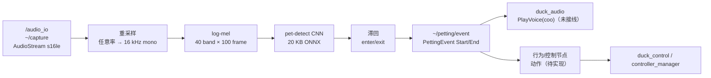

# duck_ear ROS 2 实现架构

> 对象：`microduck_rev` 的 `duck_ear` 功能包
> 目标：把 `/audio_io/capture` 的麦克风 PCM 变成摸头事件，不碰声卡、不执行动作。
> 状态：已实现摸头检测；环境声 `sound_event` 暂未发布。
> 上层：[`docs/duck-ros2-audio-architecture.zh-CN.md`](../../../docs/duck-ros2-audio-architecture.zh-CN.md)

---

## 0. 一句话结论

`duck_ear` 是**麦克风感知层**：

```text
/audio_io/capture → 重采样 16 kHz → log-mel → pet-detect CNN → ~/petting/event
```

- 采集设备仍然只归 `audio_io`；`duck_ear` 不打开 ALSA。
- `duck_ear` 只发布 `PettingEvent`，不播放声音、不写舵机。
- `duck_audio` 当前没有订阅该事件，所以不会自动 `coo`；动作由行为/控制节点消费事件后执行。
- 运行时需要 ONNX Runtime 和 `models/pet_detect.onnx`；缺失时节点保持运行，只是不发布事件。

---

## 1. 职责与边界

| 层 | 负责 | 不负责 |
|---|---|---|
| `audio_io` | 麦克风设备、48 kHz PCM、`~/capture`、设备恢复 | 重采样、VAD、mel、CNN、动作 |
| `duck_ear` | 16 kHz 重采样、窗口、log-mel、CNN、滞回、`PettingEvent` | 声卡、音库、动作 |
| `duck_audio` | `coo` 等语义声音、嘴部目标 | 麦克风、CNN、运动 |
| 行为/控制节点 | 把 `petting` 映射成动作，处理安全/互斥/超时 | 音频解码、音库 |

原版 `pet-detect` 在摸头开始时只触发 `coo`，没有额外运动动作。需要“摸头后做特定动作”时，这是新增
行为，应单独定义动作语义，并和跌倒/脚本动作互斥。

---

## 2. 数据流



`duck_ear` 只产生事件；事件的消费者决定声音或动作。

---

## 3. 输入契约

订阅 `audio_io` 的采集话题，默认：

```text
topic      /audio_io/capture
stream_id  mic
encoding   s16le
sample_rate 48000（可配）
channels   1（支持 1–2，2 声道会下混）
QoS        best_effort, depth 2
```

- 麦克风没有单独的 `AudioCapture` 消息，复用 `audio_io_interface/AudioStream`。
- `eos=true` 表示采集停止；`AudioState.capture_ok`/`capture_error` 和 `AudioEvent` 表达设备健康。
- `duck_ear` 只处理有数据之后的逻辑；采集设备故障由 `audio_io` 恢复。

输入格式不合法（编码、声道、字节长度）时丢帧，并只告警一次；不会崩溃。

---

## 4. 处理管线

### 4.1 下混与重采样

- 每个声道 sample / 32768 转 f32，再按声道平均。
- `LinearResampler` 带状态，跨 AudioStream 块连续；48 kHz → 16 kHz 为 3:1。
- 重采样器在输入采样率/声道数变化时重建。
- 48 kHz 输入是当前板级默认；16 kHz 直通。

### 4.2 log-mel

复用原版 `pet-detect` 训练时的特征契约：

| 参数 | 值 |
|---|---|
| 采样率 | 16 000 Hz |
| N_FFT | 512 |
| 窗长 | 400（25 ms） |
| hop | 160（10 ms） |
| 窗函数 | Hann |
| mel | 40 band，0–8000 Hz |
| 窗口 | 100 帧，即 1 s |
| 输出 | `[40, 100]` log-mel，展平为 `[1, 1, 40, 100]` |
| log epsilon | `1e-6` |

### 4.3 分类器

- 模型：`models/pet_detect.onnx`，约 20 KB。
- 结构：Conv → BN → ReLU → MaxPool → Conv → BN → ReLU → GAP → Linear。
- 输入：`[1, 1, 40, 100]`；输出两个概率，取 `probs[1]` 作为摸头概率。
- `stride=0` 使用原版默认约 250 ms；越小延迟越低、CPU 越高。

### 4.4 滞回

```text
if !petting && p >= enter_threshold:  Start
if  petting && p <  exit_threshold:   End
```

默认 `enter=0.95`、`exit=0.85`。退出阈值必须更低，否则边界会抖动。

---

## 5. 输出事件

`~/petting/event`，类型 `duck_audio_interface/msg/PettingEvent`：

```text
std_msgs/Header header
uint8 event          # START=0, END=1
float32 confidence   # 触发本次状态变化时的概率
```

语义是**边沿**，不是电平：

- 持续摸头只发一次 `START`，不会每 250 ms 重复；
- 摸头结束发一次 `END`；
- 下游动作应按边沿触发；需要“现在是否在摸头”的查询时，库内消费者可读取 `is_petting()`，
  或后续增加状态 topic。

当前 `duck_ear` 没有发布 `~/state`；`is_petting()` 只在库内部可用。

---

## 6. 线程、频率与延迟

| 环节 | 频率/块 | 说明 |
|---|---|---|
| `audio_io` 采集 | 10 ms period | 48 kHz、s16le、mono（可配） |
| `duck_ear` 订阅回调 | 每个 AudioStream 块 | 下混、重采样、推入 detector |
| 推理 | 约 4 Hz（250 ms stride） | pet-detect 单线程 |
| 事件发布 | 状态变化时 | 不按音频块发布 |

端到端延迟由“1 s 窗口 + stride + 推理”决定，量级约数百毫秒；摸头不是安全关键路径，不需要
进 50 Hz 控制闭环。回调不在控制线程上执行。

---

## 7. 包结构

```text
src/duck_ear/
├── include/duck_ear/
│   ├── duck_ear_node.hpp
│   ├── ear_processor.hpp
│   ├── linear_resampler.hpp
│   └── ffi/duck_ear_ffi.h
├── src/
│   ├── duck_ear_node.cpp
│   ├── ear_processor.cpp
│   ├── linear_resampler.cpp
│   └── main.cpp
├── rust/
│   ├── pet-detect/          # 原版 crate 的固定副本
│   ├── duck_ear_ffi/        # C ABI 静态库
│   ├── Cargo.toml
│   └── Cargo.lock
├── models/pet_detect.onnx
├── config/duck_ear.yaml
├── launch/duck_ear.launch.py
└── test/test_linear_resampler.cpp
```

CMake 输出：

| target | 产物 | 说明 |
|---|---|---|
| `duck_ear` | `libduck_ear.so` | C++ 库；内部链接 Rust `duck_ear_ffi.a` |
| `duck_ear_node` | executable | 只含 `main.cpp`，组合式节点 |

安装：

```text
lib/libduck_ear.so
lib/duck_ear/duck_ear_node
share/duck_ear/models/pet_detect.onnx
share/duck_ear/config/duck_ear.yaml
share/duck_ear/launch/duck_ear.launch.py
```

---

## 8. 参数

`config/duck_ear.yaml`：

| 参数 | 默认 | 含义 |
|---|---|---|
| `stream_id` | `mic` | 只接受该 stream_id；空 = 任意 |
| `model` | `""` | 空 = `share/duck_ear/models/pet_detect.onnx` |
| `enter_threshold` | `0.95` | 进入摸头 |
| `exit_threshold` | `0.85` | 结束摸头 |
| `stride` | `0` | 0 = 约 250 ms；单位 16 kHz 样本 |

采集话题固定为 `audio_io_interface::topic_capture()`（默认 `/audio_io/capture`），不通过参数覆盖；节点名 `/duck_ear`，输出接口相对于节点私有命名空间。

---

## 9. 依赖与降级

### 9.1 构建依赖

- ROS 2 Humble、C++23（GCC 13+）
- `rclcpp`、`audio_io_interface`、`duck_audio_interface`、`ament_index_cpp`
- Rust 1.89+、Cargo
- `pet-detect` 的 Rust 依赖：`ort`（`load-dynamic`）、`rustfft`、`hound`、`clap`、`tracing`

### 9.2 运行时依赖

```text
libonnxruntime.so
share/duck_ear/models/pet_detect.onnx
```

`ort` 使用 `load-dynamic`，所以构建不需要 ONNX Runtime；运行时找不到
`libonnxruntime.so` 时：

- `duck_ear_new` 失败，节点记录英文错误；
- 节点继续运行，不订阅/不发布事件；
- 运动、音频播放和 `duck_audio` 不受影响。

### 9.3 失败模式

| 失败 | 行为 |
|---|---|
| 无 ONNX Runtime/模型 | 启动时记录错误，节点保持运行，不发布事件 |
| AudioStream 格式非法 | 丢帧；只告警一次 |
| 采集停止/超时 | 不再有输入；`audio_io` 状态报告设备问题 |
| 推理失败 | 本次 drop；不影响节点 |
| 事件无人订阅 | 事件丢弃；不阻塞音频线程 |
| 下游动作失败 | `duck_ear` 不负责；由行为/控制节点处理 |

---

## 10. 构建与测试

```bash
source /opt/ros/humble/setup.bash
colcon build --base-paths src \
  --packages-select audio_io_interface duck_audio_interface duck_ear \
  --cmake-args -DCMAKE_CXX_COMPILER=g++-13 -DCMAKE_C_COMPILER=gcc-13

colcon test --base-paths src --packages-select duck_ear
colcon test-result --verbose
```

当前测试覆盖：

- 48 kHz → 16 kHz 跨块重采样；
- 16 kHz 直通。

运行：

```bash
ros2 launch audio_io audio_io.launch.py
ros2 launch duck_ear duck_ear.launch.py
ros2 topic echo /duck_ear/petting/event
```

---

## 11. 与其它包的接线

| 链路 | 状态 |
|---|---|
| `/audio_io` → `duck_ear` | 可用：`~/capture`，`stream_id=mic` |
| `duck_ear` → `duck_audio` | **未接线**：事件已发布，`duck_audio` 未订阅，不会自动 `coo` |
| `duck_ear` → 行为/控制 | 事件可用；具体动作/超时/互斥由行为或控制节点实现 |
| `duck_ear` → 音库 | 不连接；`duck_ear` 不播放声音 |

后续要接声音反馈时，在 `duck_audio` 增加 `PettingEvent` 订阅，在“未摔倒、无脚本动作”时调用
`PlayVoice(coo)`。要接动作时，由行为/控制节点订阅同一事件；不要让 `duck_ear` 直接写舵机。

---

## 12. 参考

- [`src/audio_io/docs/audio_io-architecture.zh-CN.md`](../../audio_io/docs/audio_io-architecture.zh-CN.md)
- [`src/duck_audio/docs/duck-ros2-architecture.zh-CN.md`](../../duck_audio/docs/duck-ros2-architecture.zh-CN.md)
- 原版 `pet-detect`：`pet-detect/src/lib.rs`、`pet-detect/src/worker.rs`、`models/pet_detect.onnx`
